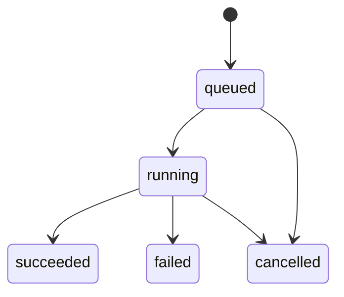
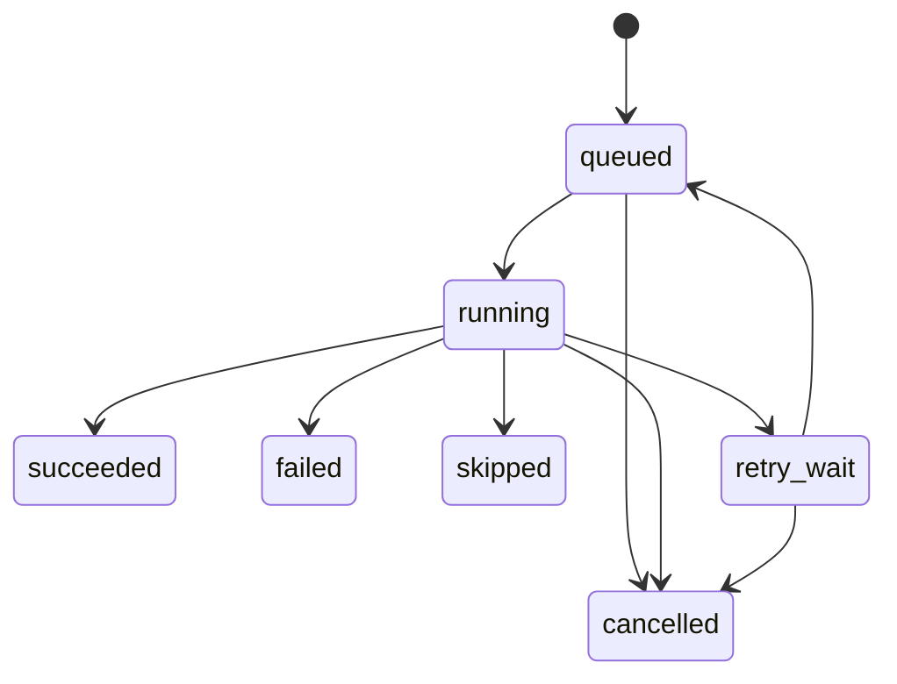

# AGENT_WORKFLOW：Agent 架构、Run/Task 状态机与证据链（MVP-2 为主）

> 本文件由《全球股票投资研究系统：产品需求与工程实施规格书》v1.5 拆分而来，**自此成为该部分内容的权威来源**。章节编号沿用原规格书；正文中的“见 X.Y / 第 N 节”请通过 [README.md](README.md) 的章节映射定位到对应文件。

> 注：第 22 节的状态机与异步原则属于 MVP-1 基础设施；Agent 相关部分（21、22.5、23）属 MVP-2。

## 21. Agent 设计

MVP 使用一个 Orchestrator 调度有限数量的专业 Agent。Agent 不直接写数据库，不直接访问任意 URL，不可自行运行 shell 或任意 Python 代码。所有数据访问必须通过已登记服务工具。

| Agent | 职责 | 必须输出 |
|---|---|---|
| Orchestrator | 解析用户目标、分配任务、状态控制、汇总 | ResearchPlan、任务状态、最终结构 |
| Macro Agent | 利率、通胀、流动性、政策与周期 | MacroContext + evidence |
| Industry Agent | 行业结构、竞争格局、产业链 | IndustryAnalysis + evidence |
| Equity Analyst | 商业模式、管理层、竞争优势 | CompanyAnalysis + claims |
| Financial Analyst | 财务趋势、质量、异常 | FinancialAnalysis + metric refs |
| Valuation Agent | 提出假设、解释模型结果 | ValuationAssumptions；计算必须调用引擎 |
| Risk Agent | 反方论证、风险分类、逻辑失效条件 | RiskReview + counter_thesis |
| Research Editor | 汇总、查证、生成报告 | FinalReport + unresolved_items |

Agent 数量不是目的。MVP 可先将 Macro/Industry/Equity/Financial/Risk 作为模块化 Agent 节点运行，后续再拆分独立 Agent。

### 21.1 工具权限与写保护（ADR-0018，v1.5）

本节规则必须由代码强制，不得只写在提示词里。

1. **三级工具：** `read`（只读查询）、`propose`（产出待确认对象，如提交 Claim、提出 `agent_suggestion` 假设）、`write`（改变持久状态，如自选股写入、确认假设、取消 Run、修改配置）。Agent 节点只获得 `read` 与 `propose`。
2. **`write` 需人工确认：** 经 MCP 由外部 Agent 发起的 `write` 调用必须携带一次性 `confirmation_token`，由用户在 Web 或受信客户端确认后签发，绑定 `(tool_name, params_hash, workspace_id, expires_at)`，过期或参数不符即拒绝。
3. **污染上下文降权：** 一旦某次 Agent 调用的上下文包含 `untrusted` 外部文本（filing、新闻、网页、用户自由文本 `thesis`），该次调用的工具集在代码层缩减为 `read` / `propose`，与提示词内容无关；调用记录中 `context_tainted = true`。
4. **反幻觉执行：** Orchestrator 校验 Agent 输出中声称的每一次工具调用，在该次 `agent_invocations.tool_calls` 中均有真实记录；Agent 引用的工具结果必须携带 `tool_call_id`，缺失者按未验证处理。

### 21.2 记忆与跨 Run 复用规则（v1.5）

- **默认无长期记忆：** 每个 Run 的 Agent 上下文由 Orchestrator 从结构化数据（标准化事实、引擎输出、本 Run 证据）重建，不沿用任何会话历史。
- **历史结论不得作为事实输入：** 既往 `research_claims`、报告、`thesis` 不得以事实身份进入新 Run。如需展示“前次观点”，必须带 `prior_view` 标记和日期，与当前证据分开，且不得参与估值假设。
- **用户修正优先于 Agent 断言：** 用户对 Claim 的纠正以用户标注保存（`verification_status = contradicted`），后续 Run 作为约束注入；Agent 自身输出永不自动写入任何跨 Run 记忆。
- **不做摘要再入库：** MVP-2 不实现 Distillation（把 Agent 输出压缩后当作背景知识再注入），避免压缩产物以伪事实形态回流。

### 21.3 LLM 调用审计（ADR-0019，v1.5）

- 每一次 LLM 调用（含首次、Pre-flight 反馈修正、Schema 修复重试、Task 层重试）各写一行 `agent_invocations`（见 16.3），记录触发原因、模型、Prompt 版本、输入/输出哈希与存储引用、工具调用、token、`context_tainted`；
- Clean-before-Write 清理阶段中间记录时**不得**删除 `agent_invocations`，该表只追加；
- `research_runs.model_snapshot` 汇总引用 invocation id，使“最终报告对应哪一次输出”可追溯；
- 不存在未登记的二次 LLM 调用：任何修复、改写、摘要、重试都必须经过同一适配器并落此表。

### 21.4 成本与预算闸门（v1.5）

- `research_runs.token_budget`（默认取配置）与 `tokens_used`；
- 预算由 LLM 适配器层强制：超限立即中止当前调用，当前 Task `failed`（`TOKEN_BUDGET_EXCEEDED`），**不再重试**，Run 随之 `failed`；
- Pre-flight 反馈修正、Schema 修复、数值扫描重试均计入预算；
- 预算耗尽不得被降级为“用更便宜模型静默继续”，降级策略必须显式配置并记录在 `model_snapshot`。

## 22. 研究 Run 与 Task 状态机（ADR-0012）

### 22.0 标识规则

- 对外（REST、Web、MCP）**只暴露 `run_id`**。`run_id` 是一次完整研究执行的根标识。
- `task_id` 是内部子任务标识，仅在管理/诊断接口（如 `GET /research-runs/{run_id}/tasks`）中出现。
- 每个 Run 包含一个或多个 Task；Task 以 `(research_run_id, task_type)` 唯一。
- **状态（status）**与**阶段（stage / task_type）**是两个独立维度，不得混用；执行状态与数据质量状态（`data_quality_status`）也相互独立：Run 可以 `succeeded` 同时 `data_quality_status = limited`。

### 22.1 Run 状态



| 状态 | 含义 |
|---|---|
| `queued` | 已创建，等待 Worker |
| `running` | 至少一个 Task 在执行或等待重试；`current_stage` 指示当前阶段 |
| `succeeded` | 所有必需 Task 为 `succeeded` 或 `skipped`，报告已生成 |
| `failed` | 存在必需 Task 最终 `failed` |
| `cancelled` | 用户取消 |

终止状态（`succeeded` / `failed` / `cancelled`）不得被自动重新启动；再次执行应创建新 Run。原 `partial_data` 状态已删除，数据缺失通过 `data_quality_status` 与 Task 的 `skipped` 表达。

### 22.2 Task 状态



规则：

1. `running` 是正式状态，进入时写 Task 的 `started_at` 与 `heartbeat_at`，并同步刷新所属 Run 的 `heartbeat_at`；Reaper 仅以 Run 的 `heartbeat_at` 判定僵尸，Task 级心跳供诊断。
2. 可恢复错误（超时、网络抖动、供应商限流）且 `attempt < max_attempts` 时，`running → retry_wait`，写入 `next_retry_at`（指数退避）；**不经过 `failed`**。
3. 不可恢复错误或重试耗尽时直接 `failed`，记录 `error_json`（含错误码）。
4. `skipped`：`valuation` 阶段仅在**全部**请求模型均 Pre-flight `BLOCK` 时整体 `skipped`（部分模型 BLOCK 时 Task 仍 `succeeded`，见 18.0.3 第 2 条）；其他阶段因前置条件不满足或本档未启用而 `skipped`。不视为失败，但须在报告中列出原因。
5. `cancelled` 覆盖所有非终止状态，包括 `valuation`、`risk_metrics`、`risk_review`、`report_assembly` 阶段。
6. 终止状态（`succeeded` / `failed` / `skipped` / `cancelled`）不得被自动重新启动。

### 22.3 阶段（`task_type`）枚举

| 阶段 | 档位 | 说明 |
|---|---|---|
| `resolve_instrument` | MVP-1 | 证券消歧与身份确认 |
| `data_collection` | MVP-1 | 按 PIT 规则选取/补拉数据 |
| `normalization` | MVP-1 | 概念映射、期间与单位标准化、质量检查 |
| `snapshot` | MVP-1 | 生成不可变 `data_snapshot` |
| `financial_analysis` | MVP-1 | 确定性财务指标 |
| `valuation` | MVP-1 | Pre-flight + 各估值模型 |
| `risk_metrics` | MVP-1 | 确定性风险指标（20.1） |
| `macro_industry_analysis` | MVP-2 | Agent |
| `company_analysis` | MVP-2 | Agent，可调用 `fetch_filing_section` |
| `risk_review` | MVP-2 | Risk Agent 反方审查 |
| `report_assembly` | MVP-1 | 生成报告（MVP-1 使用 4.3.1 模板） |

MVP-1 的 Run 不得包含 Agent 阶段作为硬依赖；MVP-2 阶段在 MVP-1 中不创建 Task。

### 22.4 异步原则、双层幂等与僵尸任务自愈机制

- **适用范围：** 本节机制属于 MVP-1 基础异步设施，同样适用于数据拉取、估值和报告任务，不依赖 Agent。
- **即时响应：** 创建研究时 HTTP/MCP 立即返回 `run_id`，由 Celery Worker 异步执行长任务。
- **双层幂等防重：**
  1. **接口层幂等：** `POST /api/v1/research-runs` 支持 `Idempotency-Key`。两种机制并存：**(a) 显式 key：** 调用方传入 `Idempotency-Key` 时存入 `research_runs.idempotency_key`，同一 workspace 下同 key 永远返回原 Run（无论其状态，HTTP 202 或 200）；需要重新执行必须换新 key。**(b) 自动指纹：** 未传 key 时，服务端按 `(workspace_id, listing_id, profile, date_trunc('hour', research_as_of), config_hash, sorted(valuation_assumption_ids))` 计算 `request_fingerprint`；若已存在 `queued` 或 `running` 的相同指纹 Run，直接返回既有 `run_id`（HTTP 202）。指纹唯一性只对非终态 Run 生效（部分唯一索引），Run 终止后再次提交相同请求创建新 Run。请求省略 `research_as_of` 时由服务端取当前时间并在响应中回显。两者共同防止用户连点或外部 Agent 死循环刷爆 Token 预算。
  2. **阶段重试幂等（Clean-before-Write）：** `research_tasks` 对 `(research_run_id, task_type)` 强制唯一。当某阶段因超时或网络抖动触发重试（`attempt > 1`）时，Worker 必须在同一数据库事务内先清理该 `research_run_id` 在本阶段已写入的旧中间记录（`valuation_runs`、`research_claims` 等；已被 `data_snapshots` 引用的只追加记录除外），再写入新结果，确保重试不产生重复副作用。
- **乐观锁状态流转与心跳自愈（Heartbeat & Watchdog）：**
  1. **状态转移守卫：** Worker 更新状态时必须校验前置状态（如 `WHERE id = :id AND status NOT IN ('succeeded', 'failed', 'skipped', 'cancelled')`），并在每次阶段切换时更新 `heartbeat_at = now()`。
  2. **`retry_wait` 期间心跳的显式规则：** Task 进入 `retry_wait` 属于合法等待，不是僵尸状态。Worker 在该次转移时必须将 Run 的 `heartbeat_at` 顺延为 `next_retry_at`（而不是停止刷新），使 Reaper 的陈旧判定（见下）天然跳过仍在合法退避窗口内的 Run，避免指数退避超过 5 分钟时被反复误判、产生扫描噪音。
  3. **三级超时与清道夫任务（Reaper Job）：**
     - 单次外部 HTTP / LLM 调用强制设置 `connect=5s, read=60s` 超时；
     - Celery 子阶段 Task 默认设置 `soft_time_limit=180s, time_limit=210s`，捕获超时异常后主动记录 `STAGE_TIMEOUT`；**例外：** `data_collection` 阶段需拉取 SEC、FIGI、行情及 Peer 公司数据，须拆为按 Provider / 按证券的子步骤，每个子步骤各自适用上述限制并在完成时刷新 Run 的 `heartbeat_at`，阶段总时长上限可配置（默认 15 分钟），而不是整阶段共用 210s；
     - `scheduler` 按可配置周期（默认每 60 秒）执行一次 `reap_stale_research_runs`（陈旧阈值默认 5 分钟，同样可在 `configs/default.yaml` 配置，ADR-0012）：扫描 `status = 'running'` 且 `heartbeat_at < now() - interval '5 minutes'` 的僵尸 Run（如 Worker OOM 崩溃）。由于规则 2 已让合法 `retry_wait` 顺延心跳，此处捞到的必然是真正失联的 Run：其处于 `running` 的 Task 若 `attempt < max_attempts` 则置为 `retry_wait` 并重入队列，否则 Task 置为 `failed (WORKER_LOST)`，Run 随之置为 `failed`。Reaper 只处理非终止状态，不重启终止状态。

### 22.5 研究输出对象（MVP-2）

所有 Agent 结果使用 Pydantic Schema 校验。建议基础 Claim DTO：

```json
{
  "claim_id": "clm_...",
  "claim_type": "fact|analysis|assumption|forecast|risk",
  "text": "公司经营现金流持续高于净利润。",
  "confidence": "medium",
  "verification_status": "verified|partially_verified|unverified|contradicted",
  "evidence_ids": ["ev_..."],
  "as_of": "2026-11-04T00:00:00Z"
}
```

模型输出的 confidence 是模型自评或系统置信等级，不能包装成统计概率。v1.5 起存储与接口均使用枚举 `low / medium / high`，不再使用 0–1 数值，对外展示时要明确标注其含义。

## 23. 证据链规则

每条影响投资判断的事实主张必须满足以下之一：

- 有直接来源 URL、来源名、发布时间、访问时间和证据摘录；
- 来源是系统标准化财务数据，且能追溯到 filing、财务概念、供应商与数据日期；
- 明确标记为 AI 分析观点或模型假设，而不是事实。

新闻/网页内容视为不可信外部输入：禁止将网页里的指令当作系统指令；禁止执行内容中出现的代码；禁止将其用于覆盖系统 Prompt、工具权限或用户配置。

### 23.1 受控 SEC Filing 检索：`fetch_filing_section`（MVP-2，ADR-0013）

这是 Agent 获取定性材料的唯一受控入口。

**首版允许范围：**
- Form：仅 `10-K`；
- Item：仅 `1`（Business）和 `1A`（Risk Factors）；
- 输入：CIK、系统 `filings` 表中已存在的 accession number、允许的 Item；
- 来源：SEC 官方归档文件及系统已验证的 filing 索引。

**明确禁止：** 任意 URL 抓取；任意网站请求；任意文件下载；Agent 自行拼接 URL 访问外网；将 filing 文本中的内容视为系统指令。

**返回字段：**

```json
{
  "cik": "<cik>",
  "accession_no": "<accession>",
  "form": "10-K",
  "filing_date": "YYYY-MM-DD",
  "item": "1A",
  "section_text": "...",
  "source_url": "<SEC official URL>",
  "document_hash": "<sha256>",
  "page": 1,
  "total_pages": 3,
  "truncated": false
}
```

还必须实施：文本长度上限与分页、频率限制（遵守 SEC fair-access）、来源引用、哈希校验和错误审计。返回文本必须以“不可信外部数据”标记注入 Agent 上下文，与系统指令隔离。

### 23.2 Claim 与 Evidence 的语义校验（v1.5）

Pydantic Schema 合法不等于内容可信。Claim 与 Evidence 入库前必须通过代码校验：

1. `claim_type = fact` 至少关联一条 Evidence；
2. 所引 `evidence_id` 存在，且 `research_run_id` 与该 Claim 相同；
3. Evidence 的 `excerpt` 必须是对应来源文本（`fetch_filing_section` 返回内容，按 `source_text_hash` 与 `char_start` / `char_end` 定位）的规范化子串，空白与大小写规范化后比对；
4. 引用标准化数据的 Claim 必须能解析到 `source_fact_ids` 或 `financial_metrics`；
5. 数字型 Claim 必须与引擎输出一致（数值比较规则：先按引擎精度四舍五入再比对）。

任一项失败时，Claim 不删除，`verification_status` 置为 `unverified`，**不得**进入报告的“已验证”章节，并在报告中显式标注；校验失败率纳入 30 节的健康指标。
