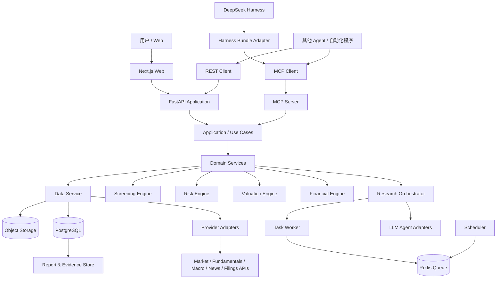

# ARCHITECTURE：总体技术架构与仓库结构

> 本文件由《全球股票投资研究系统：产品需求与工程实施规格书》v1.5 拆分而来，**自此成为该部分内容的权威来源**。章节编号沿用原规格书；正文中的“见 X.Y / 第 N 节”请通过 [README.md](README.md) 的章节映射定位到对应文件。

## 5. 架构原则

- **Hexagonal / Ports & Adapters：** 核心领域逻辑不依赖数据供应商、LLM、Web UI 或 Harness。
- **Modular Monolith：** MVP 采用一个 FastAPI 应用、一个 Worker、一个 Scheduler 和独立 MCP 入口；按模块边界组织代码。
- **Async-first Research：** 长研究任务必须异步运行，不能要求 MCP/HTTP 请求长期阻塞。
- **Event + Snapshot：** 关键任务状态、数据更新、报告版本和告警均持久化。
- **Provider-neutral：** 供应商通过接口接入，标准化后才进入研究层。
- **Schema-first：** API、MCP 工具和 Agent 之间传递 Pydantic 校验的结构化对象。
- **Reproducible:** 研究任务记录 prompt、模型、配置、数据快照和代码版本。

## 6. 逻辑架构



## 7. 推荐技术栈

| 层 | 推荐 | 说明 |
|---|---|---|
| 前端 | Next.js + React + TypeScript | 独立 Web 工作台 |
| UI | Tailwind CSS + shadcn/ui（可选） | 统一组件体系 |
| 图表 | Apache ECharts 或 Plotly | 财务、估值、组合风险 |
| 后端 | Python 3.12+ + FastAPI | REST/API 应用层 |
| 类型与校验 | Pydantic v2 | 请求、响应和 Agent 结构化输出 |
| ORM / Migration | SQLAlchemy 2 + Alembic | 数据访问和版本迁移 |
| 数据计算 | pandas、NumPy、SciPy | 财务和风险计算 |
| 金融日历 | exchange_calendars（需核验目标市场覆盖） | 交易日历辅助，不作为唯一官方来源 |
| 数据库 | PostgreSQL 16+ | 业务、财务、研究与任务数据 |
| 时序扩展 | TimescaleDB（可选） | 数据规模增长后再加 |
| 缓存/队列 | Redis + Celery | 异步任务、缓存、限流 |
| 对象存储 | MinIO（可选）/ S3 兼容存储 | 原始文件、报告、下载文件 |
| MCP | 官方 MCP Python SDK | 本地 stdio、远程 Streamable HTTP |
| Agent | 自定义 Agent 接口；可选 LangGraph | 避免将业务逻辑绑定到单一 Agent 框架 |
| LLM | DeepSeek / OpenAI-compatible provider adapter | 可配置模型与降级策略 |
| 部署 | Docker Compose | 本地与服务器统一运行形态 |
| 监控 | structlog + Prometheus + Grafana（后期） | 结构化日志和运行指标 |
| 测试 | pytest、httpx、Playwright、Vitest | 后端、API、UI、端到端 |

**版本策略：** 具体依赖版本必须在项目启动时锁定到 `uv.lock` / `package-lock.json` 或等价锁文件；AI 编程工具不得在未运行测试的情况下随意升级主版本。

## 35. 推荐 Monorepo 结构

```text
global-equity-intelligence/
├── apps/
│   ├── web/                         # Next.js Web
│   ├── api/                         # FastAPI REST
│   ├── worker/                      # Celery Worker
│   ├── scheduler/                   # 定时任务与僵尸任务清道夫
│   └── mcp-server/                  # MCP Server entrypoint
├── packages/
│   ├── domain/                      # 领域模型、枚举、领域规则
│   ├── application/                 # Use Cases / Application Services
│   ├── data_engine/                 # Provider、两层概念标准化、数据质量、PIT
│   ├── financial_engine/            # 财务指标
│   ├── valuation_engine/            # Pre-flight Check、DCF、Reverse DCF、相对估值
│   ├── risk_engine/                 # 风险分析
│   ├── screening_engine/            # 股票筛选
│   ├── portfolio_engine/            # 组合分析
│   ├── research_engine/             # 研究编排与任务状态机
│   └── reporting_engine/            # 报告生成
├── agents/
│   ├── orchestrator/
│   ├── macro/
│   ├── industry/
│   ├── equity/
│   ├── financial/
│   ├── valuation/
│   ├── risk/
│   └── editor/
├── integrations/
│   ├── providers/
│   │   ├── sec_edgar/
│   │   ├── fred/
│   │   ├── openfigi/
│   │   └── market_vendor/            # MVP-1 仅一家，许可审查通过后命名
│   └── deepseek_harness/
├── configs/
│   ├── markets/
│   ├── providers/
│   ├── taxonomy/                    # 40项核心概念与跨市场映射种子配置
│   ├── research_profiles/
│   ├── valuation_models/
│   └── risk_rules/
├── database/
│   ├── migrations/
│   └── seeds/
├── tests/
│   ├── unit/
│   ├── integration/
│   ├── contract/
│   ├── financial/
│   ├── pit/
│   ├── security/
│   └── e2e/
├── deploy/
│   ├── compose/
│   ├── caddy/
│   └── scripts/
├── docs/                            # 结构见 docs/README.md
├── .github/workflows/
├── AGENTS.md                        # AI 编程智能体共同规则（37.1）
├── CLAUDE.md                        # 仅含 @AGENTS.md 引用，供 Claude Code 读取
├── .env.example
├── Makefile
├── pyproject.toml
├── uv.lock
├── package.json
├── pnpm-lock.yaml
└── README.md
```
