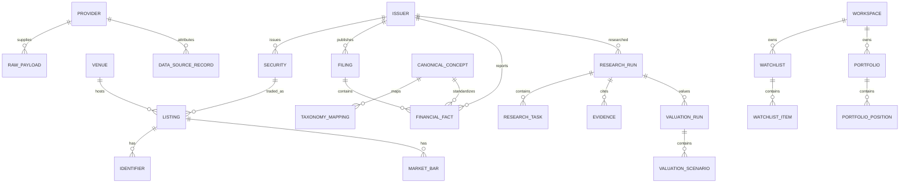

# DATABASE：数据库设计与 DDL 基线

> 本文件由《全球股票投资研究系统：产品需求与工程实施规格书》v1.5 拆分而来，**自此成为该部分内容的权威来源**。章节编号沿用原规格书；正文中的“见 X.Y / 第 N 节”请通过 [README.md](README.md) 的章节映射定位到对应文件。

## 13. 数据库设计约定

- PostgreSQL 作为主数据库。
- 主键 UUID；时间使用 `TIMESTAMPTZ`，日期使用 `DATE`。
- 金额使用 `NUMERIC`，不要用浮点数存储货币或财务结果。
- 原始供应商数据存 `JSONB`，标准化数据存结构化列。
- 关键表包含 `created_at`、`updated_at`；可变映射包含有效期。
- 所有可追溯事实数据必须关联来源（`source_id NOT NULL`）。
- 研究任务的模型参数、Prompt 版本和数据快照必须可保存。
- 初期不建议在所有表上过度使用 JSONB；关系结构用于关键查询，JSONB 用于供应商原始内容和扩展字段。

## 14. 核心实体关系



## 15. 核心表清单

### 15.1 身份与市场主数据

| 表 | 关键字段 | 说明 |
|---|---|---|
| `workspaces` | `id`, `name`, `settings_json` | 工作区 |
| `users` | `id`, `email`, `password_hash`, `status` | 本地用户/登录主体 |
| `workspace_members` | `workspace_id`, `user_id`, `role` | 工作区成员权限 |
| `issuers` | `id`, `legal_name`, `common_name`, `country_code`, `sector`, `industry`, `lei` | 公司/发行主体 |
| `securities` | `id`, `issuer_id`, `security_type`, `share_class`, `currency`, `adr_ratio` | 证券类别 |
| `venues` | `id`, `mic`, `name`, `country_code`, `timezone` | 交易场所 |
| `listings` | `id`, `security_id`, `venue_id`, `ticker`, `trading_currency`, `status` | 上市记录 |
| `identifiers` | `id`, `entity_type`, `entity_id`, `id_type`, `id_value`, `source_id`, `valid_from`, `valid_to` | ISIN/FIGI 等标识符映射（带排他约束与实体校验触发器） |
| `market_calendars` | `id`, `venue_id`, `calendar_date`, `is_open`, `session_json` | 交易日历 |
| `currencies` | `code`, `name`, `minor_unit` | ISO 4217 币种 |
| `fx_rates` | `base_currency`, `quote_currency`, `rate`, `as_of`, `source_id` | 汇率 |

### 15.2 来源与原始数据

| 表 | 关键字段 | 说明 |
|---|---|---|
| `providers` | `id`, `name`, `provider_type`, `base_url`, `status` | 数据供应商 |
| `provider_entitlements` | `provider_id`, `workspace_id`, `license_type`, `allowed_use`, `redistribution_allowed`, `expires_at` | 许可与授权范围 |
| `provider_coverage` | `provider_id`, `market_code`, `dataset`, `coverage_status`, `checked_at` | 市场/字段覆盖 |
| `raw_payloads` | `id`, `provider_id`, `payload_json`, `payload_hash`, `first_received_at`, `published_at`, `license_scope` | 去重后的原始响应内容（`provider_id + payload_hash` 唯一；`retention = stored / hash_only`，见 12.8） |
| `ingest_log` | `id`, `provider_id`, `endpoint`, `request_hash`, `requested_at`, `received_at`, `http_status`, `payload_id`, `error_code`, `error_message`, `retry_count`, `response_meta_json` | 每一次拉取事件（含失败与重试），不去重 |
| `data_sources` | `id`, `provider_id`, `source_name`, `source_url`, `source_type` | 来源元数据 |
| `data_quality_issues` | `id`, `entity_id`, `field_name`, `severity`, `issue_type`, `details_json`, `status` | 数据质量问题 |

### 15.3 行情、公司披露和财务数据

| 表 | 关键字段 | 说明 |
|---|---|---|
| `market_bars` | `listing_id`, `interval`, `bar_time`, `open`, `high`, `low`, `close`, `volume`, `turnover`, `currency`, `adjustment_basis`, `source_id` | OHLCV（复合主键含 `revision_no`，只追加修订，强制 `source_id NOT NULL`，见 12.8） |
| `corporate_actions` | `security_id`, `action_type`, `announcement_date`, `ex_date`, `effective_date`, `ratio`, `cash_amount` | 公司行动 |
| `filings` | `issuer_id`, `filing_type`, `filed_at`, `published_at`, `accession_no`, `source_url`, `document_hash` | 财报和公告 |
| `canonical_concepts` | `concept_code`, `statement_type`, `period_nature`, `standard_unit_type`, `sign_convention` | 内部标准财务概念字典 |
| `taxonomy_mappings` | `id`, `taxonomy_source`, `external_tag`, `concept_code`, `priority`, `sign_multiplier`, `unit_multiplier`, `mapping_version` | 跨市场财务概念映射规则 |
| `financial_facts` | `issuer_id`, `filing_id`, `concept`, `value_numeric`, `unit`, `currency`, `period_type`, `period_start`, `period_end`, `fiscal_year`, `fiscal_period`, `published_at`, `accepted_at`, `pit_precision`, `supersedes_id`, `source_id`, `taxonomy` | 标准化财务事实（只追加、不可原地修改）；期间信息直接落在事实行上，**不设独立的 `financial_periods` 维度表**，避免与本表冗余（17.0 的 FY/季度/TTM 规则直接基于本表字段执行） |
| `financial_metrics` | `issuer_id`, `metric_code`, `value_numeric`, `period_end`, `calculation_version`, `source_fact_ids` | 派生指标 |
| `data_snapshots` | `id`, `workspace_id`, `snapshot_type`, `as_of`, `schema_version`, `selection_policy`, `manifest`, `content_hash` | 不可变数据快照 |
| `data_snapshot_items` | `snapshot_id`, `record_type`, `record_id`, `range_ref_json`, `record_hash`, `source_published_at` | 快照清单项（逐行引用或区间引用） |
| `peer_sets` | `id`, `workspace_id`, `issuer_id`, `version`, `members_json`, `basis`, `created_at` | 用户确认的可比公司集合（版本化） |
| `macro_series` | `id`, `provider_series_id`, `name`, `frequency`, `unit`, `country_code` | 宏观序列 |
| `macro_observations` | `series_id`, `observation_date`, `value_numeric`, `realtime_start`, `realtime_end`, `published_at`, `source_id` | 宏观观测值 |

### 15.4 新闻、研究和估值

| 表 | 关键字段 | 说明 |
|---|---|---|
| `news_events` | `id`, `issuer_id`, `listing_id`, `published_at`, `headline`, `summary`, `source_url`, `source_id`, `language` | 新闻/事件元数据 |
| `research_runs` | `id`, `workspace_id`, `issuer_id`, `listing_id`, `profile`, `status`, `current_stage`, `data_quality_status`, `idempotency_key`, `heartbeat_at`, `research_as_of`, `data_snapshot_id`, `started_at`, `completed_at`, `config_snapshot`, `model_snapshot`, `code_version` | 一次完整研究；对外唯一标识 `run_id`（MVP-1 中 `model_snapshot` 为空） |
| `research_tasks` | `id`, `research_run_id`, `task_type`, `status`, `attempt`, `max_attempts`, `next_retry_at`, `input_json`, `output_json`, `error_json` | 内部子任务（对 `research_run_id + task_type` 唯一） |
| `research_evidence` | `id`, `research_run_id`, `claim_id`, `source_id`, `source_url`, `published_at`, `quoted_text`, `evidence_type`, `relevance` | 证据链 |
| `research_claims` | `id`, `research_run_id`, `claim_type`, `claim_text`, `confidence`, `verification_status` | 结构化主张 |
| `valuation_runs` | `id`, `research_run_id`, `listing_id`, `model_type`, `model_version`, `preflight_status`, `preflight_rules_version`, `status`, `preflight_report_json`, `currency`, `valuation_date`, `data_snapshot_id`, `input_snapshot` | 估值运行（含 Pre-flight 结论与估值状态） |
| `valuation_assumptions` | `id`, `workspace_id`, `listing_id`, `scenario`, `version`, `supersedes_id`, `name`, `value_numeric`, `currency`, `rate_type`, `source_type`, `rationale`, `status`, `entered_at`, `confirmed_by`, `confirmed_at` | 用户/Agent 提出的估值假设（WACC 等）；独立于估值运行、先于快照创建，修订以新版本追加（见 18.1.3） |
| `valuation_scenarios` | `id`, `valuation_run_id`, `scenario`, `assumptions_json`, `enterprise_value`, `equity_value`, `value_per_share` | Bear/Base/Bull |
| `valuation_sensitivities` | `id`, `valuation_run_id`, `variable_x`, `variable_y`, `grid_json` | 敏感性矩阵 |
| `risk_assessments` | `id`, `research_run_id`, `risk_category`, `severity`, `likelihood`, `impact`, `mitigation`, `evidence_ids` | 风险结果 |
| `research_reports` | `id`, `research_run_id`, `format`, `storage_key`, `content_hash`, `version` | 报告文件 |

### 15.5 自选股、组合和告警

| 表 | 关键字段 | 说明 |
|---|---|---|
| `watchlists` | `id`, `workspace_id`, `name`, `description` | 自选股集合 |
| `watchlist_items` | `watchlist_id`, `listing_id`, `thesis`, `status`, `added_at` | 自选股票 |
| `portfolios` | `id`, `workspace_id`, `name`, `base_currency`, `portfolio_type` | 虚拟组合 |
| `portfolio_positions` | `portfolio_id`, `listing_id`, `quantity`, `cost_basis`, `cost_currency`, `as_of` | 持仓 |
| `alert_rules` | `id`, `workspace_id`, `listing_id`, `rule_type`, `config_json`, `enabled` | 告警条件 |
| `alert_events` | `id`, `alert_rule_id`, `triggered_at`, `payload_json`, `status` | 告警记录 |
| `audit_logs` | `id`, `workspace_id`, `actor_type`, `actor_id`, `action`, `resource_type`, `resource_id`, `details_json`, `created_at` | 操作审计 |

## 16. 关键 DDL 生产级基线

> 以下 SQL 为经过生产级约束加固的核心表基线设计。实际项目应拆分为 Alembic migrations，并为所有外键、唯一约束、排他约束、触发器和权限规则编写测试。

```sql
CREATE EXTENSION IF NOT EXISTS pgcrypto;
CREATE EXTENSION IF NOT EXISTS btree_gist;

CREATE TABLE currencies (
  code CHAR(3) PRIMARY KEY,
  name TEXT NOT NULL,
  minor_unit SMALLINT NOT NULL DEFAULT 2
);

-- 工作区与用户：MVP-1 单用户模式下只会存在一个 workspace 与一个 Owner 用户，
-- 但 workspace_id / user_id 外键必须从第一个迁移开始就存在，为后续多用户/多工作区铺路
CREATE TABLE workspaces (
  id UUID PRIMARY KEY DEFAULT gen_random_uuid(),
  name TEXT NOT NULL,
  settings_json JSONB NOT NULL DEFAULT '{}'::jsonb,
  created_at TIMESTAMPTZ NOT NULL DEFAULT now(),
  updated_at TIMESTAMPTZ NOT NULL DEFAULT now()
);

CREATE TABLE users (
  id UUID PRIMARY KEY DEFAULT gen_random_uuid(),
  email TEXT NOT NULL UNIQUE,
  password_hash TEXT NOT NULL,
  status TEXT NOT NULL DEFAULT 'active' CHECK (status IN ('active', 'disabled')),
  created_at TIMESTAMPTZ NOT NULL DEFAULT now(),
  updated_at TIMESTAMPTZ NOT NULL DEFAULT now()
);

CREATE TABLE workspace_members (
  workspace_id UUID NOT NULL REFERENCES workspaces(id) ON DELETE CASCADE,
  user_id UUID NOT NULL REFERENCES users(id) ON DELETE CASCADE,
  role TEXT NOT NULL CHECK (role IN ('owner', 'researcher', 'viewer')),
  created_at TIMESTAMPTZ NOT NULL DEFAULT now(),
  PRIMARY KEY (workspace_id, user_id)
);

CREATE TABLE issuers (
  id UUID PRIMARY KEY DEFAULT gen_random_uuid(),
  legal_name TEXT NOT NULL,
  common_name TEXT,
  country_code CHAR(2),
  sector TEXT,
  industry TEXT,
  lei TEXT,
  website TEXT,
  created_at TIMESTAMPTZ NOT NULL DEFAULT now(),
  updated_at TIMESTAMPTZ NOT NULL DEFAULT now()
);

CREATE TABLE securities (
  id UUID PRIMARY KEY DEFAULT gen_random_uuid(),
  issuer_id UUID NOT NULL REFERENCES issuers(id) ON DELETE RESTRICT,
  security_type TEXT NOT NULL,
  share_class TEXT,
  description TEXT,
  nominal_currency CHAR(3) REFERENCES currencies(code),
  adr_ratio NUMERIC(18,6), -- 每份ADR对应的普通股数量（非ADR为空或1）
  created_at TIMESTAMPTZ NOT NULL DEFAULT now()
);

CREATE TABLE venues (
  id UUID PRIMARY KEY DEFAULT gen_random_uuid(),
  mic VARCHAR(4) UNIQUE,
  name TEXT NOT NULL,
  country_code CHAR(2),
  timezone TEXT NOT NULL,
  created_at TIMESTAMPTZ NOT NULL DEFAULT now()
);

CREATE TABLE listings (
  id UUID PRIMARY KEY DEFAULT gen_random_uuid(),
  security_id UUID NOT NULL REFERENCES securities(id) ON DELETE RESTRICT,
  venue_id UUID NOT NULL REFERENCES venues(id) ON DELETE RESTRICT,
  ticker TEXT NOT NULL,
  trading_currency CHAR(3) NOT NULL REFERENCES currencies(code),
  status TEXT NOT NULL DEFAULT 'active' CHECK (status IN ('active', 'suspended', 'delisted')),
  valid_from DATE NOT NULL DEFAULT CURRENT_DATE,
  valid_to DATE NOT NULL DEFAULT '9999-12-31',
  created_at TIMESTAMPTZ NOT NULL DEFAULT now(),
  CONSTRAINT chk_listings_valid_range CHECK (valid_from < valid_to),
  -- 同一交易场所 + ticker 在有效期内不允许重叠（防止 ticker 复用场景下误插入时间重叠记录）；
  -- 排他约束已覆盖“同一天重复开始”，故不另设 UNIQUE (venue_id, ticker, valid_from)（ADR-0016）
  EXCLUDE USING gist (
    venue_id WITH =,
    ticker WITH =,
    daterange(valid_from, valid_to, '[)') WITH &&
  )
);
CREATE INDEX idx_listings_ticker ON listings(ticker);

CREATE TABLE providers (
  id UUID PRIMARY KEY DEFAULT gen_random_uuid(),
  name TEXT NOT NULL UNIQUE,
  provider_type TEXT NOT NULL,
  status TEXT NOT NULL DEFAULT 'active',
  base_url TEXT,
  created_at TIMESTAMPTZ NOT NULL DEFAULT now()
);

CREATE TABLE data_sources (
  id UUID PRIMARY KEY DEFAULT gen_random_uuid(),
  provider_id UUID REFERENCES providers(id) ON DELETE RESTRICT,
  source_name TEXT NOT NULL,
  source_type TEXT NOT NULL,
  source_url TEXT,
  license_scope TEXT,
  created_at TIMESTAMPTZ NOT NULL DEFAULT now()
);

-- 多态标识符表：采用 btree_gist 排他约束防时间重叠 + 触发器校验引用完整性
CREATE TABLE identifiers (
  id UUID PRIMARY KEY DEFAULT gen_random_uuid(),
  entity_type TEXT NOT NULL CHECK (entity_type IN ('issuer', 'security', 'listing', 'venue')),
  entity_id UUID NOT NULL,
  id_type TEXT NOT NULL CHECK (id_type IN (
    'isin', 'figi', 'composite_figi', 'share_class_figi', 
    'cusip', 'sedol', 'lei', 'cik', 'local_code', 'vendor_symbol'
  )),
  id_value TEXT NOT NULL,
  source_id UUID NOT NULL REFERENCES data_sources(id) ON DELETE RESTRICT,
  valid_from TIMESTAMPTZ NOT NULL DEFAULT '-infinity',
  valid_to TIMESTAMPTZ NOT NULL DEFAULT 'infinity',
  observed_at TIMESTAMPTZ NOT NULL DEFAULT now(),
  CONSTRAINT chk_identifiers_valid_range CHECK (valid_from < valid_to),
  -- 核心排他约束：同一标识符类型+值，在有效时间段内绝不允许重叠指向不同实体
  EXCLUDE USING gist (
    entity_type WITH =,
    id_type WITH =,
    id_value WITH =,
    tstzrange(valid_from, valid_to, '[)') WITH &&
  )
);
CREATE INDEX idx_identifiers_lookup ON identifiers(id_type, id_value);
CREATE INDEX idx_identifiers_entity ON identifiers(entity_type, entity_id);

CREATE OR REPLACE FUNCTION trg_verify_identifier_entity()
RETURNS TRIGGER AS $$
DECLARE
  entity_exists BOOLEAN;
BEGIN
  CASE NEW.entity_type
    WHEN 'issuer' THEN
      SELECT EXISTS(SELECT 1 FROM issuers WHERE id = NEW.entity_id) INTO entity_exists;
    WHEN 'security' THEN
      SELECT EXISTS(SELECT 1 FROM securities WHERE id = NEW.entity_id) INTO entity_exists;
    WHEN 'listing' THEN
      SELECT EXISTS(SELECT 1 FROM listings WHERE id = NEW.entity_id) INTO entity_exists;
    WHEN 'venue' THEN
      SELECT EXISTS(SELECT 1 FROM venues WHERE id = NEW.entity_id) INTO entity_exists;
  END CASE;

  IF NOT entity_exists THEN
    RAISE EXCEPTION 'Referenced entity (%: %) does not exist', NEW.entity_type, NEW.entity_id
      USING ERRCODE = 'foreign_key_violation';
  END IF;
  RETURN NEW;
END;
$$ LANGUAGE plpgsql;

CREATE TRIGGER check_identifier_entity_exists
  BEFORE INSERT OR UPDATE ON identifiers
  FOR EACH ROW EXECUTE FUNCTION trg_verify_identifier_entity();

-- 反向保护（ADR-0016）：被 identifiers 引用的主数据实体禁止删除，避免多态表留下孤儿记录
CREATE OR REPLACE FUNCTION trg_block_delete_if_identified()
RETURNS TRIGGER AS $$
BEGIN
  IF EXISTS (SELECT 1 FROM identifiers WHERE entity_type = TG_ARGV[0] AND entity_id = OLD.id) THEN
    RAISE EXCEPTION '% % is referenced by identifiers', TG_ARGV[0], OLD.id
      USING ERRCODE = 'foreign_key_violation';
  END IF;
  RETURN OLD;
END;
$$ LANGUAGE plpgsql;

CREATE TRIGGER issuers_block_delete_if_identified BEFORE DELETE ON issuers
  FOR EACH ROW EXECUTE FUNCTION trg_block_delete_if_identified('issuer');
CREATE TRIGGER securities_block_delete_if_identified BEFORE DELETE ON securities
  FOR EACH ROW EXECUTE FUNCTION trg_block_delete_if_identified('security');
CREATE TRIGGER listings_block_delete_if_identified BEFORE DELETE ON listings
  FOR EACH ROW EXECUTE FUNCTION trg_block_delete_if_identified('listing');
CREATE TRIGGER venues_block_delete_if_identified BEFORE DELETE ON venues
  FOR EACH ROW EXECUTE FUNCTION trg_block_delete_if_identified('venue');

-- 原始内容去重存储：相同响应只保存一份
CREATE TABLE raw_payloads (
  id UUID PRIMARY KEY DEFAULT gen_random_uuid(),
  provider_id UUID NOT NULL REFERENCES providers(id) ON DELETE RESTRICT,
  payload_json JSONB,                    -- retention = 'hash_only' 时为空（见 12.8）
  payload_hash CHAR(64) NOT NULL,
  retention TEXT NOT NULL DEFAULT 'stored' CHECK (retention IN ('stored', 'hash_only')),
  first_received_at TIMESTAMPTZ NOT NULL DEFAULT now(),
  published_at TIMESTAMPTZ,
  license_scope TEXT,
  UNIQUE (provider_id, payload_hash),
  CONSTRAINT chk_raw_payload_retention CHECK (
    (retention = 'stored' AND payload_json IS NOT NULL) OR
    (retention = 'hash_only' AND payload_json IS NULL)
  )
);

-- 拉取事件日志：每一次请求（含失败、重试、重复内容）都记录，保留完整观测历史
CREATE TABLE ingest_log (
  id UUID PRIMARY KEY DEFAULT gen_random_uuid(),
  provider_id UUID NOT NULL REFERENCES providers(id) ON DELETE RESTRICT,
  endpoint TEXT NOT NULL,
  request_hash TEXT NOT NULL,            -- 请求参数规范化后哈希（敏感字段脱敏）
  requested_at TIMESTAMPTZ NOT NULL,
  received_at TIMESTAMPTZ,
  http_status INTEGER,
  payload_id UUID REFERENCES raw_payloads(id) ON DELETE RESTRICT,  -- 失败时为空
  error_code TEXT,
  error_message TEXT,
  retry_count INTEGER NOT NULL DEFAULT 0,
  response_meta_json JSONB NOT NULL DEFAULT '{}'::jsonb  -- ETag/Last-Modified 等，按许可与安全策略保存
);
CREATE INDEX idx_ingest_log_provider_time ON ingest_log(provider_id, requested_at DESC);

-- 行情时序表：强制 source_id NOT NULL，采用天然复合主键与 OHLC 质量检查
CREATE TABLE market_bars (
  listing_id UUID NOT NULL REFERENCES listings(id) ON DELETE RESTRICT,
  interval TEXT NOT NULL CHECK (interval IN ('1d', '1wk', '1mo', '1h', '5m')),
  bar_time TIMESTAMPTZ NOT NULL,
  open NUMERIC(24,8) NOT NULL,
  high NUMERIC(24,8) NOT NULL,
  low NUMERIC(24,8) NOT NULL,
  close NUMERIC(24,8) NOT NULL,
  volume NUMERIC(28,6) NOT NULL DEFAULT 0,
  turnover NUMERIC(30,6),
  currency CHAR(3) NOT NULL REFERENCES currencies(code),
  adjustment_basis TEXT NOT NULL DEFAULT 'raw'
    CHECK (adjustment_basis IN ('raw', 'split_only', 'total_return')),
  source_id UUID NOT NULL REFERENCES data_sources(id) ON DELETE RESTRICT,
  observed_at TIMESTAMPTZ NOT NULL DEFAULT now(),
  revision_no INTEGER NOT NULL DEFAULT 1 CHECK (revision_no >= 1),  -- 供应商修订以 +1 追加（见 12.8）
  PRIMARY KEY (listing_id, interval, bar_time, adjustment_basis, source_id, revision_no),
  CONSTRAINT chk_market_bars_ohlc CHECK (
    high >= low AND high >= open AND high >= close AND
    low <= open AND low <= close AND close >= 0 AND volume >= 0
  )
);
CREATE INDEX idx_market_bars_listing_time
  ON market_bars(listing_id, interval, adjustment_basis, bar_time DESC);

CREATE TABLE filings (
  id UUID PRIMARY KEY DEFAULT gen_random_uuid(),
  issuer_id UUID NOT NULL REFERENCES issuers(id) ON DELETE RESTRICT,
  filing_type TEXT NOT NULL,
  accession_no TEXT,
  filed_at TIMESTAMPTZ,
  published_at TIMESTAMPTZ,
  period_end DATE,
  source_id UUID NOT NULL REFERENCES data_sources(id) ON DELETE RESTRICT,
  source_url TEXT NOT NULL,
  document_hash TEXT,
  created_at TIMESTAMPTZ NOT NULL DEFAULT now(),
  UNIQUE (issuer_id, accession_no)
);

-- 跨市场财务概念标准化两层字典表
CREATE TABLE canonical_concepts (
  concept_code TEXT PRIMARY KEY,
  statement_type TEXT NOT NULL CHECK (statement_type IN ('income', 'balance', 'cash_flow', 'shares', 'other')),
  period_nature TEXT NOT NULL CHECK (period_nature IN ('duration', 'instant')),
  standard_unit_type TEXT NOT NULL CHECK (standard_unit_type IN ('monetary', 'shares', 'per_share', 'ratio')),
  sign_convention TEXT NOT NULL DEFAULT 'positive_normal',
  description TEXT NOT NULL
);

CREATE TABLE taxonomy_mappings (
  id UUID PRIMARY KEY DEFAULT gen_random_uuid(),
  taxonomy_source TEXT NOT NULL,
  external_tag TEXT NOT NULL,
  concept_code TEXT NOT NULL REFERENCES canonical_concepts(concept_code) ON DELETE RESTRICT,
  priority INTEGER NOT NULL DEFAULT 100,
  sign_multiplier NUMERIC(2,0) NOT NULL DEFAULT 1 CHECK (sign_multiplier IN (1, -1)),
  unit_multiplier NUMERIC(20,6) NOT NULL DEFAULT 1,
  mapping_version TEXT NOT NULL DEFAULT 'v1.0',
  is_active BOOLEAN NOT NULL DEFAULT true,
  UNIQUE (taxonomy_source, external_tag, mapping_version)
);

CREATE TABLE financial_facts (
  id UUID PRIMARY KEY DEFAULT gen_random_uuid(),
  issuer_id UUID NOT NULL REFERENCES issuers(id) ON DELETE RESTRICT,
  filing_id UUID REFERENCES filings(id) ON DELETE RESTRICT,
  concept TEXT NOT NULL REFERENCES canonical_concepts(concept_code) ON DELETE RESTRICT,
  taxonomy TEXT,
  external_tag TEXT,
  value_numeric NUMERIC(30,8),
  value_text TEXT,
  unit TEXT NOT NULL,
  currency CHAR(3) REFERENCES currencies(code),
  period_type TEXT NOT NULL CHECK (period_type IN ('FY', 'Q', 'H', 'YTD', 'TTM', 'instant')),
  period_start DATE,
  period_end DATE NOT NULL,
  fiscal_year INTEGER,
  fiscal_period TEXT,
  published_at TIMESTAMPTZ,
  accepted_at TIMESTAMPTZ,
  pit_precision TEXT NOT NULL DEFAULT 'timestamp' CHECK (pit_precision IN ('timestamp', 'date', 'unknown')),
  observed_at TIMESTAMPTZ NOT NULL DEFAULT now(),
  source_id UUID NOT NULL REFERENCES data_sources(id) ON DELETE RESTRICT,
  supersedes_id UUID REFERENCES financial_facts(id) ON DELETE RESTRICT,  -- 重述/修订时指向被取代版本
  revision_key TEXT,
  created_at TIMESTAMPTZ NOT NULL DEFAULT now()
);
CREATE INDEX idx_financial_facts_pit ON financial_facts(issuer_id, concept, published_at, period_end);

-- 事实表只追加：禁止原地修改或删除，修订以新版本 + supersedes_id 表达
CREATE OR REPLACE FUNCTION trg_forbid_mutation()
RETURNS TRIGGER AS $$
BEGIN
  RAISE EXCEPTION '% is append-only; create a new version instead', TG_TABLE_NAME
    USING ERRCODE = 'restrict_violation';
END;
$$ LANGUAGE plpgsql;

CREATE TRIGGER financial_facts_append_only
  BEFORE UPDATE OR DELETE ON financial_facts
  FOR EACH ROW EXECUTE FUNCTION trg_forbid_mutation();

-- 行情同样只追加：供应商修订以新 revision_no 行表达，保证旧快照可复现（12.8）
CREATE TRIGGER market_bars_append_only
  BEFORE UPDATE OR DELETE ON market_bars
  FOR EACH ROW EXECUTE FUNCTION trg_forbid_mutation();

-- 不可变数据快照：记录一次研究/估值使用的全部输入数据版本
CREATE TABLE data_snapshots (
  id UUID PRIMARY KEY DEFAULT gen_random_uuid(),
  workspace_id UUID NOT NULL REFERENCES workspaces(id) ON DELETE RESTRICT,
  snapshot_type TEXT NOT NULL,           -- research_run / valuation / screening
  as_of TIMESTAMPTZ NOT NULL,            -- 等于 research_as_of
  schema_version TEXT NOT NULL,
  selection_policy JSONB NOT NULL,       -- PIT 选择规则、复权口径、期间规则等
  manifest JSONB NOT NULL,
  content_hash CHAR(64) NOT NULL,        -- 规范化清单 + 关键元数据的 SHA-256
  created_at TIMESTAMPTZ NOT NULL DEFAULT now()
);

-- 快照清单项：财务事实等有 UUID 的记录逐行引用；行情按区间引用（market_bars 为复合主键且数据量大）
CREATE TABLE data_snapshot_items (
  id UUID PRIMARY KEY DEFAULT gen_random_uuid(),
  snapshot_id UUID NOT NULL REFERENCES data_snapshots(id) ON DELETE RESTRICT,
  record_type TEXT NOT NULL CHECK (record_type IN (
    'financial_fact', 'filing', 'corporate_action', 'fx_rate', 'market_bar_range', 'valuation_assumption', 'peer_set'
  )),
  record_id UUID,                        -- 逐行引用时使用
  range_ref_json JSONB,                  -- market_bar_range：listing_id/interval/adjustment_basis/source_id/start/end/observed_at_cutoff
  record_hash CHAR(64) NOT NULL,         -- 行内容或区间内全部行的规范化哈希
  source_published_at TIMESTAMPTZ,
  created_at TIMESTAMPTZ NOT NULL DEFAULT now(),
  CONSTRAINT chk_snapshot_item_ref CHECK (
    (record_type = 'market_bar_range' AND range_ref_json IS NOT NULL AND record_id IS NULL) OR
    (record_type <> 'market_bar_range' AND record_id IS NOT NULL)
  )
);
CREATE UNIQUE INDEX uq_snapshot_items_record ON data_snapshot_items(snapshot_id, record_type, record_id)
  WHERE record_id IS NOT NULL;

CREATE TRIGGER data_snapshots_immutable
  BEFORE UPDATE OR DELETE ON data_snapshots
  FOR EACH ROW EXECUTE FUNCTION trg_forbid_mutation();
CREATE TRIGGER data_snapshot_items_immutable
  BEFORE UPDATE OR DELETE ON data_snapshot_items
  FOR EACH ROW EXECUTE FUNCTION trg_forbid_mutation();

CREATE TABLE research_runs (
  id UUID PRIMARY KEY DEFAULT gen_random_uuid(),
  workspace_id UUID NOT NULL REFERENCES workspaces(id) ON DELETE RESTRICT,
  issuer_id UUID NOT NULL REFERENCES issuers(id) ON DELETE RESTRICT,
  listing_id UUID REFERENCES listings(id) ON DELETE RESTRICT,
  profile TEXT NOT NULL CHECK (profile IN ('balanced','value','growth')),
  -- 执行状态与数据质量状态分离（见 22）
  status TEXT NOT NULL CHECK (status IN ('queued', 'running', 'succeeded', 'failed', 'cancelled')),
  current_stage TEXT,
  data_quality_status TEXT NOT NULL DEFAULT 'ok' CHECK (data_quality_status IN ('ok', 'warn', 'limited')),
  idempotency_key TEXT,                  -- 仅调用方显式传入的 Idempotency-Key；同 key 永远返回原 Run
  request_fingerprint TEXT,              -- 服务端自动指纹（见 22.4），仅在非终态 Run 之间唯一
  heartbeat_at TIMESTAMPTZ,
  research_as_of TIMESTAMPTZ NOT NULL,
  config_snapshot JSONB NOT NULL,
  model_snapshot JSONB,                  -- LLM 模型与 Prompt 版本，汇总引用 agent_invocations；MVP-1 为空
  token_budget INTEGER CHECK (token_budget IS NULL OR token_budget > 0),  -- MVP-2 起使用（21.4）
  tokens_used INTEGER NOT NULL DEFAULT 0,
  data_snapshot_id UUID REFERENCES data_snapshots(id) ON DELETE RESTRICT,
  code_version TEXT,
  started_at TIMESTAMPTZ,
  completed_at TIMESTAMPTZ,
  created_at TIMESTAMPTZ NOT NULL DEFAULT now(),
  UNIQUE (workspace_id, idempotency_key)
);
CREATE UNIQUE INDEX uq_research_runs_active_fingerprint
  ON research_runs(workspace_id, request_fingerprint)
  WHERE status IN ('queued', 'running') AND request_fingerprint IS NOT NULL;
CREATE INDEX idx_research_runs_workspace ON research_runs(workspace_id, created_at DESC);
CREATE INDEX idx_research_runs_watchdog ON research_runs(status, heartbeat_at) WHERE status IN ('queued', 'running');

CREATE TABLE research_tasks (
  id UUID PRIMARY KEY DEFAULT gen_random_uuid(),
  research_run_id UUID NOT NULL REFERENCES research_runs(id) ON DELETE CASCADE,
  -- 枚举值见 22.3 阶段（task_type）枚举；新增阶段须出新 Alembic migration 扩展该 CHECK
  task_type TEXT NOT NULL CHECK (task_type IN (
    'resolve_instrument', 'data_collection', 'normalization', 'snapshot',
    'financial_analysis', 'valuation', 'risk_metrics',
    'macro_industry_analysis', 'company_analysis', 'risk_review', 'report_assembly'
  )),
  status TEXT NOT NULL CHECK (status IN ('queued', 'running', 'retry_wait', 'succeeded', 'failed', 'skipped', 'cancelled')),
  attempt INTEGER NOT NULL DEFAULT 0,
  max_attempts INTEGER NOT NULL DEFAULT 3,
  next_retry_at TIMESTAMPTZ,             -- retry_wait 时必填
  input_json JSONB NOT NULL DEFAULT '{}'::jsonb,
  output_json JSONB,
  error_json JSONB,
  started_at TIMESTAMPTZ,
  heartbeat_at TIMESTAMPTZ,              -- Task 级心跳，供诊断；Reaper 以 Run 的 heartbeat_at 为准
  completed_at TIMESTAMPTZ,
  created_at TIMESTAMPTZ NOT NULL DEFAULT now(),
  UNIQUE (research_run_id, task_type)
);

CREATE TABLE research_claims (
  id UUID PRIMARY KEY DEFAULT gen_random_uuid(),
  research_run_id UUID NOT NULL REFERENCES research_runs(id) ON DELETE CASCADE,
  task_type TEXT NOT NULL DEFAULT 'company_analysis',
  claim_type TEXT NOT NULL,
  claim_text TEXT NOT NULL,
  confidence TEXT CHECK (confidence IN ('low', 'medium', 'high')),
  verification_status TEXT NOT NULL CHECK (verification_status IN (
    'verified', 'partially_verified', 'unverified', 'contradicted'
  )),
  created_at TIMESTAMPTZ NOT NULL DEFAULT now()
);

CREATE TABLE research_evidence (
  id UUID PRIMARY KEY DEFAULT gen_random_uuid(),
  research_run_id UUID NOT NULL REFERENCES research_runs(id) ON DELETE CASCADE,
  claim_id UUID REFERENCES research_claims(id) ON DELETE SET NULL,
  source_id UUID REFERENCES data_sources(id),
  source_url TEXT NOT NULL,
  published_at TIMESTAMPTZ,
  accessed_at TIMESTAMPTZ NOT NULL DEFAULT now(),
  evidence_type TEXT NOT NULL,
  excerpt TEXT,
  content_hash TEXT,
  source_text_hash CHAR(64),             -- 来源文本哈希，用于 23.2 的子串校验
  char_start INTEGER,
  char_end INTEGER,
  relevance NUMERIC(5,4)
);

CREATE TABLE valuation_runs (
  id UUID PRIMARY KEY DEFAULT gen_random_uuid(),
  research_run_id UUID REFERENCES research_runs(id) ON DELETE CASCADE,
  listing_id UUID NOT NULL REFERENCES listings(id) ON DELETE RESTRICT,
  -- MVP-1 枚举值见 25.2 valuation_models 示例；新增模型须出新 Alembic migration 扩展该 CHECK
  -- Forward PE / PEG 等未支持模型不写入本表（见 18.0.3 第 7 条）
  model_type TEXT NOT NULL CHECK (model_type IN (
    'dcf_fcff', 'reverse_dcf', 'pe_ttm', 'pe_latest_fy', 'ev_ebitda'
  )),
  model_version TEXT NOT NULL,
  -- Pre-flight 结论（PASS/WARN/BLOCK）与估值结果状态（见 18.0 映射表）
  preflight_status TEXT NOT NULL CHECK (preflight_status IN ('PASS', 'WARN', 'BLOCK')),
  preflight_rules_version TEXT NOT NULL,
  status TEXT NOT NULL CHECK (status IN ('completed', 'degraded', 'not_applicable', 'insufficient_data')),
  preflight_report_json JSONB NOT NULL DEFAULT '{}'::jsonb,
  currency CHAR(3) NOT NULL REFERENCES currencies(code),
  valuation_date DATE NOT NULL,
  data_snapshot_id UUID NOT NULL REFERENCES data_snapshots(id) ON DELETE RESTRICT,
  input_snapshot JSONB NOT NULL,
  assumption_ids UUID[] NOT NULL DEFAULT '{}',  -- 引用的 valuation_assumptions（先于快照创建，见 18.1.3）
  created_at TIMESTAMPTZ NOT NULL DEFAULT now(),
  CONSTRAINT chk_preflight_status_mapping CHECK (
    (preflight_status = 'PASS'  AND status = 'completed') OR
    (preflight_status = 'WARN'  AND status = 'degraded') OR
    (preflight_status = 'BLOCK' AND status IN ('not_applicable', 'insufficient_data'))
  )
);

-- 估值假设：WACC 等用户输入或 Agent 建议，均需显式保存来源与确认状态
CREATE TABLE valuation_assumptions (
  id UUID PRIMARY KEY DEFAULT gen_random_uuid(),
  workspace_id UUID NOT NULL REFERENCES workspaces(id) ON DELETE RESTRICT,
  listing_id UUID NOT NULL REFERENCES listings(id) ON DELETE RESTRICT,
  -- 假设独立于 valuation_run 存在并先于快照创建；估值运行通过 valuation_runs.assumption_ids 与快照清单引用（18.1.3）
  scenario TEXT CHECK (scenario IN ('bear', 'base', 'bull')),  -- 为空表示适用全部情景
  version INTEGER NOT NULL DEFAULT 1,
  supersedes_id UUID REFERENCES valuation_assumptions(id) ON DELETE RESTRICT,
  name TEXT NOT NULL,                    -- wacc / terminal_growth / tax_rate / revenue_growth ...
  value_numeric NUMERIC(18,8) NOT NULL,
  currency CHAR(3) REFERENCES currencies(code),
  rate_type TEXT CHECK (rate_type IN ('nominal', 'real')),
  period_basis TEXT NOT NULL DEFAULT 'annual',
  source_type TEXT NOT NULL CHECK (source_type IN ('user_input', 'agent_suggestion', 'system_derived')),
  rationale TEXT,
  status TEXT NOT NULL CHECK (status IN ('unconfirmed', 'confirmed')),
  entered_at TIMESTAMPTZ NOT NULL DEFAULT now(),
  confirmed_by UUID,
  confirmed_at TIMESTAMPTZ,
  UNIQUE NULLS NOT DISTINCT (workspace_id, listing_id, scenario, name, version)  -- PostgreSQL 15+
);

CREATE TABLE valuation_scenarios (
  id UUID PRIMARY KEY DEFAULT gen_random_uuid(),
  valuation_run_id UUID NOT NULL REFERENCES valuation_runs(id) ON DELETE CASCADE,
  scenario TEXT NOT NULL CHECK (scenario IN ('bear','base','bull')),
  assumptions_json JSONB NOT NULL,
  enterprise_value NUMERIC(30,8),
  equity_value NUMERIC(30,8),
  value_per_share NUMERIC(24,8),
  created_at TIMESTAMPTZ NOT NULL DEFAULT now(),
  UNIQUE (valuation_run_id, scenario)
);
```

### 16.1 数据库迁移与生产级扩展规范

- `workspaces` / `users` / `workspace_members` 已在 16 节基线 DDL 中定义，`data_snapshots.workspace_id`、`research_runs.workspace_id` 均已声明 `REFERENCES workspaces(id)`；Alembic 迁移必须原样保留该外键，不得降级为裸 `UUID`。
- 任何写入 `market_bars` 或 `financial_facts` 的数据（包括本地 CSV 导入或 Mock 测试数据），必须先在 `providers` 和 `data_sources` 表中注册来源记录（如 `system_mock` 或 `manual_import`），拿到合法的 `source_id`。
- 添加 MIC、ISO 国家代码和标准单位字典种子数据（Seed Data）。
- 给财务概念建立 taxonomy mapping 表，禁止依赖未经版本管理的字符串替换（已由 12.6 的 `canonical_concepts` / `taxonomy_mappings` 落实）。
- 对 `data_snapshots` 引用到的记录禁止物理删除；数据供应商许可到期需清除数据时，必须通过受审计的维护过程（临时停用只追加触发器、写 `audit_logs`）执行清除，并先将受影响快照标记为不可复现（追加状态记录），保留哈希与清单。
- 对时间序列表按数据量设计分区；MVP 不必立即启用 TimescaleDB，`market_bars` 的复合主键已为未来平滑转换超表做好准备。
- 为新闻全文、报表附件、公告文件设定数据保留和许可策略。
- 对多租户部署启用 Postgres Row Level Security（RLS）或在服务层实施严格 workspace scope，并进行越权测试。

### 16.2 补充 DDL 基线（MVP-1，v1.4）

以下为 15 节中此前仅有字段清单、缺少约束定义的 MVP-1 必需表。同样应拆分为 Alembic migrations 并配套测试。

```sql
-- 会话（MVP-1 单用户登录）；仅存令牌哈希
CREATE TABLE auth_sessions (
  id UUID PRIMARY KEY DEFAULT gen_random_uuid(),
  user_id UUID NOT NULL REFERENCES users(id) ON DELETE CASCADE,
  token_hash CHAR(64) NOT NULL UNIQUE,
  created_at TIMESTAMPTZ NOT NULL DEFAULT now(),
  expires_at TIMESTAMPTZ NOT NULL,
  revoked_at TIMESTAMPTZ
);

CREATE TABLE audit_logs (
  id UUID PRIMARY KEY DEFAULT gen_random_uuid(),
  workspace_id UUID REFERENCES workspaces(id) ON DELETE RESTRICT,
  actor_type TEXT NOT NULL CHECK (actor_type IN ('user', 'service', 'system')),
  actor_id UUID,
  action TEXT NOT NULL,
  resource_type TEXT NOT NULL,
  resource_id UUID,
  details_json JSONB NOT NULL DEFAULT '{}'::jsonb,
  created_at TIMESTAMPTZ NOT NULL DEFAULT now()
);
CREATE TRIGGER audit_logs_append_only
  BEFORE UPDATE OR DELETE ON audit_logs
  FOR EACH ROW EXECUTE FUNCTION trg_forbid_mutation();

CREATE TABLE provider_entitlements (
  id UUID PRIMARY KEY DEFAULT gen_random_uuid(),
  provider_id UUID NOT NULL REFERENCES providers(id) ON DELETE RESTRICT,
  workspace_id UUID NOT NULL REFERENCES workspaces(id) ON DELETE RESTRICT,
  license_type TEXT NOT NULL,
  allowed_use TEXT NOT NULL,
  persistence_allowed BOOLEAN NOT NULL DEFAULT false,   -- false → raw_payloads.retention 必须为 hash_only
  llm_transmission_allowed BOOLEAN NOT NULL DEFAULT false,
  redistribution_allowed BOOLEAN NOT NULL DEFAULT false,
  contract_version TEXT,
  expires_at TIMESTAMPTZ,
  UNIQUE (provider_id, workspace_id)
);

CREATE TABLE provider_coverage (
  provider_id UUID NOT NULL REFERENCES providers(id) ON DELETE RESTRICT,
  market_code TEXT NOT NULL,
  dataset TEXT NOT NULL,
  coverage_status TEXT NOT NULL CHECK (coverage_status IN ('supported', 'partial', 'unsupported', 'unverified')),
  checked_at TIMESTAMPTZ NOT NULL DEFAULT now(),
  PRIMARY KEY (provider_id, market_code, dataset)
);

CREATE TABLE data_quality_issues (
  id UUID PRIMARY KEY DEFAULT gen_random_uuid(),
  entity_type TEXT NOT NULL,
  entity_id UUID,
  field_name TEXT,
  severity TEXT NOT NULL CHECK (severity IN ('info', 'warn', 'error')),
  issue_type TEXT NOT NULL,
  details_json JSONB NOT NULL DEFAULT '{}'::jsonb,
  status TEXT NOT NULL DEFAULT 'open' CHECK (status IN ('open', 'acknowledged', 'resolved', 'wont_fix')),
  created_at TIMESTAMPTZ NOT NULL DEFAULT now(),
  resolved_at TIMESTAMPTZ
);

CREATE TABLE corporate_actions (
  id UUID PRIMARY KEY DEFAULT gen_random_uuid(),
  security_id UUID NOT NULL REFERENCES securities(id) ON DELETE RESTRICT,
  action_type TEXT NOT NULL CHECK (action_type IN (
    'split', 'reverse_split', 'cash_dividend', 'stock_dividend', 'spin_off', 'merger', 'delisting'
  )),
  announcement_date DATE,
  ex_date DATE,
  effective_date DATE,
  ratio NUMERIC(24,10),
  cash_amount NUMERIC(24,8),
  currency CHAR(3) REFERENCES currencies(code),
  source_id UUID NOT NULL REFERENCES data_sources(id) ON DELETE RESTRICT,
  observed_at TIMESTAMPTZ NOT NULL DEFAULT now(),
  supersedes_id UUID REFERENCES corporate_actions(id) ON DELETE RESTRICT,
  created_at TIMESTAMPTZ NOT NULL DEFAULT now()
);
CREATE INDEX idx_corporate_actions_security ON corporate_actions(security_id, ex_date);
CREATE TRIGGER corporate_actions_append_only
  BEFORE UPDATE OR DELETE ON corporate_actions
  FOR EACH ROW EXECUTE FUNCTION trg_forbid_mutation();

CREATE TABLE fx_rates (
  base_currency CHAR(3) NOT NULL REFERENCES currencies(code),
  quote_currency CHAR(3) NOT NULL REFERENCES currencies(code),
  as_of DATE NOT NULL,
  rate NUMERIC(24,10) NOT NULL CHECK (rate > 0),
  source_id UUID NOT NULL REFERENCES data_sources(id) ON DELETE RESTRICT,
  observed_at TIMESTAMPTZ NOT NULL DEFAULT now(),
  PRIMARY KEY (base_currency, quote_currency, as_of, source_id)
);

CREATE TABLE financial_metrics (
  id UUID PRIMARY KEY DEFAULT gen_random_uuid(),
  issuer_id UUID NOT NULL REFERENCES issuers(id) ON DELETE RESTRICT,
  metric_code TEXT NOT NULL,
  value_numeric NUMERIC(30,8),
  unit TEXT NOT NULL,
  currency CHAR(3) REFERENCES currencies(code),
  period_type TEXT NOT NULL CHECK (period_type IN ('FY', 'Q', 'TTM')),
  period_end DATE NOT NULL,
  as_of TIMESTAMPTZ NOT NULL,             -- 计算所用的 PIT 时点
  calculation_version TEXT NOT NULL,
  source_fact_ids UUID[] NOT NULL,
  computed_at TIMESTAMPTZ NOT NULL DEFAULT now(),
  UNIQUE (issuer_id, metric_code, period_type, period_end, as_of, calculation_version)
);

CREATE TABLE peer_sets (
  id UUID PRIMARY KEY DEFAULT gen_random_uuid(),
  workspace_id UUID NOT NULL REFERENCES workspaces(id) ON DELETE RESTRICT,
  issuer_id UUID NOT NULL REFERENCES issuers(id) ON DELETE RESTRICT,
  version INTEGER NOT NULL CHECK (version >= 1),
  members_json JSONB NOT NULL,            -- [{issuer_id, listing_id, inclusion_reason, source: 'sic_candidate'|'manual'}]
  basis TEXT NOT NULL,                    -- 如 'sic_candidates_v1 + user_edit'
  created_by UUID REFERENCES users(id),
  created_at TIMESTAMPTZ NOT NULL DEFAULT now(),
  UNIQUE (workspace_id, issuer_id, version)
);
CREATE TRIGGER peer_sets_immutable
  BEFORE UPDATE OR DELETE ON peer_sets
  FOR EACH ROW EXECUTE FUNCTION trg_forbid_mutation();

CREATE TABLE research_reports (
  id UUID PRIMARY KEY DEFAULT gen_random_uuid(),
  research_run_id UUID NOT NULL REFERENCES research_runs(id) ON DELETE CASCADE,
  format TEXT NOT NULL CHECK (format IN ('markdown', 'html')),
  storage_key TEXT NOT NULL,
  content_hash CHAR(64) NOT NULL,
  version INTEGER NOT NULL DEFAULT 1,
  template_version TEXT NOT NULL,
  created_at TIMESTAMPTZ NOT NULL DEFAULT now(),
  UNIQUE (research_run_id, format, version)
);

CREATE TABLE watchlists (
  id UUID PRIMARY KEY DEFAULT gen_random_uuid(),
  workspace_id UUID NOT NULL REFERENCES workspaces(id) ON DELETE RESTRICT,
  name TEXT NOT NULL,
  description TEXT,
  created_at TIMESTAMPTZ NOT NULL DEFAULT now(),
  UNIQUE (workspace_id, name)
);

CREATE TABLE watchlist_items (
  watchlist_id UUID NOT NULL REFERENCES watchlists(id) ON DELETE CASCADE,
  listing_id UUID NOT NULL REFERENCES listings(id) ON DELETE RESTRICT,
  thesis TEXT,
  status TEXT NOT NULL DEFAULT 'active' CHECK (status IN ('active', 'archived')),
  added_at TIMESTAMPTZ NOT NULL DEFAULT now(),
  PRIMARY KEY (watchlist_id, listing_id)
);

CREATE TABLE alert_rules (
  id UUID PRIMARY KEY DEFAULT gen_random_uuid(),
  workspace_id UUID NOT NULL REFERENCES workspaces(id) ON DELETE RESTRICT,
  listing_id UUID NOT NULL REFERENCES listings(id) ON DELETE RESTRICT,
  rule_type TEXT NOT NULL CHECK (rule_type IN ('earnings_filed', 'price_move', 'valuation_deviation')),  -- MVP-1
  config_json JSONB NOT NULL,
  enabled BOOLEAN NOT NULL DEFAULT true,
  created_at TIMESTAMPTZ NOT NULL DEFAULT now()
);

CREATE TABLE alert_events (
  id UUID PRIMARY KEY DEFAULT gen_random_uuid(),
  alert_rule_id UUID NOT NULL REFERENCES alert_rules(id) ON DELETE CASCADE,
  triggered_at TIMESTAMPTZ NOT NULL DEFAULT now(),
  payload_json JSONB NOT NULL,
  status TEXT NOT NULL DEFAULT 'unread' CHECK (status IN ('unread', 'read', 'dismissed'))
);
```

`portfolios`、`portfolio_positions`、`risk_assessments`、`news_events`、`macro_*` 属 EPIC 10 / MVP-2，不在 MVP-1 迁移中创建。

### 16.3 MVP-2 补充 DDL：LLM 调用审计（v1.5）

```sql
-- MVP-2 迁移：每次 LLM 调用一行，只追加；Clean-before-Write 不得清理本表（21.3）
CREATE TABLE agent_invocations (
  id UUID PRIMARY KEY DEFAULT gen_random_uuid(),
  research_run_id UUID NOT NULL REFERENCES research_runs(id) ON DELETE RESTRICT,
  task_type TEXT NOT NULL,
  agent_name TEXT NOT NULL,
  attempt INTEGER NOT NULL DEFAULT 1,
  trigger TEXT NOT NULL CHECK (trigger IN ('initial', 'preflight_feedback', 'schema_repair', 'narrative_rescan', 'retry')),
  model TEXT NOT NULL,
  prompt_version TEXT NOT NULL,
  input_hash CHAR(64) NOT NULL,
  output_hash CHAR(64),
  input_ref TEXT,                        -- 对象存储键；许可不允许保存时为空
  output_ref TEXT,
  context_tainted BOOLEAN NOT NULL DEFAULT false,
  tool_calls JSONB NOT NULL DEFAULT '[]'::jsonb,   -- [{tool_call_id, tool_name, params_hash, result_hash}]
  schema_valid BOOLEAN,
  tokens_in INTEGER,
  tokens_out INTEGER,
  cost_estimate NUMERIC(12,6),
  error_code TEXT,
  started_at TIMESTAMPTZ NOT NULL DEFAULT now(),
  completed_at TIMESTAMPTZ
);
CREATE INDEX idx_agent_invocations_run ON agent_invocations(research_run_id, started_at);
CREATE TRIGGER agent_invocations_append_only
  BEFORE UPDATE OR DELETE ON agent_invocations
  FOR EACH ROW EXECUTE FUNCTION trg_forbid_mutation();
```

删除工作区研究数据时，`agent_invocations` 随受审计的维护流程一并清理（见 16.1），不适用普通 DELETE。
