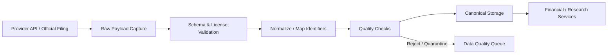

# DATA_PIPELINE：数据源、接入流程、数据质量与 PIT

> 本文件由《全球股票投资研究系统：产品需求与工程实施规格书》v1.5 拆分而来，**自此成为该部分内容的权威来源**。章节编号沿用原规格书；正文中的“见 X.Y / 第 N 节”请通过 [README.md](README.md) 的章节映射定位到对应文件。

> 原第 12 节中的 12.6（跨市场财务概念标准化）见 [DATA_MODEL.md](DATA_MODEL.md)，故本文件小节编号从 12.5 直接跳到 12.7。

## 12. 数据源实施策略

供应商选择应遵循“覆盖 × 数据质量 × 授权 × 成本 × 稳定性”的评分框架。MVP 不锁定单一全球供应商。

### 12.1 建议的数据源类别

| 类别 | 起步候选 | 适用范围/注意事项 |
|---|---|---|
| 美国公司披露 | SEC EDGAR / data.sec.gov | 官方 submissions 与 XBRL company facts；需遵守 SEC fair-access、请求频率和 User-Agent 要求 |
| 美国宏观 | FRED / ALFRED | 宏观数据与历史修订/实时期间信息；检查每个序列的数据发布和使用条件 |
| 证券标识映射 | OpenFIGI | 可用于 ticker、ISIN 等标识符映射；免费额度/限流和映射结果需检查 |
| 全球行情/基本面候选 | Twelve Data、EODHD、其他商业供应商 | 先对目标市场、字段、延迟、历史长度、商业使用和再分发授权做 PoC 与合同核验 |
| 官方公告 | 各交易所、监管机构、发行人 IR 网站 | 作为重要证据来源；需要各站点适配器和合规抓取策略 |
| 新闻/电话会 | 经授权的新闻/文字数据商、发行人材料 | 不能默认抓取付费墙内容，也不能未经许可长期保存全文 |

#### 12.1.1 MVP-1 数据源职责（美国市场）

| 数据源 | 主要职责 | 不应假定的能力 |
|---|---|---|
| SEC EDGAR | 发行主体、CIK、SIC、申报文件、submissions（含 `acceptanceDateTime`）、XBRL Company Facts | 不保证 Company Facts 覆盖所有自定义标签或所有所需财务项目 |
| OpenFIGI | FIGI 与外部证券标识映射 | 不作为完整、无缺失的历史证券主数据库 |
| 单一行情 Provider | 日线行情、复权因子、分红/拆股（以实际套餐为准） | 不得假定所有交易所、退市证券和公司行动均有完整覆盖 |

**SEC 数据完整性：** Company Facts 未覆盖的自定义 taxonomy 或关键项目，MVP-1 只做到**识别缺失并在 `data_quality_issues` 中标记**；从原始 Filing / XBRL instance 补充解析延后至 MVP-1 之后。必须保存 accession number、form、filing date、`accepted_at`、period end、taxonomy/concept、单位和原始来源。

#### 12.1.2 行情供应商选型门槛

不得由 AI 编程智能体自行选定供应商。由项目负责人完成 PoC 比较并签署许可审查（ADR-0005）。至少比较：

1. 美股覆盖及证券类型范围；
2. 历史 OHLCV 覆盖年限；
3. 原始价格与复权价格是否均可获取；
4. 分红、拆股和其他公司行动数据；
5. 退市证券和历史证券数据覆盖；
6. API 速率限制、分页方式和批量查询能力；
7. 延迟、可用性、历史数据修订机制；
8. 个人、内部、商业使用和再分发许可；
9. 数据保存期限、缓存限制和衍生数据使用限制；
10. 费用、SLA 和供应商锁定风险。

**未完成许可审核的 Provider 不得接入正式环境。** 开发与测试使用 Mock Provider 和明确标记的 fixture。

### 12.2 Provider Adapter 接口

每个数据供应商适配器必须实现明确的标准接口，不允许在业务层直接调用供应商 SDK。

```python
from typing import Protocol, Any
from datetime import date, datetime

class MarketDataProvider(Protocol):
    provider_name: str

    async def get_daily_bars(
        self,
        provider_symbol: str,
        start_date: date,
        end_date: date,
        adjusted: bool = False,
    ) -> list[dict[str, Any]]: ...

class FundamentalDataProvider(Protocol):
    provider_name: str

    async def get_company_facts(
        self,
        provider_entity_id: str,
        as_of: datetime | None = None,
    ) -> dict[str, Any]: ...

class FilingProvider(Protocol):
    provider_name: str

    async def list_filings(
        self,
        provider_entity_id: str,
        filing_types: list[str] | None = None,
        from_date: date | None = None,
    ) -> list[dict[str, Any]]: ...
```

以上是接口示意。实际实现需用 Pydantic DTO 替换裸 `dict`，并统一超时、重试、限流、错误码、来源元数据和数据许可校验。

### 12.3 数据接入流程



每次 ingest 至少记录：
- provider、endpoint、request parameters（敏感字段脱敏）；
- `requested_at`、`received_at`；
- `published_at`（如来源提供）；
- 原始 payload 的 hash；
- 标准化版本；
- 许可范围/授权标识；
- 错误、警告和质量检查结果。

### 12.4 数据质量规则

- 不允许把缺失值自动变成 0。
- 不允许把不同币种的金额直接比较。
- 不允许混用股数、千股、百万股或不同金额单位。
- 不允许把季度、半年、年度期间直接当成同一期间比较。
- 必须记录财报版本、原始报表和标准化口径。
- 财务数据需要明确 GAAP/IFRS/本地准则及供应商标准化口径。
- 行情必须区分原始价格、拆股调整价格、股息调整价格和 total-return 口径。
- 同一指标多源冲突时进入冲突队列，不得静默覆盖。
- 数据过期或缺失应阻止依赖该数据的指标计算，或在结果中明确降级。
- 证券退市、合并、代码变更和停牌状态必须保留历史记录。

### 12.5 Point-in-Time 数据规范

所有可能进入历史研究的事实数据，至少记录：

- `period_start` / `period_end`：数据所属期间；
- `published_at`：来源公开发布时间；
- `accepted_at`：监管系统接受时间（如 SEC `acceptanceDateTime`，可用时）；
- `observed_at`：系统首次观测到数据的时间；
- `ingested_at`：系统入库时间；
- `valid_from` / `valid_to`：信息在现实世界中的有效区间（适用时）；
- `source_id` / `provider_id`；
- `revision_id` / `supersedes_id`（适用时）。

历史研究查询必须使用 `published_at <= research_as_of`，并根据当时可知的数据版本选择记录。若来源不提供发布时间，必须标记时间可信度较低，不能假装其具备精确 PIT 能力。不能用今天下载到的修订值冒充历史时点已知值。

**SEC 时点规则（ADR-0015）：**
- `period_end` 不等于市场可用时间；SEC 财务事实的 `published_at` 取对应 filing 的 `acceptanceDateTime`（来自 submissions）。
- 只有日期（如 Company Facts 的 `filed`）而无时间戳时，保守地视为**下一个交易日开盘**才可用，并标记 `pit_precision = 'date'`。
- **盘前 / 盘中 / 盘后规则（v1.6，ADR-0015）：** `published_at` 始终记录 `acceptanceDateTime` 原值。对依赖价格的计算，受理时间在美东 09:30 之前的事实自当日开盘起可用；09:30 及之后（盘中、盘后、非交易日）的事实自下一交易日开盘起可用。交易日历使用锁定版本的 `exchange_calendars`（XNYS），写入 `market_calendars`，每年对照 NYSE 公布的休市安排核对一次。
- 重述或修订的财务事实以新版本追加（`supersedes_id` 指向旧版本），禁止覆盖历史已知事实。

### 12.7 股票池灌库与筛选数据底座（MVP-1，v1.4）

筛选器（2.1）依赖全市场已标准化的财务指标，必须有显式的灌库机制：

- **筛选范围：** 筛选只在已灌库（存在对应 `financial_metrics`）的证券上运行；结果必须返回 `universe_coverage`（目标池总数、已灌库数、缺失数及原因），不得把未灌库证券当作"不满足条件"。
- **灌库任务：** 由 `scheduler` 触发 `universe_sync` 周期任务（不走 Research Run 状态机，不产生 `run_id`）：先以 SEC `submissions` 确定美国普通股目标池（按 form type 排除 20-F / 6-K 发行人），再分批拉取 Company Facts。必须使用限速器遵守 SEC fair-access，支持断点续传（以 `ingest_log` 判定已完成批次），失败项写入 `data_quality_issues`。
- **行情配额：** 行情 Provider 配额不足以覆盖全池时，按优先级拉取：Watchlist > 近期研究过的证券 > 其余；筛选结果必须标注每只证券的价格日期，价格过期者标记而非隐藏。
- **幸存者偏差：** 12.1.2 第 5 项（退市证券覆盖）若不满足，历史（PIT）筛选结果必须附带 `survivorship_bias_risk = true` 并在界面与报告披露，不得宣称无幸存者偏差。
- **容量记录：** Phase 2 PoC 必须记录目标池证券数、`financial_facts` 行数、完整灌库耗时与 Provider 配额消耗，作为部署规格与许可审查的输入。

### 12.8 行情修订与原始数据留存策略（MVP-1，v1.4）

- **行情只追加：** `market_bars` 禁止 UPDATE / DELETE。供应商修订（含拆股后复权价格的全量回溯调整）以更大的 `revision_no` 追加新行。快照选取行情时按 `observed_at <= observed_at_cutoff` 取每根 bar 的最新 revision，`observed_at_cutoff` 记录在快照 `range_ref_json` 中，因此快照可在行情被修订后仍然复现。
- **原始响应留存分级：** `raw_payloads.retention` 取值 `stored`（保存 `payload_json`，可回放；适用于许可明确的来源，如 SEC 公开数据）或 `hash_only`（`payload_json` 为空，仅保留 `payload_hash`、`ingest_log` 与标准化结果）。**供应商许可未明确允许保存原始响应前，该供应商一律使用 `hash_only`。** `hash_only` 下不可回放原始响应，但标准化记录与数据快照仍可复算。
