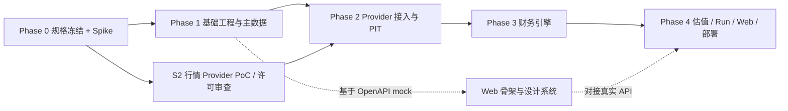

# ROADMAP：三档交付、Epic、实施规划与发布定义

> 本文件由《全球股票投资研究系统：产品需求与工程实施规格书》v1.5 拆分而来，**自此成为该部分内容的权威来源**。章节编号沿用原规格书；正文中的“见 X.Y / 第 N 节”请通过 [README.md](README.md) 的章节映射定位到对应文件。

> 三档交付定义见 [PRD.md](PRD.md) 的 0.3 节。

## 34. Epic 划分

### EPIC 0 — 项目初始化与开发规范（MVP-1）

- [ ] 建立 Monorepo 目录结构。
- [ ] 配置 Python 包管理（建议 uv）和 TypeScript 包管理。
- [ ] 建立 lint、format、type check、pytest、frontend test。
- [ ] 建立 GitHub Actions 或等价 CI。
- [ ] 建立 `.env.example` 和 Secret 使用规范。
- [ ] 建立 ADR（Architecture Decision Records）目录，录入第 39 节 ADR 评审稿。
- [ ] 建立 `AGENTS.md`（AI 编程智能体共同规则，见 37.1）与引用它的 `CLAUDE.md`。
- [ ] 定义 API、数据库迁移和代码版本策略。

**验收：** 新开发者可按 README 在干净环境启动服务并通过基础测试。

### EPIC 1 — 数据库与主数据（MVP-1）

- [ ] 建立 PostgreSQL（启用 `pgcrypto` 与 `btree_gist`）和 Alembic。
- [ ] 建立 Issuer、Security、Listing、Venue、Identifier（含排他约束与引用完整性触发器）。
- [ ] 建立 Currency、Provider、Data Source、Raw Payload、Ingest Log。
- [ ] 建立 Data Snapshot 与 Snapshot Items（含不可变触发器）。
- [ ] 建立 Workspace/User/Role 基础结构与单用户登录。
- [ ] 编写证券消歧服务。
- [ ] 接入 MIC 和标识符映射导入流程。
- [ ] 添加退市、停牌、ticker 变化和有效期字段。

**验收：** 同一 ticker 在不同交易场所不会冲突；同一交易场所内同一 ticker 的有效期区间不可重叠（`listings` 的 GIST 排他约束生效）；同一外部标识符在同一时间段内不可重叠映射；关联不存在实体的 identifier 插入会被触发器拦截。

### EPIC 2 — Provider Adapter 与数据治理（MVP-1）

- [ ] 定义 Market/Fundamental/Filing/Identifier Provider Protocol（Macro/News 留接口不实现）。
- [ ] 实现 HTTP Client、超时、重试、退避、限流和缓存。
- [ ] 实现原始响应留存（`raw_payloads` 去重 + `ingest_log` 事件）。
- [ ] 实现 OpenFIGI Adapter。
- [ ] 实现数据来源和许可登记（含 `system_mock` / `manual_import` 默认来源种子）。
- [ ] 实现行情数据 Adapter（一家已签署许可审查的美股 Provider，强制关联 `source_id`），含公司行动与复权口径。
- [ ] 实现 SEC EDGAR Adapter（submissions + Company Facts，保存 `acceptanceDateTime`）。
- [ ] 实现两层标准化财务概念映射（`canonical_concepts` 40 项标准概念与 `taxonomy_mappings` 符号/单位转换）。
- [ ] 实现数据质量校验与冲突队列。
- [ ] 实现 PIT 查询接口（含日期精度的下一交易日规则）。
- [ ] 实现美股股票池灌库（`universe_sync`，见 12.7）：目标池确定、限速、断点续传、`universe_coverage` 与容量记录。
- [ ] 实现行情只追加修订与快照 `observed_at_cutoff` 选取（12.8），以及 `raw_payloads.retention` 的许可联动。

**验收：** 数据从供应商进入数据库后可追溯到原始来源，费用与 Capex 符号按约定统一为正数；PIT 测试通过。

### EPIC 3 — 财务计算引擎（MVP-1）

- [ ] 建立财务指标目录和计算版本。
- [ ] 实现营收、利润、现金流、利润率、ROE、ROIC、净负债等指标。
- [ ] 统一季度/年度/TTM 期间处理（含 YTD 推导单季度，见 17.0）。
- [ ] 统一单位、币种和股份口径。
- [ ] 实现加权平均股数与期末股数分离、稀释股数代理口径（12.6）和股权稀释分析。
- [ ] 实现确定性风险指标（20.1）。
- [ ] 为所有指标建立公式文档和测试。

**验收：** 给定固定财务事实快照，指标计算可重复、可解释。

### EPIC 4 — 估值引擎（MVP-1）

- [ ] 实现估值引擎 Pre-flight Check（PASS / WARN / BLOCK + 原因码；行业适用性、核心字段缺失、WACC 输入、次要字段降级、数学边界）。
- [ ] 实现 WACC 等估值假设的录入、确认与保存（`valuation_assumptions`）。
- [ ] 实现 FCFF DCF（SBC 不加回，18.1.2）。
- [ ] 实现 Bear/Base/Bull 场景。
- [ ] 实现 WACC × Terminal Growth 敏感性矩阵。
- [ ] 实现 Reverse DCF（单变量求解收入增长率，18.2）。
- [ ] 实现 PE TTM、Latest FY PE 和 EV/EBITDA 相对估值，以及 SIC 候选 + 用户确认的 Peer Set。
- [ ] 实现模型输入快照和模型版本记录。

**验收：** 估值结果不依赖 LLM 直接计算；面对缺失值或银行股等异常输入不抛 500 错误，准确返回结构化状态；同一输入与版本数值一致。

### EPIC 5A — 研究 Run 与异步任务基础设施（MVP-1）

- [ ] 实现 ResearchRun、ResearchTask 和第 22 节状态机（含 `retry_wait`、`skipped`）。
- [ ] 实现 Celery Worker 与 Redis Queue。
- [ ] 实现接口幂等、阶段重试 Clean-before-Write 幂等、心跳更新与 Scheduler 僵尸任务回收（Reaper Job）。
- [ ] 实现 MVP-1 阶段编排（`resolve_instrument` → … → `report_assembly`），不含 Agent。

**验收：** 研究 Run 可异步运行，Worker 崩溃或超时可被自动检测回收；不配置任何 LLM 也能完成。

### EPIC 5B — Agent 研究（MVP-2）

- [ ] 定义 Agent 输入/输出 Pydantic Schema。
- [ ] 实现 `fetch_filing_section`（23.1）。
- [ ] 实现 Orchestrator（支持根据估值 Pre-flight 结果自动降级或要求 Agent 修正不合规假设）。
- [ ] 实现 Company/Industry/Financial/Valuation/Risk Agent 节点。
- [ ] 实现结构化 Claim 和 Evidence 存储。
- [ ] 实现反方审查和未解决问题列表。
- [ ] 实现模型适配器、Token/成本记录和降级策略。
- [ ] 实现 `agent_invocations` 审计与 `token_budget` 适配器层强制（21.3、21.4）。
- [ ] 实现工具三级权限、污染上下文降权与 `confirmation_token`（21.1）。
- [ ] 实现 Claim / Evidence 语义校验（23.2）与报告数值占位符渲染器及数字扫描（4.3.2）。

**验收：** 含 Agent 阶段的研究 Run 可完成；任何 Agent 输出不符合 Schema 时不能静默进入最终报告。

### EPIC 6 — 报告与独立 Web（MVP-1；定性章节展示属 MVP-2）

- [ ] 实现 Overview。
- [ ] 实现 Instrument Search / Resolve。
- [ ] 实现 Stock Screener。
- [ ] 实现 Company Detail。
- [ ] 实现登录页。
- [ ] 实现 Research Run 页面。
- [ ] 实现 Valuation 页面（展示 Pre-flight 状态与降级警告）。
- [ ] 实现 Report Viewer。
- [ ] 实现 Watchlist。
- [ ] 实现 MVP-1 确定性报告模板（4.3.1），支持 Markdown/HTML 导出。
- [ ] 页面显示数据日期、来源和缺失项。

**验收：** 不使用任何 LLM、MCP 或 Harness，也能从 Web 完成一家美国公司的研究并查看报告。

### EPIC 7A — REST API（MVP-1）

- [ ] 建立 REST API v1。
- [ ] 建立统一错误结构和单用户会话鉴权。
- [ ] 建立 OpenAPI 自动生成与 REST 契约回归测试。

**验收：** Web 与外部 HTTP 客户端可完成证券识别、筛选、创建研究 Run、查询状态、估值和读取报告。

### EPIC 7B — MCP（MVP-2）

- [ ] 建立 MCP Server 与 scoped API Key / OAuth。
- [ ] 暴露 26.1 所列 12 个 MCP 工具。
- [ ] 为工具添加输入输出 Schema 和权限要求。
- [ ] 实现异步研究 `run_id` 轮询模式。
- [ ] 使用 MCP Inspector 或其他兼容工具测试。
- [ ] 建立工具契约回归测试。

**验收：** 外部客户端可完成证券识别、创建研究、查询任务和读取报告。

### EPIC 8 — DeepSeek Harness 接入（MVP-3）

- [ ] 锁定目标 DeepSeek Harness 版本/Commit。
- [ ] 阅读并记录官方 Cordis、Tool 和 MCP Client 文档。
- [ ] 创建 Harness Bundle / 配置适配层。
- [ ] 连接 GEI MCP Server。
- [ ] 映射研究和估值工具。
- [ ] 将 run_id、状态和报告链接呈现给 Agent。
- [ ] 编写安装、配置、卸载和故障排查说明。
- [ ] 编写 Harness 版本升级 smoke test。

**验收：** Harness 能连接外部 GEI 服务并调用核心工具；关闭 Harness 不影响 GEI。

### EPIC 9 — 安全、部署、备份与发布（MVP-1）

- [ ] 编写本地 Docker Compose。
- [ ] 编写生产 Docker Compose。
- [ ] 建立 Caddy/Traefik TLS 配置。
- [ ] 建立数据库迁移和备份命令。
- [ ] 建立数据恢复演练脚本。
- [ ] 建立 Session 管理（MVP-1）与 API Key 管理（MVP-2）。
- [ ] 建立审计日志。
- [ ] 建立安全检查、依赖漏洞扫描。
- [ ] 编写 Windows 部署指南。
- [ ] 编写 Linux 服务器部署指南。

**验收：** 在干净 Windows Docker 环境和干净 Linux 服务器环境中均能按文档完成部署与恢复。

### EPIC 10 — 后续增强（MVP-3 之后）

- [ ] 新增港股/A 股/欧洲/日本等市场 Provider。
- [ ] 新增 SOTP、PB/ROE、FFO 及银行/保险/REIT 专用模型。
- [ ] 新增 ADR 与外国私人发行人（20-F / 6-K）支持。
- [ ] 新增分析师预期 Provider、Forward PE / PEG、CAPM/WACC 推导。
- [ ] 新增从原始 XBRL instance 补充解析自定义 taxonomy。
- [ ] 新增宏观数据（FRED/ALFRED）与授权新闻源。
- [ ] 新增完整组合风险、相关性、压力测试。
- [ ] 新增历史回测（需先通过 PIT 验收）。
- [ ] 新增宏观和行业事件驱动监控。
- [ ] 新增邮件/消息通知。
- [ ] 新增更多 Agent Host 适配器。

## 41. 实施规划补充（v1.5）

本节为规划建议，所列阈值与时间盒均为**建议值**，须在 Phase 0 评审时由项目负责人确认或调整，AI 编程智能体不得自行当作已决定事项。

### 41.1 关键路径

1. **ADR-0005 行情供应商许可审查**是 Phase 2 正式接入的唯一外部阻塞项，应在 Phase 1 开始时就并行启动 PoC，不得等到 Phase 2 才开始。
2. **ADR 状态**：ADR-0003、0006、0007、0010、0012、0015、0016、0017 直接决定数据库与估值引擎的形状，必须在 Phase 1 开始前为 `accepted`；其余 ADR 最晚在各自相关 Phase 开始前 `accepted`。
3. **Golden fixture 的独立复核**（见 41.4）是 Phase 3、4 的前置条件。

### 41.2 Phase 0 去风险验证（Spike）

Phase 0 不写业务代码，但应完成下列以小样本验证为目的的 Spike，结论写入对应 ADR 或开放问题登记。

| Spike | 目的 | 建议样本 | 通过标准（建议） | 建议时间盒 |
|---|---|---|---|---|
| S1 SEC 数据可行性 | 验证 40 个概念能否稳定映射，`ebit` 回退、TTM / YTD 推导可行 | 约 30 家美股：含亏损企业、财年非自然年、有重述、银行 / 保险 / REIT、自定义 taxonomy 较多者 | 非金融样本中 `revenue` / `ebit` / `shares_outstanding` 可得率达到约定阈值（建议 ≥ 95%）；全部缺失项能被识别并落入 `data_quality_issues` | 2–3 天 |
| S2 行情 Provider PoC | 按 12.1.2 十项标准评分，决定 ADR-0005 | 2–3 家候选 | 十项评分表完成；许可条款（存储、衍生、LLM、再分发）逐条核对 | 与 Phase 1 并行 |
| S3 PIT 夹具 | 构造 PIT 与重述的最小可复现案例 | 至少 3 个：有 `acceptanceDateTime`、仅有 `filed` 日期、被重述的事实 | 夹具能表达“研究时点前后读到不同版本”，并可作为自动化测试的种子 | 1–2 天 |
| S4 容量估算 | 估计目标池规模与灌库耗时 | SEC 全美股目标池 | 记录证券数、`financial_facts` 行数、完整灌库耗时、行情配额消耗，写入 12.7 | 1 天 |
| S5 估值金标准 | 防止“实现与测试一起错” | 3 个手算案例（正常、高终值占比、含租赁与少数股东权益） | 由与实现者无关的人用电子表格独立复算，结果一致后才作为 golden fixture | 1–2 天 |

### 41.3 阶段依赖与并行



- Web 骨架与设计系统可在 Phase 1 之后基于 OpenAPI mock 并行推进，但不得先于 REST 契约冻结。
- Phase 3 的 golden fixture 与 Phase 2 的 PIT 测试互相独立，可并行编写。
- M1-a（Phase 1–3）通过后才进入 M1-b（Phase 4），见 0.3。

### 41.4 各 Phase 的可度量退出准则

| Phase | 退出准则（须有自动化证据） |
|---|---|
| Phase 0 | 关键 ADR 全部 `accepted`；S1–S5 结论入档；开放问题均有负责人、影响范围和阻断策略；文档无互相矛盾的口径 |
| Phase 1 | 迁移可从空库一键建立；排他约束、触发器、只追加表的测试全部通过；单用户登录与 `/health/ready` 可用；CI 绿色 |
| Phase 2 | SEC / OpenFIGI / Mock Provider 端到端入库；`ingest_log` 与 `raw_payloads` 满足 12.8；PIT 与重述测试通过；`universe_sync` 可断点续传 |
| Phase 3 | golden fixture 全部通过且经独立复核；TTM / YTD / 股数口径 / 符号约定测试通过；风险指标可复算 |
| Phase 4 | 33.1 MVP-1 清单全部勾选并附证据；关闭所有 LLM 配置后 E2E 全绿；Windows 与 Linux 部署及恢复演练通过 |

### 41.5 非功能指标（建议值，待 Phase 0 评审）

| 项 | 建议目标 |
|---|---|
| 估值 API（同步，数据已入库） | p95 < 2 秒 |
| 筛选（全池，数据已入库） | p95 < 5 秒 |
| 研究 Run 端到端（数据已入库） | 5 分钟内完成 |
| 首次研究新证券（含数据拉取） | 受 Provider 限速约束，进度必须可见，不设固定上限 |
| 备份与恢复 | 每日备份；RPO ≤ 24 小时；RTO ≤ 4 小时；每季度演练 |
| 可用性 | 单机部署不设 SLA，须有健康探针与自动重启 |

### 41.6 测试数据策略

- **三类数据严格分开：** 真实供应商数据（受许可约束，不入 Git）、Mock / fixture（明确标记，可入 Git）、合成极端案例（负利润、零股数、TTM 缺季度等边界）。
- **独立复核的金标准：** 估值与关键指标的 golden fixture 必须经非实现者独立复算（S5），修改 fixture 须附变更原因，禁止为通过测试而改期望值。
- **回归基线：** 每个模型版本、概念映射版本、Pre-flight 规则版本变化时，必须保留旧版本 fixture 的结果快照，差异需要人工确认。
- **Agent 阶段（MVP-2）：** 用录制回放（recorded LLM responses）做确定性回归，真实模型调用只用于少量评测集，且评测结果不得作为通过 / 失败的唯一依据。
| 范围同时铺开 | 基础数据层未验证即产生大量依赖 | MVP-1 零 LLM 依赖；每档独立验收后才进入下一档 |

# 附录 A：MVP 发布定义

GEI MVP 不以“能生成一份看起来专业的股票报告”作为完成标准。每档只有以下链路完整闭环，才算该档完成：

```text
MVP-1（零 LLM）
证券识别
  -> 数据拉取与两层概念标准化
  -> 数据质量验证
  -> 点时快照
  -> 财务指标计算
  -> 估值模型（含 Pre-flight Check）
  -> 确定性风险指标
  -> 确定性报告生成
  -> 研究档案保存
  -> Web / REST 查询

MVP-2（在 MVP-1 之上）
  -> 公司与行业研究（受控 Filing 检索）
  -> 风险反方审查
  -> 证据核验
  -> MCP 查询

MVP-3（在 MVP-2 之上）
  -> DeepSeek Harness 调用
```

任一环节缺少来源、时间、单位、币种、权限或可复现信息，系统都必须明确显示限制，不能用大模型生成的文字掩盖数据缺陷。
