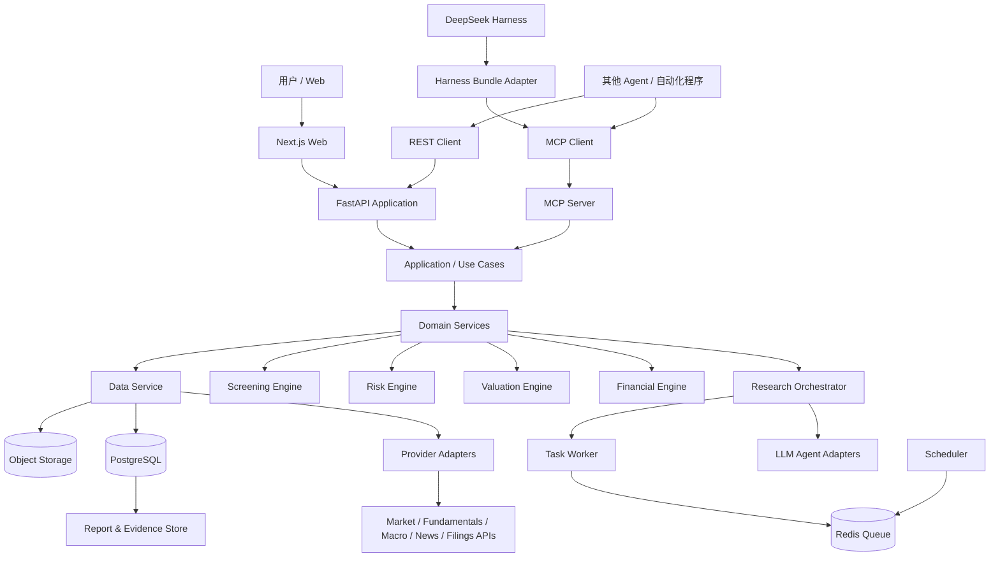
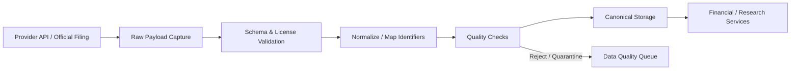
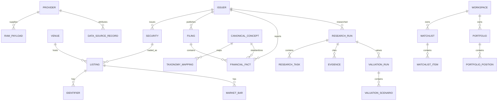
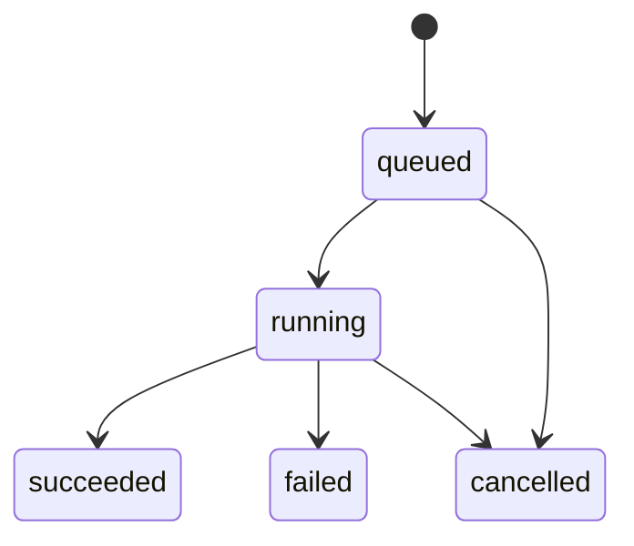
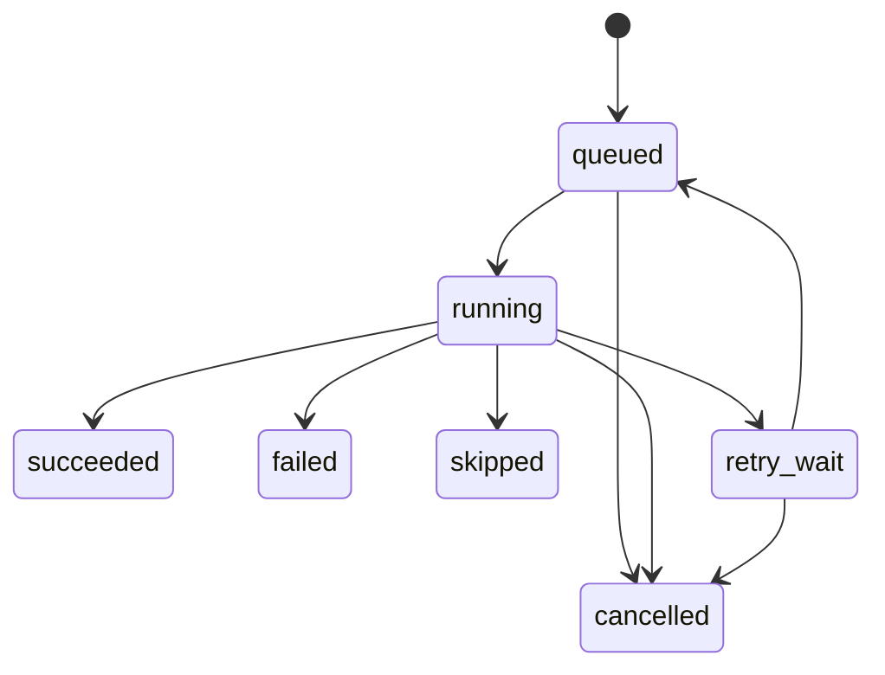
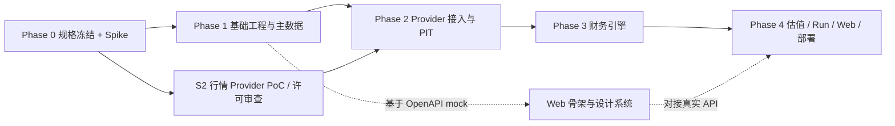

> **已归档（v1.5 拆分前的单文件版本）。** 仅作历史参考，**不再是权威来源**。当前权威文档见 [../README.md](../README.md)。

# 全球股票投资研究系统：产品需求与工程实施规格书

> **文档版本：** v1.5  
> **基准日期：** 2026-11-04  
> **项目代号：** Global Equity Intelligence（GEI）  
> **文档用途：** 可直接交给 Codex、Claude Code、DeepSeek Harness Creator Mode 等编程智能体，作为产品设计、代码生成、工程实现和验收依据。  
> **状态：** MVP 工程基线；实施前需针对所选数据供应商、交易所覆盖和授权条款完成最终核验。  
> **权威性：** 本文件是唯一权威规格。`docs/修订建议书.md` 已合入本版本，仅作历史参考。

## 修订记录

| 版本 | 日期 | 主要变更 |
|---|---|---|
| v1.0 | 2026-11-04 | 初始工程规格 |
| v1.0.1 | 2026-11-04 | 合入 5 项加固：两层财务概念映射、DDL 生产级约束、估值 Pre-flight、双层幂等、僵尸任务回收 |
| v1.1 | 2026-11-04 | 合入《修订建议书》：MVP 三档交付（MVP-1 美股确定性产品 / MVP-2 Agent+MCP / MVP-3 Harness）；MVP-1 零 LLM 依赖；Pre-flight PASS/WARN/BLOCK + 原因码；统一 Run/Task 状态机；对外只暴露 `run_id`；数据快照与 `ingest_log`；WACC、SBC、SIC/Peer Set、Forward PE 口径决策；受控 `fetch_filing_section`；标准概念扩至 38 项并区分加权/期末股数；ADR 统一编号 |
| v1.2 | 2026-11-04 | 一致性与完整性修订：修正 §0 小节编号顺序（0.1→0.2→0.3）；统一 REST/MCP 入口字段名为 `horizon_years`，`sections` 示例值与 MVP-1 允许清单对齐（`risk_metrics`）；18.3 节 PB/ROE、PS 标注为 EPIC 10（MVP-1 不实现）；`listings` 增补 GIST 排他约束防 ticker 有效期重叠；删除未落地的冗余 `financial_periods` 表定义（期间信息并入 `financial_facts`）；`research_tasks.task_type`、`valuation_runs.model_type` 补充 `CHECK` 约束；Pre-flight 新增 `EFFECTIVE_TAX_RATE_UNAVAILABLE` / `EFFECTIVE_TAX_RATE_REPLACED_BY_USER_INPUT` 原因码并补充必测案例；明确 `retry_wait` 期间心跳顺延规则，避免 Reaper 误判合法退避中的 Run |
| v1.3 | 2026-11-04 | 可行性评估后的矛盾修复：§8 Docker Compose 服务表修正 `mcp` 必需性为"仅 MVP-2 起"，消除与 0.3 节"MVP-1 禁止依赖 MCP"的直接冲突；18.0.3 新增第 9 条 `NEGATIVE_OR_ZERO_EBITDA` 原因码，补齐 EV/EBITDA 的 EBITDA$\le 0$ 边界判定（此前只有 PE 有对应的 `NEGATIVE_EARNINGS`）并补充必测案例；16 节基线 DDL 补齐 `workspaces`/`users`/`workspace_members` 三表定义，`data_snapshots.workspace_id`、`research_runs.workspace_id` 补上缺失的 `REFERENCES workspaces(id)` 外键，不再是裸 `UUID` |
| v1.4 | 2026-11-06 | 文档分析后的缺口与矛盾修复：①估值假设（`valuation_assumptions`）改为独立于 `valuation_run`、先于快照创建，消除"快照↔假设↔估值运行"循环依赖，新增 18.1.3 规定创建顺序；②`POST /research-runs` 新增 `valuation_assumption_ids`，明确 Run 的 WACC/情景假设入口；③`POST /valuations` 明确为同步 Pre-flight + 确定性计算（200 / 422），新增 `POST /valuation-assumptions`；④`market_bars` 改为只追加修订（`revision_no` + 只追加触发器 + 快照 `observed_at_cutoff`），保证快照可复现；⑤`raw_payloads` 新增 `retention`（`stored` / `hash_only`），化解许可未决与"可回放"验收的冲突；⑥12.6 定义 `ebit` 取数与回退规则；⑦新增 18.3.1 相对估值输出定义与 `PEER_SET_*` 原因码；⑧REST / MCP 的 `sections`、`models` 取值彻底统一；⑨`research_tasks` 补 `heartbeat_at`；⑩幂等拆分为显式 `idempotency_key` 与自动 `request_fingerprint`（仅非终态唯一）；⑪Pre-flight BLOCK 的 Task 粒度改为按模型；⑫Forward PE/PEG 不落库；⑬`tax_rate` 假设结构与 WACC 一致；⑭新增 16.2 补充 DDL（corporate_actions、financial_metrics、peer_sets、fx_rates、auth_sessions、audit_logs 等）；⑮新增 12.7 股票池灌库与 12.8 行情修订/原始数据留存；⑯`data_collection` 阶段超时例外；⑰新增 MVP-1 内部里程碑 M1-a / M1-b；⑱主导航标注档位 |
| v1.5 | 2026-11-06 | Agent 架构审计与实施规划补充：①新增 21.1 Agent 工具权限与写保护（read / propose / write 三级，污染上下文代码级降权，写工具需 `confirmation_token`）；②新增 21.2 记忆与跨 Run 复用规则（默认无长期记忆，历史 Claim 不得作为事实输入）；③新增 21.3 LLM 调用审计（`agent_invocations`，重试不删除）；④新增 21.4 Run 级 token 预算与适配器层强制中止；⑤新增 23.2 Claim / Evidence 语义校验（防虚构引用与非原文引文）；⑥新增 4.3.2 报告数值由确定性渲染器注入、LLM 文本数字扫描；⑦`confidence` 改为 low / medium / high 枚举；⑧新增 ADR-0018 至 ADR-0020；⑨新增第 41 节实施规划（Phase 0 去风险验证、依赖与并行、退出准则、非功能指标建议值、测试数据策略）；⑩开放问题补充 #10–#12；⑪MVP-2 验收与 EPIC 5B 补充对应条目 |

---

## 0. 执行摘要

GEI 是一套面向全球股票市场的研究与决策支持系统。产品必须具备两种主要运行形态：

1. **独立使用：** Windows 本地 Docker 部署、Linux 服务器部署，提供 Web 研究工作台、数据管理、研究任务、估值、风险分析、自选股和持续跟踪。
2. **智能体接入：** 通过统一 REST API 和 MCP Server 开放研究能力；提供 DeepSeek Harness 原生插件/Bundle 作为宿主适配层。未来可接入其他兼容 MCP 或 HTTP 工具调用的智能体。

核心设计原则：

- **一个研究引擎，多种入口。** Web、MCP、Harness 插件不得各自实现一套财务和估值逻辑。
- **数据优先，模型其次。** 研究结论必须能追溯至来源、发布时间、数据快照和假设。
- **确定性计算与模型判断分离。** 数值计算由 Python 计算引擎执行；LLM 负责解释、假设建议、信息综合和反方审查。
- **全球数据模型先行，市场覆盖分期交付。** 数据模型从第一天支持多市场、多币种、多交易日历和不同财报口径；真实数据供应商按覆盖、成本和授权逐步接入。
- **点时数据（Point-in-Time）是基础能力。** 历史研究、回测和预测偏差评估不得使用当时尚未公开的数据。
- **人工保留最终投资决策权。** MVP 不下单、不自动交易、不承诺收益，不将 AI 评分直接转成交易指令。
- **模块化单体优先。** 初期使用清晰分层的模块化单体和独立 Worker，避免过早引入微服务复杂度。

### 0.1 已确认的业务配置

| 配置项 | 已确定要求 |
|---|---|
| 部署模式 | Windows 本地 Docker + Linux 远程服务器双模式 |
| 市场范围 | 全球市场；先建立全球化模型，再按市场逐步接入数据 |
| 数据策略 | 免费/开源数据 + 付费 API + 官方披露的混合模式 |
| 自动化程度 | 自动采集、研究、估值、风险分析、监控和报告；人工最终决策 |
| 投资风格 | 价值投资 + 成长投资兼顾；提供可配置的 Balanced / Value / Growth 研究配置 |
| 投资周期 | 以 1—3 年为主要研究期限 |
| 接入方式 | 独立 Web、REST API、MCP、DeepSeek Harness 原生适配 |
| 首版市场 | MVP-1 只实现美国市场纵向切片（NYSE / NASDAQ / NYSE American 美国普通股）；港股、A 股数据模型保留兼容性，Provider 与财务适配延后至 EPIC 10；系统架构不得限制其他市场 |
| 首版产品 | 分三档交付，见 0.3 |

### 0.2 非目标（MVP 不做）

- 自动连接券商并执行买卖指令。
- 高频交易、实时做市、订单簿级别策略和低延迟交易。
- 自主训练基础金融大模型。
- 未经授权抓取、存储或再分发付费数据。
- 用 LLM 猜测缺失财务数据、伪造分析师一致预期或生成无来源的新闻事实。
- 一开始覆盖所有国家的所有交易所、所有证券类型和所有数据字段。
- 直接把“综合评分”解释为买入、卖出或收益保证。

### 0.3 MVP 三档交付（v1.1）

> **最高优先级架构约束：** 先做出一个不依赖 LLM、数据可追溯、财务可复算、估值可校验、可以独立部署的美股研究产品；再在其上叠加 Agent 和 MCP；最后接入 DeepSeek Harness。

| 档位 | 目标 | 纳入 | 运行依赖 |
|---|---|---|---|
| **MVP-1** 美股确定性研究产品 | 无 LLM 即可完成筛选、财务分析、估值、报告与追溯 | 证券主数据与消歧；SEC EDGAR + OpenFIGI + 一家完成许可审查的行情 Provider；Raw Payload / Ingest Log / 数据质量 / PIT；两层财务概念映射；财务指标（FY / 季度 / TTM）；DCF（FCFF）、Reverse DCF、PE TTM、Latest FY PE、EV/EBITDA；Pre-flight；Bear/Base/Bull 与敏感性；股票筛选；确定性风险指标（见 20.1）；Watchlist；确定性报告模板（见 4.3.1）；数据快照；REST API；独立 Web；单用户鉴权；基础异步 Worker / Scheduler（数据拉取、估值、报告任务，含幂等与僵尸任务回收）；Windows / Linux Docker 部署 | PostgreSQL、Redis；**禁止依赖任何 LLM、MCP、Harness** |
| **MVP-2** AI 研究与 MCP | 让智能体在受控边界内调用已验证的确定性能力 | Research Orchestrator；Company / Financial / Valuation / Risk Agent 节点；Risk Agent 反方审查与证据核验；结构化 Claim / Evidence / Assumption；受控 `fetch_filing_section`（见 23.1）；报告中的定性章节；MCP Server | MVP-1 + LLM Provider |
| **MVP-3** DeepSeek Harness 适配 | 把既有 MCP 能力接入 Harness，不搬运核心逻辑 | Harness Bundle / 插件、MCP 连接与工具映射、工具权限与交互、任务状态与报告展示、版本兼容 smoke test | MVP-2 |

**MVP-1 明确不纳入：** 非美国市场真实 Provider；ETF、期权、债券、权证、OTC；ADR 与外国私人发行人（申报 20-F / 6-K 的发行人按 form type 排除），相关字段（如 `adr_ratio`）仅预留；分析师一致预期与 Forward PE / PEG；自动 CAPM / WACC 推导；PB/ROE、FFO 等行业专用模型；组合风险、相关性与压力测试；任何 Agent、LLM、MCP、Harness 功能。

**验收原则：** 每档只验收本档范围（见第 33 节）。MVP-1 不得因 Agent、MCP 或 Harness 尚未完成而判定失败。未经用户或项目负责人确认，不自动进入下一档。

**MVP-1 内部里程碑（v1.4）：** MVP-1 体量较大，内部划分两个检查点，不改变 MVP-1 的整体验收范围。**M1-a（Phase 1–3）：** 数据层 + 财务引擎，可通过 REST API 对单只美股得到标准化财务事实、财务指标与确定性风险指标，PIT 与快照测试通过；不含估值与 Web。**M1-b（Phase 4）：** 估值与 Pre-flight、Run 编排、报告、Web、双平台部署与备份恢复。M1-a 未通过时不进入 M1-b。

---

# 第一部分：产品需求文档（PRD）

## 1. 产品目标与成功标准

### 1.1 产品目标

GEI 帮助个人投资者或研究人员完成全球股票投资研究工作流：

1. 发现宏观与产业趋势；
2. 从全球股票池筛选候选企业；
3. 进行商业模式、竞争优势、财务质量和成长性研究；
4. 使用可解释的估值模型判断价格与价值之间的关系；
5. 识别公司风险、市场风险和组合风险；
6. 保存研究逻辑、来源证据、模型参数与研究快照；
7. 在财报、价格、公告或关键经营指标变化时触发再研究；
8. 将研究能力以统一接口提供给外部 Agent。

### 1.2 产品成功标准

按交付档位分别满足（详细验收见第 33 节）：

**MVP-1**
- 用户可以在独立 Web 平台解析并打开一只美国普通股的正确上市证券，而不是只靠 ticker 猜测。
- 可以对美股股票池执行可复现的筛选，并说明数据缺失情况。
- 可以创建研究 Run，任务异步执行、可查询状态、可失败恢复。
- 报告中的关键数值能追溯到标准化数据记录和数据快照。
- DCF 和相对估值由确定性代码计算，同输入同版本产生同输出。
- 估值报告包含 Bear / Base / Bull 情景、假设、敏感性、Pre-flight 结果、数据日期和局限性。
- 关闭所有 LLM API 后，以上功能全部可用；本地 Docker 部署无需 MCP / Harness 即可完整运行。
- 测试证明 PIT（历史时点）查询不会读取研究时点之后公开的数据。

**MVP-2**
- 关键观点能追溯到引用证据，或明确标注为分析判断。
- Risk Agent 能提出反方观点，并能标记无法验证的主张。
- MCP 客户端能发现并调用核心工具。

**MVP-3**
- Harness 插件只负责接入和呈现，不包含核心财务算法；禁用插件不影响 GEI。

### 1.3 核心用户与权限

| 用户类型 | 核心需求 | 权限建议 |
|---|---|---|
| Owner / Admin | 部署、数据源配置、权限、备份、全局设置 | 全部管理权限 |
| Researcher | 筛选、研究、估值、风险分析、报告 | 研究读写权限 |
| Viewer | 查看研究报告和仪表盘 | 只读权限 |
| Agent / Service | 通过 MCP/API 执行授权工具 | 按 API Key Scope 限定权限 |

MVP 可先实现单用户模式，但数据库和接口应预留 `workspace_id` / `user_id`，不能把所有数据设计成无法迁移的全局单例。

## 2. 核心使用场景与用户故事

### 2.1 全球股票筛选

作为研究者，我可以按市场、交易所、行业、币种、市值、营收增长、利润率、ROIC、负债水平、估值倍数、股息率和流动性筛选股票，并查看每项筛选条件的数据日期、来源与缺失率。

验收：
- 筛选支持组合条件（AND/OR）或明确限定 MVP 只支持 AND 条件。
- 查询结果返回 `listing_id`、公司名、当地 ticker、交易所 MIC、币种、指标值、数据日期。
- 缺失值不得自动视为 0；筛选规则必须声明 `exclude / include / fail` 行为。

### 2.2 公司深度研究

作为研究者，我可以输入公司名、ticker、ISIN 或 FIGI，系统先消歧，再研究指定的上市证券/发行主体。

研究内容至少包括：
- 商业模式与收入结构；
- 产品、客户、地域、供应链与行业位置；
- 护城河、竞争者、议价能力和技术替代风险；
- 管理层与资本配置；
- 三大财务报表、现金流质量、股本稀释和资本开支；
- 1—3 年增长驱动和关键变量；
- 主要风险、催化剂与投资逻辑失效条件。

验收：报告分开标识 **事实 / 来源证据 / 模型假设 / AI 分析判断**，不能混为一类。

### 2.3 估值与预期回报

作为研究者，我可以运行 DCF、Reverse DCF、PE、EV/EBITDA、PB/ROE、PS、SOTP（后续）和历史估值区间分析。

MVP-1 至少完成：
- DCF（FCFF 优先）；
- Reverse DCF（反推市场价格隐含假设）；
- PE（TTM、Latest FY）/ EV/EBITDA 相对估值；Forward PE、PEG 不支持（见 18.3）；
- Bear / Base / Bull 情景；
- WACC、永续增长率、收入增长率、利润率、再投资率等核心假设敏感性；
- 当前股价、合理价值区间、上行/下行空间和预期回报区间。

估值不得只返回一个无来源的“目标价”。所有模型应输出 `model_version`、输入数据快照、假设、币种、估值日和局限。

### 2.4 价值与成长双风格

系统必须支持三个研究 Profile：

| Profile | 侧重点 | 典型分析重点 |
|---|---|---|
| Balanced | 价值与成长均衡，默认 Profile | 企业质量、长期增长、估值、安全边际、风险 |
| Value | 价值导向 | 自由现金流、资产负债表、资本回报、估值折价、股东回报 |
| Growth | 成长导向 | TAM、增长持续性、市场份额、单位经济、再投资回报、稀释 |

默认使用 Balanced。分数权重均为可配置参数，不能在代码中写死为普遍真理。每次运行保存 Profile 版本和权重快照。成长公司不能因 PE 高而直接判为差；价值公司也不能仅因 PE 低而获得高分。

### 2.5 组合风险研究（EPIC 10）

> v1.1：组合风险整体延后至 EPIC 10。MVP-1 只提供单只证券的确定性风险指标（见 20.1）。

后续版本可允许用户手动创建虚拟持仓，不要求接银行/券商账户。需要计算：
- 单一股票、行业、国家/地区、币种集中度；
- 组合权重和暴露；
- 相关性矩阵（数据足够时）；
- 历史波动率、最大回撤、Beta（可用数据时）；
- 压力情景（利率冲击、汇率冲击、行业回撤等）；
- 流动性与数据质量风险。

### 2.6 持续监控

用户可对自选股设置监控条件：财报发布、公告、重大新闻、估值偏离、价格变化、关键财务指标变化、投资逻辑失效条件等。

MVP-1 先实现 Watchlist 与基于定时任务的事件记录（财报发布、价格与估值偏离），通知仅站内；邮件适配接口、新闻与投资逻辑失效监控后续再接。

## 3. 产品功能范围与优先级

> v1.1：以“交付档位”取代原 P0/P1 口径。MVP-1 列中的模块必须在 MVP-1 完成；其他档位不得成为 MVP-1 的运行依赖。

| 模块 | 交付档位 | 说明 |
|---|---|---|
| 用户、Workspace、配置 | MVP-1 | 单用户登录 + 远程部署强制 TLS；Schema 预留多 Workspace |
| 证券主数据 | MVP-1 | 发行主体、证券、上市、标识符分层；首批仅美国普通股 |
| Provider Adapter 框架 | MVP-1 | 不绑定特定供应商 |
| 原始数据留存与来源记录 | MVP-1 | `raw_payloads` + `ingest_log`，可回放、可追溯 |
| 市场行情 | MVP-1 | 一家完成许可审查的美股日线 Provider |
| 财务报表与标准化指标 | MVP-1 | SEC XBRL + 两层概念映射 |
| 官方披露 | MVP-1 | SEC EDGAR 元数据与 XBRL；文本章节检索属 MVP-2 |
| 新闻证据 | EPIC 10 | 需授权新闻源 |
| 宏观数据 | EPIC 10 | FRED/ALFRED 可作为美国宏观起点 |
| 股票筛选 | MVP-1 | 核心筛选条件和缺失值处理 |
| 研究 Run 与异步任务 | MVP-1 | 基础 Worker / Scheduler、状态机、幂等、僵尸任务回收 |
| 财务质量分析 | MVP-1 | 指标计算、异常提示 |
| DCF / Reverse DCF | MVP-1 | 确定性计算、测试覆盖 |
| 相对估值 | MVP-1 | PE TTM / Latest FY、EV/EBITDA |
| 估值 Pre-flight | MVP-1 | PASS / WARN / BLOCK + 原因码 |
| 确定性风险指标 | MVP-1 | 单只证券的波动率、回撤、杠杆、流动性、数据质量（见 20.1） |
| 组合风险 | EPIC 10 | 集中度、相关性、压力测试 |
| Watchlist | MVP-1 | 自选股与站内事件记录 |
| 报告与研究档案 | MVP-1 | 确定性报告模板（见 4.3.1），Markdown/HTML，版本可追溯 |
| Web UI | MVP-1 | 筛选、公司页、估值、研究 Run、报告 |
| REST API | MVP-1 | 对外服务契约 |
| Agent 编排与定性研究 | MVP-2 | 有界、可重试、可观察，不让 Agent 自由执行代码 |
| 受控 Filing 检索 | MVP-2 | `fetch_filing_section` |
| MCP Server | MVP-2 | 核心研究工具 |
| DeepSeek Harness Bundle | MVP-3 | MCP 接入 Bundle 起步，原生 UI 后续 |
| 回测 | EPIC 10 | 先完成 PIT 数据基础，再做回测 |
| 自动组合优化 | EPIC 10 | 不作为决策依据 |
| 自动交易 | 不做 | 明确禁止进入任何 MVP |

## 4. 页面与交互需求

### 4.1 主导航

1. Overview：市场概览、任务状态、关注列表、风险提示。
2. Markets：国家、交易所、行业与宏观指标（MVP-1 仅交易所/行业基础浏览；宏观为 EPIC 10）。
3. Screener：条件筛选、保存筛选器、导出研究候选列表。
4. Companies：公司搜索、证券消歧、公司研究档案。
5. Research：研究任务列表、进度、结果、报告版本。
6. Valuation：估值模型、情景、敏感性与历史估值。
7. Portfolio：虚拟组合、暴露、风险与压力测试（EPIC 10，MVP-1 不实现，不出现在导航中）。
8. Watchlist：自选股、逻辑跟踪、告警。
9. Data Sources：供应商、连接状态、许可范围、覆盖、配额、数据质量。
10. Settings：模型配置、Agent 配置、工作区、权限、日志、备份。

### 4.2 公司详情页

必须显示：
- 公司法定名称、常用名、注册国家/地区；
- 证券代码、交易所、MIC、ISIN/FIGI（存在时）、币种；
- 当前价格及数据时间；
- 财务概览；
- 估值区间和情景；
- 公司研究结论、核心证据和关键风险；
- 最新财报/公告/新闻；
- 历史研究版本和下一次复核日期。

### 4.3 报告结构

每份完整研究报告应包含：

1. 封面与研究范围；
2. 投资结论摘要（不是自动交易建议）；
3. 研究日期、数据日期、证券身份；
4. 商业模式；
5. 行业与竞争格局；
6. 管理层与资本配置；
7. 财务质量；
8. 增长驱动与未来 1—3 年关键变量；
9. 估值模型与 Bear/Base/Bull 情景；
10. 敏感性分析；
11. 风险清单与反方论证；
12. 投资逻辑成立条件和失效条件；
13. 监控指标；
14. 证据目录；
15. 数据缺口、假设、模型版本和免责声明。

以上为 MVP-2 起的完整结构。第 4—6、8、11（反方论证部分）、12 节依赖 Agent，MVP-1 中不生成。

#### 4.3.2 MVP-2 报告的数值注入规则（ADR-0020，v1.5）

MVP-2 报告混合确定性章节与 Agent 定性章节，为防止 LLM 在转述时改动数值：

- 报告中所有数值、日期、证券标识、估值结果、风险指标，一律由**确定性渲染器**依据 `run_id` 关联的引擎输出注入；
- LLM 产出的段落只允许通过占位符引用数值，如 `{{valuation.base.value_per_share}}`，不得自行写出数字；
- 渲染前由代码校验：①所有占位符均可解析；②LLM 文本中出现的未占位数字（金额、百分比、倍数）视为违规，白名单仅限年份、章节序号和日期格式；
- 违规时拒收并重试一次（重试计入 token 预算，见 21.4）；仍违规则该段落整体省略，并在“数据缺口与限制”中记录 `NARRATIVE_REJECTED`，不得带病发布；
- 渲染后的最终报告保存 `content_hash`，并记录生成它的全部 `agent_invocations.id`（见 21.3）。

#### 4.3.1 MVP-1 确定性报告模板

MVP-1 报告只包含可由确定性代码生成的章节，不得出现由模板“拼装”的伪定性判断：

1. 封面：证券身份（Issuer / Listing / MIC / CIK / FIGI）、研究时点 `research_as_of`、`data_snapshot_id`、`run_id`；
2. 数据概况：数据日期、来源、缺失项、数据质量问题、PIT 可信度；
3. 财务概览：FY / 季度 / TTM 核心指标表及趋势，标注期间类型与公式版本；
4. 估值：各模型 Pre-flight 结果（PASS / WARN / BLOCK + 原因码）、Bear / Base / Bull 假设与结果、敏感性矩阵；
5. Reverse DCF：当前价格隐含的经营假设；
6. 相对估值：PE TTM / Latest FY、EV/EBITDA 与 Peer Set（列出纳入理由和 Peer Set 版本）；
7. 确定性风险指标（见 20.1）；
8. 假设清单：所有用户输入假设（含 WACC 及其 `rationale`）、模型版本、代码版本；
9. 不适用与未支持项：如“Forward PE — Estimates provider not configured”、“FCFF DCF 不适用于银行业”；
10. 免责声明。

---

# 第二部分：系统总体技术架构

## 5. 架构原则

- **Hexagonal / Ports & Adapters：** 核心领域逻辑不依赖数据供应商、LLM、Web UI 或 Harness。
- **Modular Monolith：** MVP 采用一个 FastAPI 应用、一个 Worker、一个 Scheduler 和独立 MCP 入口；按模块边界组织代码。
- **Async-first Research：** 长研究任务必须异步运行，不能要求 MCP/HTTP 请求长期阻塞。
- **Event + Snapshot：** 关键任务状态、数据更新、报告版本和告警均持久化。
- **Provider-neutral：** 供应商通过接口接入，标准化后才进入研究层。
- **Schema-first：** API、MCP 工具和 Agent 之间传递 Pydantic 校验的结构化对象。
- **Reproducible:** 研究任务记录 prompt、模型、配置、数据快照和代码版本。

## 6. 逻辑架构



## 7. 推荐技术栈

| 层 | 推荐 | 说明 |
|---|---|---|
| 前端 | Next.js + React + TypeScript | 独立 Web 工作台 |
| UI | Tailwind CSS + shadcn/ui（可选） | 统一组件体系 |
| 图表 | Apache ECharts 或 Plotly | 财务、估值、组合风险 |
| 后端 | Python 3.12+ + FastAPI | REST/API 应用层 |
| 类型与校验 | Pydantic v2 | 请求、响应和 Agent 结构化输出 |
| ORM / Migration | SQLAlchemy 2 + Alembic | 数据访问和版本迁移 |
| 数据计算 | pandas、NumPy、SciPy | 财务和风险计算 |
| 金融日历 | exchange_calendars（需核验目标市场覆盖） | 交易日历辅助，不作为唯一官方来源 |
| 数据库 | PostgreSQL 16+ | 业务、财务、研究与任务数据 |
| 时序扩展 | TimescaleDB（可选） | 数据规模增长后再加 |
| 缓存/队列 | Redis + Celery | 异步任务、缓存、限流 |
| 对象存储 | MinIO（可选）/ S3 兼容存储 | 原始文件、报告、下载文件 |
| MCP | 官方 MCP Python SDK | 本地 stdio、远程 Streamable HTTP |
| Agent | 自定义 Agent 接口；可选 LangGraph | 避免将业务逻辑绑定到单一 Agent 框架 |
| LLM | DeepSeek / OpenAI-compatible provider adapter | 可配置模型与降级策略 |
| 部署 | Docker Compose | 本地与服务器统一运行形态 |
| 监控 | structlog + Prometheus + Grafana（后期） | 结构化日志和运行指标 |
| 测试 | pytest、httpx、Playwright、Vitest | 后端、API、UI、端到端 |

**版本策略：** 具体依赖版本必须在项目启动时锁定到 `uv.lock` / `package-lock.json` 或等价锁文件；AI 编程工具不得在未运行测试的情况下随意升级主版本。

## 8. 推荐运行服务

MVP Docker Compose 服务：

| 服务名 | 作用 | 必需性 |
|---|---|---|
| `web` | Next.js 前端 | 必需（MVP-1 起） |
| `api` | FastAPI REST API | 必需（MVP-1 起） |
| `worker` | 研究任务执行 | 必需（MVP-1 起） |
| `scheduler` | 周期更新与告警任务 | 必需（MVP-1 起） |
| `postgres` | PostgreSQL | 必需（MVP-1 起） |
| `redis` | 队列和缓存 | 必需（MVP-1 起） |
| `mcp` | MCP Server，部署模式可独立进程 | 必需（**仅 MVP-2 起**）；MVP-1 的 `docker-compose.dev.yml` 不得包含该服务，以符合 0.3 节"MVP-1 禁止依赖任何 LLM、MCP、Harness"的约束 |
| `minio` | 文件对象存储 | 可选，MVP 可用本地卷 |
| `caddy` / `traefik` | TLS 反向代理 | 远程服务器必需，本地可选 |

本地开发建议使用 `docker-compose.dev.yml`（MVP-1 阶段不含 `mcp` 服务），远程服务器使用 `docker-compose.prod.yml`。MVP-2 起新增 `docker-compose.mcp.yml` 或在既有 compose 文件中追加 `mcp` 服务，不得提前合并进 MVP-1 的默认启动集。生产环境禁止直接暴露 PostgreSQL、Redis、MinIO 管理端口到公网。

## 9. 部署模式

### 9.1 Windows 本地部署

- Windows 10/11 + WSL2 + Docker Desktop；
- 项目代码放在 WSL2 Linux 文件系统中，避免高频 I/O 全部落在 `/mnt/c`；
- `docker compose up -d` 启动核心服务；
- Web 默认仅绑定 localhost；
- 本地 MCP 可使用 stdio 子进程方式供本地 Agent 调用；
- `.env` 中的密钥不得进入 Git。

### 9.2 Linux 服务器部署

- Ubuntu LTS 或同类受支持 Linux；
- Docker Engine + Compose Plugin；
- Caddy/Traefik 负责 HTTPS；
- API、Web、Worker、Scheduler、MCP 放在私有 Docker 网络；
- 仅反向代理对外开放必要端口；
- 数据卷加密备份；
- 远程 MCP 使用 Streamable HTTP + 身份认证 + TLS；
- 设置 CPU、内存、磁盘、队列长度、API 配额和数据供应商速率限制。

### 9.3 配置文件

提供：
- `.env.example`：环境变量模板；
- `configs/default.yaml`：非敏感系统默认设置；
- `configs/providers.example.yaml`：供应商配置样例；
- `configs/research_profiles.yaml`：Balanced/Value/Growth Profile；
- `configs/markets.yaml`：市场和交易日历配置；
- `configs/risk_rules.yaml`：风险规则。

不要将 API Key、数据库密码、邮箱密码写入 YAML 或源代码仓库。

---

# 第三部分：数据架构与供应商策略

## 10. 全球证券主数据模型

核心对象必须区分：

1. **Issuer（发行主体/公司）：** 法律或经济意义上的公司实体。
2. **Security（证券）：** 普通股、优先股、ADR、不同股份类别等证券本身。
3. **Listing（上市记录）：** 某一证券在某交易场所、以某 ticker 和交易币种交易的上市记录。
4. **Venue / Exchange（交易场所）：** 使用 MIC 或内部规范标识。
5. **Identifier（标识符）：** ISIN、FIGI、CUSIP、SEDOL、当地代码、供应商代码等。

`symbol` / ticker 不能作为全局主键。一个 ticker 可能在不同交易所重复；同一发行主体可能拥有多个证券和上市记录；ADR 与本地普通股也不能直接合并成一个 listing。

建议内部 ID 使用 UUID。外部标识符作为可变、可带有效期的映射记录保存。

## 11. 标准数据域

| 数据域 | 核心内容 | 点时要求 |
|---|---|---|
| Security Master | Issuer、Security、Listing、Venue、Identifier | 标识符和上市状态保留有效期 |
| Market Data | OHLCV、成交额、复权因子、报价 | 保留交易时间、供应商发布时间/观察时间 |
| Fundamentals | 利润表、资产负债表、现金流、财务指标 | 保留报告期间、公开时间、修订版本 |
| Corporate Actions | 分红、拆股、回购、增发、并购 | 保留公告日、登记日、除权日、生效日 |
| Estimates | 分析师预期、预测区间、目标价 | 供应商授权和时点记录 |
| Macro | GDP、CPI、利率、失业、汇率、流动性 | 使用实时版本/修订历史（可用时） |
| Industry | 行业分类、产业链、竞争者、市场份额 | 保留分类方案与版本 |
| News & Events | 新闻、公告、电话会、事件 | 保留发布时间、来源和原文链接 |
| Ownership | 机构持仓、内部人交易、股权结构 | 依市场披露制度和授权接入 |
| Research | 研究任务、证据、模型假设、报告、结论 | 记录任务数据快照和模型版本 |

## 12. 数据源实施策略

供应商选择应遵循“覆盖 × 数据质量 × 授权 × 成本 × 稳定性”的评分框架。MVP 不锁定单一全球供应商。

### 12.1 建议的数据源类别

| 类别 | 起步候选 | 适用范围/注意事项 |
|---|---|---|
| 美国公司披露 | SEC EDGAR / data.sec.gov | 官方 submissions 与 XBRL company facts；需遵守 SEC fair-access、请求频率和 User-Agent 要求 |
| 美国宏观 | FRED / ALFRED | 宏观数据与历史修订/实时期间信息；检查每个序列的数据发布和使用条件 |
| 证券标识映射 | OpenFIGI | 可用于 ticker、ISIN 等标识符映射；免费额度/限流和映射结果需检查 |
| 全球行情/基本面候选 | Twelve Data、EODHD、其他商业供应商 | 先对目标市场、字段、延迟、历史长度、商业使用和再分发授权做 PoC 与合同核验 |
| 官方公告 | 各交易所、监管机构、发行人 IR 网站 | 作为重要证据来源；需要各站点适配器和合规抓取策略 |
| 新闻/电话会 | 经授权的新闻/文字数据商、发行人材料 | 不能默认抓取付费墙内容，也不能未经许可长期保存全文 |

#### 12.1.1 MVP-1 数据源职责（美国市场）

| 数据源 | 主要职责 | 不应假定的能力 |
|---|---|---|
| SEC EDGAR | 发行主体、CIK、SIC、申报文件、submissions（含 `acceptanceDateTime`）、XBRL Company Facts | 不保证 Company Facts 覆盖所有自定义标签或所有所需财务项目 |
| OpenFIGI | FIGI 与外部证券标识映射 | 不作为完整、无缺失的历史证券主数据库 |
| 单一行情 Provider | 日线行情、复权因子、分红/拆股（以实际套餐为准） | 不得假定所有交易所、退市证券和公司行动均有完整覆盖 |

**SEC 数据完整性：** Company Facts 未覆盖的自定义 taxonomy 或关键项目，MVP-1 只做到**识别缺失并在 `data_quality_issues` 中标记**；从原始 Filing / XBRL instance 补充解析延后至 MVP-1 之后。必须保存 accession number、form、filing date、`accepted_at`、period end、taxonomy/concept、单位和原始来源。

#### 12.1.2 行情供应商选型门槛

不得由 AI 编程智能体自行选定供应商。由项目负责人完成 PoC 比较并签署许可审查（ADR-0005）。至少比较：

1. 美股覆盖及证券类型范围；
2. 历史 OHLCV 覆盖年限；
3. 原始价格与复权价格是否均可获取；
4. 分红、拆股和其他公司行动数据；
5. 退市证券和历史证券数据覆盖；
6. API 速率限制、分页方式和批量查询能力；
7. 延迟、可用性、历史数据修订机制；
8. 个人、内部、商业使用和再分发许可；
9. 数据保存期限、缓存限制和衍生数据使用限制；
10. 费用、SLA 和供应商锁定风险。

**未完成许可审核的 Provider 不得接入正式环境。** 开发与测试使用 Mock Provider 和明确标记的 fixture。

### 12.2 Provider Adapter 接口

每个数据供应商适配器必须实现明确的标准接口，不允许在业务层直接调用供应商 SDK。

```python
from typing import Protocol, Any
from datetime import date, datetime

class MarketDataProvider(Protocol):
    provider_name: str

    async def get_daily_bars(
        self,
        provider_symbol: str,
        start_date: date,
        end_date: date,
        adjusted: bool = False,
    ) -> list[dict[str, Any]]: ...

class FundamentalDataProvider(Protocol):
    provider_name: str

    async def get_company_facts(
        self,
        provider_entity_id: str,
        as_of: datetime | None = None,
    ) -> dict[str, Any]: ...

class FilingProvider(Protocol):
    provider_name: str

    async def list_filings(
        self,
        provider_entity_id: str,
        filing_types: list[str] | None = None,
        from_date: date | None = None,
    ) -> list[dict[str, Any]]: ...
```

以上是接口示意。实际实现需用 Pydantic DTO 替换裸 `dict`，并统一超时、重试、限流、错误码、来源元数据和数据许可校验。

### 12.3 数据接入流程



每次 ingest 至少记录：
- provider、endpoint、request parameters（敏感字段脱敏）；
- `requested_at`、`received_at`；
- `published_at`（如来源提供）；
- 原始 payload 的 hash；
- 标准化版本；
- 许可范围/授权标识；
- 错误、警告和质量检查结果。

### 12.4 数据质量规则

- 不允许把缺失值自动变成 0。
- 不允许把不同币种的金额直接比较。
- 不允许混用股数、千股、百万股或不同金额单位。
- 不允许把季度、半年、年度期间直接当成同一期间比较。
- 必须记录财报版本、原始报表和标准化口径。
- 财务数据需要明确 GAAP/IFRS/本地准则及供应商标准化口径。
- 行情必须区分原始价格、拆股调整价格、股息调整价格和 total-return 口径。
- 同一指标多源冲突时进入冲突队列，不得静默覆盖。
- 数据过期或缺失应阻止依赖该数据的指标计算，或在结果中明确降级。
- 证券退市、合并、代码变更和停牌状态必须保留历史记录。

### 12.5 Point-in-Time 数据规范

所有可能进入历史研究的事实数据，至少记录：

- `period_start` / `period_end`：数据所属期间；
- `published_at`：来源公开发布时间；
- `accepted_at`：监管系统接受时间（如 SEC `acceptanceDateTime`，可用时）；
- `observed_at`：系统首次观测到数据的时间；
- `ingested_at`：系统入库时间；
- `valid_from` / `valid_to`：信息在现实世界中的有效区间（适用时）；
- `source_id` / `provider_id`；
- `revision_id` / `supersedes_id`（适用时）。

历史研究查询必须使用 `published_at <= research_as_of`，并根据当时可知的数据版本选择记录。若来源不提供发布时间，必须标记时间可信度较低，不能假装其具备精确 PIT 能力。不能用今天下载到的修订值冒充历史时点已知值。

**SEC 时点规则（ADR-0015）：**
- `period_end` 不等于市场可用时间；SEC 财务事实的 `published_at` 取对应 filing 的 `acceptanceDateTime`（来自 submissions）。
- 只有日期（如 Company Facts 的 `filed`）而无时间戳时，保守地视为**下一个交易日开盘**才可用，并标记 `pit_precision = 'date'`。
- 重述或修订的财务事实以新版本追加（`supersedes_id` 指向旧版本），禁止覆盖历史已知事实。

### 12.6 跨市场财务概念标准化（Two-Tier Taxonomy Architecture）

美股（US-GAAP / SEC XBRL）、港股（IFRS / HKFRS）与 A 股（CAS）的原始财报科目名称、正负号约定及单位存在显著差异。系统严禁在 `financial_engine` 或 `valuation_engine` 中直接硬编码外部供应商字段名或 XBRL Tag，必须实施**两层映射机制**：

1. **第一层：内部标准财务概念字典（`canonical_concepts`）**
   计算与估值引擎仅识别内部标准枚举。MVP 首批锁定 **38 个核心标准概念**：
   - **利润表（16项）：** `revenue`, `cost_of_revenue`, `gross_profit`, `rd_expense`, `sga_expense`, `operating_income`, `ebit`, `interest_expense`, `income_before_tax`, `income_tax_expense`, `net_income`, `net_income_common`, `eps_basic`, `eps_diluted`, `sbc_expense`, `da_expense`
   - **资产负债表（15项）：** `cash_and_equivalents`, `short_term_investments`, `accounts_receivable`, `inventory`, `current_assets`, `total_assets`, `accounts_payable`, `current_liabilities`, `short_term_debt`, `long_term_debt`, `lease_liabilities`, `total_debt`, `total_liabilities`, `minority_interest`, `total_equity`
   - **现金流量表与股本（7项）：** `operating_cash_flow`, `capex`, `dividends_paid`, `share_repurchases`, `weighted_basic_shares`, `weighted_diluted_shares`, `shares_outstanding`

   **股数口径（禁止混用）：**
   - `weighted_basic_shares` / `weighted_diluted_shares`：报告期**加权平均**股数（duration），仅用于 EPS 与 EPS 复核；
   - `shares_outstanding`：**期末/最近披露时点**流通股数（instant，通常取自封面 `dei:EntityCommonStockSharesOutstanding`），用于市值、EV 与每股价值；
   - DCF 每股价值使用的“稀释股数”在 MVP-1 定义为：最近一期 `weighted_diluted_shares` 与最新 `shares_outstanding` 中**较大者**，并在 Pre-flight 中给出 `DILUTED_SHARES_PROXY` 警告；精确的库存股法稀释计算延后。
   - `income_before_tax` 用于计算有效税率：`effective_tax_rate = income_tax_expense / income_before_tax`（`income_before_tax <= 0` 时不可用）。
   - **`ebit` 取数规则（v1.4）：** SEC XBRL 通常没有 EBIT 标签。`ebit` 默认映射自 `us-gaap:OperatingIncomeLoss`（与 `operating_income` 同源，二者在默认路径下数值相同）；该标签缺失时回退为 `income_before_tax + interest_expense`（`interest_expense` 已按绝对费用惯例为正数），回退结果记为 `system_derived` 并在 Pre-flight 记录警告 `EBIT_DERIVED_FROM_PRETAX`；两条路径都不可用才算 `ebit` 缺失。回退规则写入 `taxonomy_mappings` 的版本化规则，不得硬编码在引擎中。
2. **第二层：版本化映射规则表（`taxonomy_mappings`）**
   将外部 Tag（如 SEC 的 `us-gaap:Revenues`、`us-gaap:PaymentsToAcquirePropertyPlantAndEquipment`）按**匹配优先级（`priority`）**、**符号乘数（`sign_multiplier`）**和**单位乘数（`unit_multiplier`）**映射至内部概念。
3. **符号统一铁律（Absolute Expense Convention）：**
   入库 `financial_facts` 时，所有费用与现金支出项（特别是 `capex`、`interest_expense`、`dividends_paid`）统一通过 `sign_multiplier` 标准化为**正数**，从而在计算引擎中严格固定公式（如 $\text{FCF} = \text{operating\_cash\_flow} - \text{capex}$），彻底消除不同数据源正负号相反导致的计算事故。

### 12.7 股票池灌库与筛选数据底座（MVP-1，v1.4）

筛选器（2.1）依赖全市场已标准化的财务指标，必须有显式的灌库机制：

- **筛选范围：** 筛选只在已灌库（存在对应 `financial_metrics`）的证券上运行；结果必须返回 `universe_coverage`（目标池总数、已灌库数、缺失数及原因），不得把未灌库证券当作"不满足条件"。
- **灌库任务：** 由 `scheduler` 触发 `universe_sync` 周期任务（不走 Research Run 状态机，不产生 `run_id`）：先以 SEC `submissions` 确定美国普通股目标池（按 form type 排除 20-F / 6-K 发行人），再分批拉取 Company Facts。必须使用限速器遵守 SEC fair-access，支持断点续传（以 `ingest_log` 判定已完成批次），失败项写入 `data_quality_issues`。
- **行情配额：** 行情 Provider 配额不足以覆盖全池时，按优先级拉取：Watchlist > 近期研究过的证券 > 其余；筛选结果必须标注每只证券的价格日期，价格过期者标记而非隐藏。
- **幸存者偏差：** 12.1.2 第 5 项（退市证券覆盖）若不满足，历史（PIT）筛选结果必须附带 `survivorship_bias_risk = true` 并在界面与报告披露，不得宣称无幸存者偏差。
- **容量记录：** Phase 2 PoC 必须记录目标池证券数、`financial_facts` 行数、完整灌库耗时与 Provider 配额消耗，作为部署规格与许可审查的输入。

### 12.8 行情修订与原始数据留存策略（MVP-1，v1.4）

- **行情只追加：** `market_bars` 禁止 UPDATE / DELETE。供应商修订（含拆股后复权价格的全量回溯调整）以更大的 `revision_no` 追加新行。快照选取行情时按 `observed_at <= observed_at_cutoff` 取每根 bar 的最新 revision，`observed_at_cutoff` 记录在快照 `range_ref_json` 中，因此快照可在行情被修订后仍然复现。
- **原始响应留存分级：** `raw_payloads.retention` 取值 `stored`（保存 `payload_json`，可回放；适用于许可明确的来源，如 SEC 公开数据）或 `hash_only`（`payload_json` 为空，仅保留 `payload_hash`、`ingest_log` 与标准化结果）。**供应商许可未明确允许保存原始响应前，该供应商一律使用 `hash_only`。** `hash_only` 下不可回放原始响应，但标准化记录与数据快照仍可复算。

---

# 第四部分：数据库设计

## 13. 数据库设计约定

- PostgreSQL 作为主数据库。
- 主键 UUID；时间使用 `TIMESTAMPTZ`，日期使用 `DATE`。
- 金额使用 `NUMERIC`，不要用浮点数存储货币或财务结果。
- 原始供应商数据存 `JSONB`，标准化数据存结构化列。
- 关键表包含 `created_at`、`updated_at`；可变映射包含有效期。
- 所有可追溯事实数据必须关联来源（`source_id NOT NULL`）。
- 研究任务的模型参数、Prompt 版本和数据快照必须可保存。
- 初期不建议在所有表上过度使用 JSONB；关系结构用于关键查询，JSONB 用于供应商原始内容和扩展字段。

## 14. 核心实体关系



## 15. 核心表清单

### 15.1 身份与市场主数据

| 表 | 关键字段 | 说明 |
|---|---|---|
| `workspaces` | `id`, `name`, `settings_json` | 工作区 |
| `users` | `id`, `email`, `password_hash`, `status` | 本地用户/登录主体 |
| `workspace_members` | `workspace_id`, `user_id`, `role` | 工作区成员权限 |
| `issuers` | `id`, `legal_name`, `common_name`, `country_code`, `sector`, `industry`, `lei` | 公司/发行主体 |
| `securities` | `id`, `issuer_id`, `security_type`, `share_class`, `currency`, `adr_ratio` | 证券类别 |
| `venues` | `id`, `mic`, `name`, `country_code`, `timezone` | 交易场所 |
| `listings` | `id`, `security_id`, `venue_id`, `ticker`, `trading_currency`, `status` | 上市记录 |
| `identifiers` | `id`, `entity_type`, `entity_id`, `id_type`, `id_value`, `source_id`, `valid_from`, `valid_to` | ISIN/FIGI 等标识符映射（带排他约束与实体校验触发器） |
| `market_calendars` | `id`, `venue_id`, `calendar_date`, `is_open`, `session_json` | 交易日历 |
| `currencies` | `code`, `name`, `minor_unit` | ISO 4217 币种 |
| `fx_rates` | `base_currency`, `quote_currency`, `rate`, `as_of`, `source_id` | 汇率 |

### 15.2 来源与原始数据

| 表 | 关键字段 | 说明 |
|---|---|---|
| `providers` | `id`, `name`, `provider_type`, `base_url`, `status` | 数据供应商 |
| `provider_entitlements` | `provider_id`, `workspace_id`, `license_type`, `allowed_use`, `redistribution_allowed`, `expires_at` | 许可与授权范围 |
| `provider_coverage` | `provider_id`, `market_code`, `dataset`, `coverage_status`, `checked_at` | 市场/字段覆盖 |
| `raw_payloads` | `id`, `provider_id`, `payload_json`, `payload_hash`, `first_received_at`, `published_at`, `license_scope` | 去重后的原始响应内容（`provider_id + payload_hash` 唯一；`retention = stored / hash_only`，见 12.8） |
| `ingest_log` | `id`, `provider_id`, `endpoint`, `request_hash`, `requested_at`, `received_at`, `http_status`, `payload_id`, `error_code`, `error_message`, `retry_count`, `response_meta_json` | 每一次拉取事件（含失败与重试），不去重 |
| `data_sources` | `id`, `provider_id`, `source_name`, `source_url`, `source_type` | 来源元数据 |
| `data_quality_issues` | `id`, `entity_id`, `field_name`, `severity`, `issue_type`, `details_json`, `status` | 数据质量问题 |

### 15.3 行情、公司披露和财务数据

| 表 | 关键字段 | 说明 |
|---|---|---|
| `market_bars` | `listing_id`, `interval`, `bar_time`, `open`, `high`, `low`, `close`, `volume`, `turnover`, `currency`, `adjustment_basis`, `source_id` | OHLCV（复合主键含 `revision_no`，只追加修订，强制 `source_id NOT NULL`，见 12.8） |
| `corporate_actions` | `security_id`, `action_type`, `announcement_date`, `ex_date`, `effective_date`, `ratio`, `cash_amount` | 公司行动 |
| `filings` | `issuer_id`, `filing_type`, `filed_at`, `published_at`, `accession_no`, `source_url`, `document_hash` | 财报和公告 |
| `canonical_concepts` | `concept_code`, `statement_type`, `period_nature`, `standard_unit_type`, `sign_convention` | 内部标准财务概念字典 |
| `taxonomy_mappings` | `id`, `taxonomy_source`, `external_tag`, `concept_code`, `priority`, `sign_multiplier`, `unit_multiplier`, `mapping_version` | 跨市场财务概念映射规则 |
| `financial_facts` | `issuer_id`, `filing_id`, `concept`, `value_numeric`, `unit`, `currency`, `period_type`, `period_start`, `period_end`, `fiscal_year`, `fiscal_period`, `published_at`, `accepted_at`, `pit_precision`, `supersedes_id`, `source_id`, `taxonomy` | 标准化财务事实（只追加、不可原地修改）；期间信息直接落在事实行上，**不设独立的 `financial_periods` 维度表**，避免与本表冗余（17.0 的 FY/季度/TTM 规则直接基于本表字段执行） |
| `financial_metrics` | `issuer_id`, `metric_code`, `value_numeric`, `period_end`, `calculation_version`, `source_fact_ids` | 派生指标 |
| `data_snapshots` | `id`, `workspace_id`, `snapshot_type`, `as_of`, `schema_version`, `selection_policy`, `manifest`, `content_hash` | 不可变数据快照 |
| `data_snapshot_items` | `snapshot_id`, `record_type`, `record_id`, `range_ref_json`, `record_hash`, `source_published_at` | 快照清单项（逐行引用或区间引用） |
| `peer_sets` | `id`, `workspace_id`, `issuer_id`, `version`, `members_json`, `basis`, `created_at` | 用户确认的可比公司集合（版本化） |
| `macro_series` | `id`, `provider_series_id`, `name`, `frequency`, `unit`, `country_code` | 宏观序列 |
| `macro_observations` | `series_id`, `observation_date`, `value_numeric`, `realtime_start`, `realtime_end`, `published_at`, `source_id` | 宏观观测值 |

### 15.4 新闻、研究和估值

| 表 | 关键字段 | 说明 |
|---|---|---|
| `news_events` | `id`, `issuer_id`, `listing_id`, `published_at`, `headline`, `summary`, `source_url`, `source_id`, `language` | 新闻/事件元数据 |
| `research_runs` | `id`, `workspace_id`, `issuer_id`, `listing_id`, `profile`, `status`, `current_stage`, `data_quality_status`, `idempotency_key`, `heartbeat_at`, `research_as_of`, `data_snapshot_id`, `started_at`, `completed_at`, `config_snapshot`, `model_snapshot`, `code_version` | 一次完整研究；对外唯一标识 `run_id`（MVP-1 中 `model_snapshot` 为空） |
| `research_tasks` | `id`, `research_run_id`, `task_type`, `status`, `attempt`, `max_attempts`, `next_retry_at`, `input_json`, `output_json`, `error_json` | 内部子任务（对 `research_run_id + task_type` 唯一） |
| `research_evidence` | `id`, `research_run_id`, `claim_id`, `source_id`, `source_url`, `published_at`, `quoted_text`, `evidence_type`, `relevance` | 证据链 |
| `research_claims` | `id`, `research_run_id`, `claim_type`, `claim_text`, `confidence`, `verification_status` | 结构化主张 |
| `valuation_runs` | `id`, `research_run_id`, `listing_id`, `model_type`, `model_version`, `preflight_status`, `preflight_rules_version`, `status`, `preflight_report_json`, `currency`, `valuation_date`, `data_snapshot_id`, `input_snapshot` | 估值运行（含 Pre-flight 结论与估值状态） |
| `valuation_assumptions` | `id`, `workspace_id`, `listing_id`, `scenario`, `version`, `supersedes_id`, `name`, `value_numeric`, `currency`, `rate_type`, `source_type`, `rationale`, `status`, `entered_at`, `confirmed_by`, `confirmed_at` | 用户/Agent 提出的估值假设（WACC 等）；独立于估值运行、先于快照创建，修订以新版本追加（见 18.1.3） |
| `valuation_scenarios` | `id`, `valuation_run_id`, `scenario`, `assumptions_json`, `enterprise_value`, `equity_value`, `value_per_share` | Bear/Base/Bull |
| `valuation_sensitivities` | `id`, `valuation_run_id`, `variable_x`, `variable_y`, `grid_json` | 敏感性矩阵 |
| `risk_assessments` | `id`, `research_run_id`, `risk_category`, `severity`, `likelihood`, `impact`, `mitigation`, `evidence_ids` | 风险结果 |
| `research_reports` | `id`, `research_run_id`, `format`, `storage_key`, `content_hash`, `version` | 报告文件 |

### 15.5 自选股、组合和告警

| 表 | 关键字段 | 说明 |
|---|---|---|
| `watchlists` | `id`, `workspace_id`, `name`, `description` | 自选股集合 |
| `watchlist_items` | `watchlist_id`, `listing_id`, `thesis`, `status`, `added_at` | 自选股票 |
| `portfolios` | `id`, `workspace_id`, `name`, `base_currency`, `portfolio_type` | 虚拟组合 |
| `portfolio_positions` | `portfolio_id`, `listing_id`, `quantity`, `cost_basis`, `cost_currency`, `as_of` | 持仓 |
| `alert_rules` | `id`, `workspace_id`, `listing_id`, `rule_type`, `config_json`, `enabled` | 告警条件 |
| `alert_events` | `id`, `alert_rule_id`, `triggered_at`, `payload_json`, `status` | 告警记录 |
| `audit_logs` | `id`, `workspace_id`, `actor_type`, `actor_id`, `action`, `resource_type`, `resource_id`, `details_json`, `created_at` | 操作审计 |

## 16. 关键 DDL 生产级基线

> 以下 SQL 为经过生产级约束加固的核心表基线设计。实际项目应拆分为 Alembic migrations，并为所有外键、唯一约束、排他约束、触发器和权限规则编写测试。

```sql
CREATE EXTENSION IF NOT EXISTS pgcrypto;
CREATE EXTENSION IF NOT EXISTS btree_gist;

CREATE TABLE currencies (
  code CHAR(3) PRIMARY KEY,
  name TEXT NOT NULL,
  minor_unit SMALLINT NOT NULL DEFAULT 2
);

-- 工作区与用户：MVP-1 单用户模式下只会存在一个 workspace 与一个 Owner 用户，
-- 但 workspace_id / user_id 外键必须从第一个迁移开始就存在，为后续多用户/多工作区铺路
CREATE TABLE workspaces (
  id UUID PRIMARY KEY DEFAULT gen_random_uuid(),
  name TEXT NOT NULL,
  settings_json JSONB NOT NULL DEFAULT '{}'::jsonb,
  created_at TIMESTAMPTZ NOT NULL DEFAULT now(),
  updated_at TIMESTAMPTZ NOT NULL DEFAULT now()
);

CREATE TABLE users (
  id UUID PRIMARY KEY DEFAULT gen_random_uuid(),
  email TEXT NOT NULL UNIQUE,
  password_hash TEXT NOT NULL,
  status TEXT NOT NULL DEFAULT 'active' CHECK (status IN ('active', 'disabled')),
  created_at TIMESTAMPTZ NOT NULL DEFAULT now(),
  updated_at TIMESTAMPTZ NOT NULL DEFAULT now()
);

CREATE TABLE workspace_members (
  workspace_id UUID NOT NULL REFERENCES workspaces(id) ON DELETE CASCADE,
  user_id UUID NOT NULL REFERENCES users(id) ON DELETE CASCADE,
  role TEXT NOT NULL CHECK (role IN ('owner', 'researcher', 'viewer')),
  created_at TIMESTAMPTZ NOT NULL DEFAULT now(),
  PRIMARY KEY (workspace_id, user_id)
);

CREATE TABLE issuers (
  id UUID PRIMARY KEY DEFAULT gen_random_uuid(),
  legal_name TEXT NOT NULL,
  common_name TEXT,
  country_code CHAR(2),
  sector TEXT,
  industry TEXT,
  lei TEXT,
  website TEXT,
  created_at TIMESTAMPTZ NOT NULL DEFAULT now(),
  updated_at TIMESTAMPTZ NOT NULL DEFAULT now()
);

CREATE TABLE securities (
  id UUID PRIMARY KEY DEFAULT gen_random_uuid(),
  issuer_id UUID NOT NULL REFERENCES issuers(id) ON DELETE RESTRICT,
  security_type TEXT NOT NULL,
  share_class TEXT,
  description TEXT,
  nominal_currency CHAR(3) REFERENCES currencies(code),
  adr_ratio NUMERIC(18,6), -- 每份ADR对应的普通股数量（非ADR为空或1）
  created_at TIMESTAMPTZ NOT NULL DEFAULT now()
);

CREATE TABLE venues (
  id UUID PRIMARY KEY DEFAULT gen_random_uuid(),
  mic VARCHAR(4) UNIQUE,
  name TEXT NOT NULL,
  country_code CHAR(2),
  timezone TEXT NOT NULL,
  created_at TIMESTAMPTZ NOT NULL DEFAULT now()
);

CREATE TABLE listings (
  id UUID PRIMARY KEY DEFAULT gen_random_uuid(),
  security_id UUID NOT NULL REFERENCES securities(id) ON DELETE RESTRICT,
  venue_id UUID NOT NULL REFERENCES venues(id) ON DELETE RESTRICT,
  ticker TEXT NOT NULL,
  trading_currency CHAR(3) NOT NULL REFERENCES currencies(code),
  status TEXT NOT NULL DEFAULT 'active' CHECK (status IN ('active', 'suspended', 'delisted')),
  valid_from DATE NOT NULL DEFAULT CURRENT_DATE,
  valid_to DATE NOT NULL DEFAULT '9999-12-31',
  created_at TIMESTAMPTZ NOT NULL DEFAULT now(),
  CONSTRAINT chk_listings_valid_range CHECK (valid_from < valid_to),
  UNIQUE (venue_id, ticker, valid_from),
  -- 同一交易场所 + ticker 在有效期内不允许重叠（防止 ticker 复用场景下误插入时间重叠记录）；
  -- UNIQUE 约束只能防止同一天重复开始，不能防止区间重叠，故另加 GIST 排他约束
  EXCLUDE USING gist (
    venue_id WITH =,
    ticker WITH =,
    daterange(valid_from, valid_to, '[)') WITH &&
  )
);
CREATE INDEX idx_listings_ticker ON listings(ticker);

CREATE TABLE providers (
  id UUID PRIMARY KEY DEFAULT gen_random_uuid(),
  name TEXT NOT NULL UNIQUE,
  provider_type TEXT NOT NULL,
  status TEXT NOT NULL DEFAULT 'active',
  base_url TEXT,
  created_at TIMESTAMPTZ NOT NULL DEFAULT now()
);

CREATE TABLE data_sources (
  id UUID PRIMARY KEY DEFAULT gen_random_uuid(),
  provider_id UUID REFERENCES providers(id) ON DELETE RESTRICT,
  source_name TEXT NOT NULL,
  source_type TEXT NOT NULL,
  source_url TEXT,
  license_scope TEXT,
  created_at TIMESTAMPTZ NOT NULL DEFAULT now()
);

-- 多态标识符表：采用 btree_gist 排他约束防时间重叠 + 触发器校验引用完整性
CREATE TABLE identifiers (
  id UUID PRIMARY KEY DEFAULT gen_random_uuid(),
  entity_type TEXT NOT NULL CHECK (entity_type IN ('issuer', 'security', 'listing', 'venue')),
  entity_id UUID NOT NULL,
  id_type TEXT NOT NULL CHECK (id_type IN (
    'isin', 'figi', 'composite_figi', 'share_class_figi', 
    'cusip', 'sedol', 'lei', 'cik', 'local_code', 'vendor_symbol'
  )),
  id_value TEXT NOT NULL,
  source_id UUID NOT NULL REFERENCES data_sources(id) ON DELETE RESTRICT,
  valid_from TIMESTAMPTZ NOT NULL DEFAULT '-infinity',
  valid_to TIMESTAMPTZ NOT NULL DEFAULT 'infinity',
  observed_at TIMESTAMPTZ NOT NULL DEFAULT now(),
  CONSTRAINT chk_identifiers_valid_range CHECK (valid_from < valid_to),
  -- 核心排他约束：同一标识符类型+值，在有效时间段内绝不允许重叠指向不同实体
  EXCLUDE USING gist (
    entity_type WITH =,
    id_type WITH =,
    id_value WITH =,
    tstzrange(valid_from, valid_to, '[)') WITH &&
  )
);
CREATE INDEX idx_identifiers_lookup ON identifiers(id_type, id_value);
CREATE INDEX idx_identifiers_entity ON identifiers(entity_type, entity_id);

CREATE OR REPLACE FUNCTION trg_verify_identifier_entity()
RETURNS TRIGGER AS $$
DECLARE
  entity_exists BOOLEAN;
BEGIN
  CASE NEW.entity_type
    WHEN 'issuer' THEN
      SELECT EXISTS(SELECT 1 FROM issuers WHERE id = NEW.entity_id) INTO entity_exists;
    WHEN 'security' THEN
      SELECT EXISTS(SELECT 1 FROM securities WHERE id = NEW.entity_id) INTO entity_exists;
    WHEN 'listing' THEN
      SELECT EXISTS(SELECT 1 FROM listings WHERE id = NEW.entity_id) INTO entity_exists;
    WHEN 'venue' THEN
      SELECT EXISTS(SELECT 1 FROM venues WHERE id = NEW.entity_id) INTO entity_exists;
  END CASE;

  IF NOT entity_exists THEN
    RAISE EXCEPTION 'Referenced entity (%: %) does not exist', NEW.entity_type, NEW.entity_id
      USING ERRCODE = 'foreign_key_violation';
  END IF;
  RETURN NEW;
END;
$$ LANGUAGE plpgsql;

CREATE TRIGGER check_identifier_entity_exists
  BEFORE INSERT OR UPDATE ON identifiers
  FOR EACH ROW EXECUTE FUNCTION trg_verify_identifier_entity();

-- 原始内容去重存储：相同响应只保存一份
CREATE TABLE raw_payloads (
  id UUID PRIMARY KEY DEFAULT gen_random_uuid(),
  provider_id UUID NOT NULL REFERENCES providers(id) ON DELETE RESTRICT,
  payload_json JSONB,                    -- retention = 'hash_only' 时为空（见 12.8）
  payload_hash CHAR(64) NOT NULL,
  retention TEXT NOT NULL DEFAULT 'stored' CHECK (retention IN ('stored', 'hash_only')),
  first_received_at TIMESTAMPTZ NOT NULL DEFAULT now(),
  published_at TIMESTAMPTZ,
  license_scope TEXT,
  UNIQUE (provider_id, payload_hash),
  CONSTRAINT chk_raw_payload_retention CHECK (
    (retention = 'stored' AND payload_json IS NOT NULL) OR
    (retention = 'hash_only' AND payload_json IS NULL)
  )
);

-- 拉取事件日志：每一次请求（含失败、重试、重复内容）都记录，保留完整观测历史
CREATE TABLE ingest_log (
  id UUID PRIMARY KEY DEFAULT gen_random_uuid(),
  provider_id UUID NOT NULL REFERENCES providers(id) ON DELETE RESTRICT,
  endpoint TEXT NOT NULL,
  request_hash TEXT NOT NULL,            -- 请求参数规范化后哈希（敏感字段脱敏）
  requested_at TIMESTAMPTZ NOT NULL,
  received_at TIMESTAMPTZ,
  http_status INTEGER,
  payload_id UUID REFERENCES raw_payloads(id) ON DELETE RESTRICT,  -- 失败时为空
  error_code TEXT,
  error_message TEXT,
  retry_count INTEGER NOT NULL DEFAULT 0,
  response_meta_json JSONB NOT NULL DEFAULT '{}'::jsonb  -- ETag/Last-Modified 等，按许可与安全策略保存
);
CREATE INDEX idx_ingest_log_provider_time ON ingest_log(provider_id, requested_at DESC);

-- 行情时序表：强制 source_id NOT NULL，采用天然复合主键与 OHLC 质量检查
CREATE TABLE market_bars (
  listing_id UUID NOT NULL REFERENCES listings(id) ON DELETE RESTRICT,
  interval TEXT NOT NULL CHECK (interval IN ('1d', '1wk', '1mo', '1h', '5m')),
  bar_time TIMESTAMPTZ NOT NULL,
  open NUMERIC(24,8) NOT NULL,
  high NUMERIC(24,8) NOT NULL,
  low NUMERIC(24,8) NOT NULL,
  close NUMERIC(24,8) NOT NULL,
  volume NUMERIC(28,6) NOT NULL DEFAULT 0,
  turnover NUMERIC(30,6),
  currency CHAR(3) NOT NULL REFERENCES currencies(code),
  adjustment_basis TEXT NOT NULL DEFAULT 'raw'
    CHECK (adjustment_basis IN ('raw', 'split_only', 'total_return')),
  source_id UUID NOT NULL REFERENCES data_sources(id) ON DELETE RESTRICT,
  observed_at TIMESTAMPTZ NOT NULL DEFAULT now(),
  revision_no INTEGER NOT NULL DEFAULT 1 CHECK (revision_no >= 1),  -- 供应商修订以 +1 追加（见 12.8）
  PRIMARY KEY (listing_id, interval, bar_time, adjustment_basis, source_id, revision_no),
  CONSTRAINT chk_market_bars_ohlc CHECK (
    high >= low AND high >= open AND high >= close AND
    low <= open AND low <= close AND close >= 0 AND volume >= 0
  )
);
CREATE INDEX idx_market_bars_listing_time
  ON market_bars(listing_id, interval, adjustment_basis, bar_time DESC);

CREATE TABLE filings (
  id UUID PRIMARY KEY DEFAULT gen_random_uuid(),
  issuer_id UUID NOT NULL REFERENCES issuers(id) ON DELETE RESTRICT,
  filing_type TEXT NOT NULL,
  accession_no TEXT,
  filed_at TIMESTAMPTZ,
  published_at TIMESTAMPTZ,
  period_end DATE,
  source_id UUID NOT NULL REFERENCES data_sources(id) ON DELETE RESTRICT,
  source_url TEXT NOT NULL,
  document_hash TEXT,
  created_at TIMESTAMPTZ NOT NULL DEFAULT now(),
  UNIQUE (issuer_id, accession_no)
);

-- 跨市场财务概念标准化两层字典表
CREATE TABLE canonical_concepts (
  concept_code TEXT PRIMARY KEY,
  statement_type TEXT NOT NULL CHECK (statement_type IN ('income', 'balance', 'cash_flow', 'shares', 'other')),
  period_nature TEXT NOT NULL CHECK (period_nature IN ('duration', 'instant')),
  standard_unit_type TEXT NOT NULL CHECK (standard_unit_type IN ('monetary', 'shares', 'per_share', 'ratio')),
  sign_convention TEXT NOT NULL DEFAULT 'positive_normal',
  description TEXT NOT NULL
);

CREATE TABLE taxonomy_mappings (
  id UUID PRIMARY KEY DEFAULT gen_random_uuid(),
  taxonomy_source TEXT NOT NULL,
  external_tag TEXT NOT NULL,
  concept_code TEXT NOT NULL REFERENCES canonical_concepts(concept_code) ON DELETE RESTRICT,
  priority INTEGER NOT NULL DEFAULT 100,
  sign_multiplier NUMERIC(2,0) NOT NULL DEFAULT 1 CHECK (sign_multiplier IN (1, -1)),
  unit_multiplier NUMERIC(20,6) NOT NULL DEFAULT 1,
  mapping_version TEXT NOT NULL DEFAULT 'v1.0',
  is_active BOOLEAN NOT NULL DEFAULT true,
  UNIQUE (taxonomy_source, external_tag, mapping_version)
);

CREATE TABLE financial_facts (
  id UUID PRIMARY KEY DEFAULT gen_random_uuid(),
  issuer_id UUID NOT NULL REFERENCES issuers(id) ON DELETE RESTRICT,
  filing_id UUID REFERENCES filings(id) ON DELETE RESTRICT,
  concept TEXT NOT NULL REFERENCES canonical_concepts(concept_code) ON DELETE RESTRICT,
  taxonomy TEXT,
  external_tag TEXT,
  value_numeric NUMERIC(30,8),
  value_text TEXT,
  unit TEXT NOT NULL,
  currency CHAR(3) REFERENCES currencies(code),
  period_type TEXT NOT NULL CHECK (period_type IN ('FY', 'Q', 'H', 'YTD', 'TTM', 'instant')),
  period_start DATE,
  period_end DATE NOT NULL,
  fiscal_year INTEGER,
  fiscal_period TEXT,
  published_at TIMESTAMPTZ,
  accepted_at TIMESTAMPTZ,
  pit_precision TEXT NOT NULL DEFAULT 'timestamp' CHECK (pit_precision IN ('timestamp', 'date', 'unknown')),
  observed_at TIMESTAMPTZ NOT NULL DEFAULT now(),
  source_id UUID NOT NULL REFERENCES data_sources(id) ON DELETE RESTRICT,
  supersedes_id UUID REFERENCES financial_facts(id) ON DELETE RESTRICT,  -- 重述/修订时指向被取代版本
  revision_key TEXT,
  created_at TIMESTAMPTZ NOT NULL DEFAULT now()
);
CREATE INDEX idx_financial_facts_pit ON financial_facts(issuer_id, concept, published_at, period_end);

-- 事实表只追加：禁止原地修改或删除，修订以新版本 + supersedes_id 表达
CREATE OR REPLACE FUNCTION trg_forbid_mutation()
RETURNS TRIGGER AS $$
BEGIN
  RAISE EXCEPTION '% is append-only; create a new version instead', TG_TABLE_NAME
    USING ERRCODE = 'restrict_violation';
END;
$$ LANGUAGE plpgsql;

CREATE TRIGGER financial_facts_append_only
  BEFORE UPDATE OR DELETE ON financial_facts
  FOR EACH ROW EXECUTE FUNCTION trg_forbid_mutation();

-- 行情同样只追加：供应商修订以新 revision_no 行表达，保证旧快照可复现（12.8）
CREATE TRIGGER market_bars_append_only
  BEFORE UPDATE OR DELETE ON market_bars
  FOR EACH ROW EXECUTE FUNCTION trg_forbid_mutation();

-- 不可变数据快照：记录一次研究/估值使用的全部输入数据版本
CREATE TABLE data_snapshots (
  id UUID PRIMARY KEY DEFAULT gen_random_uuid(),
  workspace_id UUID NOT NULL REFERENCES workspaces(id) ON DELETE RESTRICT,
  snapshot_type TEXT NOT NULL,           -- research_run / valuation / screening
  as_of TIMESTAMPTZ NOT NULL,            -- 等于 research_as_of
  schema_version TEXT NOT NULL,
  selection_policy JSONB NOT NULL,       -- PIT 选择规则、复权口径、期间规则等
  manifest JSONB NOT NULL,
  content_hash CHAR(64) NOT NULL,        -- 规范化清单 + 关键元数据的 SHA-256
  created_at TIMESTAMPTZ NOT NULL DEFAULT now()
);

-- 快照清单项：财务事实等有 UUID 的记录逐行引用；行情按区间引用（market_bars 为复合主键且数据量大）
CREATE TABLE data_snapshot_items (
  id UUID PRIMARY KEY DEFAULT gen_random_uuid(),
  snapshot_id UUID NOT NULL REFERENCES data_snapshots(id) ON DELETE RESTRICT,
  record_type TEXT NOT NULL CHECK (record_type IN (
    'financial_fact', 'filing', 'corporate_action', 'fx_rate', 'market_bar_range', 'valuation_assumption', 'peer_set'
  )),
  record_id UUID,                        -- 逐行引用时使用
  range_ref_json JSONB,                  -- market_bar_range：listing_id/interval/adjustment_basis/source_id/start/end/observed_at_cutoff
  record_hash CHAR(64) NOT NULL,         -- 行内容或区间内全部行的规范化哈希
  source_published_at TIMESTAMPTZ,
  created_at TIMESTAMPTZ NOT NULL DEFAULT now(),
  CONSTRAINT chk_snapshot_item_ref CHECK (
    (record_type = 'market_bar_range' AND range_ref_json IS NOT NULL AND record_id IS NULL) OR
    (record_type <> 'market_bar_range' AND record_id IS NOT NULL)
  )
);
CREATE UNIQUE INDEX uq_snapshot_items_record ON data_snapshot_items(snapshot_id, record_type, record_id)
  WHERE record_id IS NOT NULL;

CREATE TRIGGER data_snapshots_immutable
  BEFORE UPDATE OR DELETE ON data_snapshots
  FOR EACH ROW EXECUTE FUNCTION trg_forbid_mutation();
CREATE TRIGGER data_snapshot_items_immutable
  BEFORE UPDATE OR DELETE ON data_snapshot_items
  FOR EACH ROW EXECUTE FUNCTION trg_forbid_mutation();

CREATE TABLE research_runs (
  id UUID PRIMARY KEY DEFAULT gen_random_uuid(),
  workspace_id UUID NOT NULL REFERENCES workspaces(id) ON DELETE RESTRICT,
  issuer_id UUID NOT NULL REFERENCES issuers(id) ON DELETE RESTRICT,
  listing_id UUID REFERENCES listings(id) ON DELETE RESTRICT,
  profile TEXT NOT NULL CHECK (profile IN ('balanced','value','growth')),
  -- 执行状态与数据质量状态分离（见 22）
  status TEXT NOT NULL CHECK (status IN ('queued', 'running', 'succeeded', 'failed', 'cancelled')),
  current_stage TEXT,
  data_quality_status TEXT NOT NULL DEFAULT 'ok' CHECK (data_quality_status IN ('ok', 'warn', 'limited')),
  idempotency_key TEXT,                  -- 仅调用方显式传入的 Idempotency-Key；同 key 永远返回原 Run
  request_fingerprint TEXT,              -- 服务端自动指纹（见 22.4），仅在非终态 Run 之间唯一
  heartbeat_at TIMESTAMPTZ,
  research_as_of TIMESTAMPTZ NOT NULL,
  config_snapshot JSONB NOT NULL,
  model_snapshot JSONB,                  -- LLM 模型与 Prompt 版本，汇总引用 agent_invocations；MVP-1 为空
  token_budget INTEGER CHECK (token_budget IS NULL OR token_budget > 0),  -- MVP-2 起使用（21.4）
  tokens_used INTEGER NOT NULL DEFAULT 0,
  data_snapshot_id UUID REFERENCES data_snapshots(id) ON DELETE RESTRICT,
  code_version TEXT,
  started_at TIMESTAMPTZ,
  completed_at TIMESTAMPTZ,
  created_at TIMESTAMPTZ NOT NULL DEFAULT now(),
  UNIQUE (workspace_id, idempotency_key)
);
CREATE UNIQUE INDEX uq_research_runs_active_fingerprint
  ON research_runs(workspace_id, request_fingerprint)
  WHERE status IN ('queued', 'running') AND request_fingerprint IS NOT NULL;
CREATE INDEX idx_research_runs_workspace ON research_runs(workspace_id, created_at DESC);
CREATE INDEX idx_research_runs_watchdog ON research_runs(status, heartbeat_at) WHERE status IN ('queued', 'running');

CREATE TABLE research_tasks (
  id UUID PRIMARY KEY DEFAULT gen_random_uuid(),
  research_run_id UUID NOT NULL REFERENCES research_runs(id) ON DELETE CASCADE,
  -- 枚举值见 22.3 阶段（task_type）枚举；新增阶段须出新 Alembic migration 扩展该 CHECK
  task_type TEXT NOT NULL CHECK (task_type IN (
    'resolve_instrument', 'data_collection', 'normalization', 'snapshot',
    'financial_analysis', 'valuation', 'risk_metrics',
    'macro_industry_analysis', 'company_analysis', 'risk_review', 'report_assembly'
  )),
  status TEXT NOT NULL CHECK (status IN ('queued', 'running', 'retry_wait', 'succeeded', 'failed', 'skipped', 'cancelled')),
  attempt INTEGER NOT NULL DEFAULT 0,
  max_attempts INTEGER NOT NULL DEFAULT 3,
  next_retry_at TIMESTAMPTZ,             -- retry_wait 时必填
  input_json JSONB NOT NULL DEFAULT '{}'::jsonb,
  output_json JSONB,
  error_json JSONB,
  started_at TIMESTAMPTZ,
  heartbeat_at TIMESTAMPTZ,              -- Task 级心跳，供诊断；Reaper 以 Run 的 heartbeat_at 为准
  completed_at TIMESTAMPTZ,
  created_at TIMESTAMPTZ NOT NULL DEFAULT now(),
  UNIQUE (research_run_id, task_type)
);

CREATE TABLE research_claims (
  id UUID PRIMARY KEY DEFAULT gen_random_uuid(),
  research_run_id UUID NOT NULL REFERENCES research_runs(id) ON DELETE CASCADE,
  task_type TEXT NOT NULL DEFAULT 'company_analysis',
  claim_type TEXT NOT NULL,
  claim_text TEXT NOT NULL,
  confidence TEXT CHECK (confidence IN ('low', 'medium', 'high')),
  verification_status TEXT NOT NULL CHECK (verification_status IN (
    'verified', 'partially_verified', 'unverified', 'contradicted'
  )),
  created_at TIMESTAMPTZ NOT NULL DEFAULT now()
);

CREATE TABLE research_evidence (
  id UUID PRIMARY KEY DEFAULT gen_random_uuid(),
  research_run_id UUID NOT NULL REFERENCES research_runs(id) ON DELETE CASCADE,
  claim_id UUID REFERENCES research_claims(id) ON DELETE SET NULL,
  source_id UUID REFERENCES data_sources(id),
  source_url TEXT NOT NULL,
  published_at TIMESTAMPTZ,
  accessed_at TIMESTAMPTZ NOT NULL DEFAULT now(),
  evidence_type TEXT NOT NULL,
  excerpt TEXT,
  content_hash TEXT,
  source_text_hash CHAR(64),             -- 来源文本哈希，用于 23.2 的子串校验
  char_start INTEGER,
  char_end INTEGER,
  relevance NUMERIC(5,4)
);

CREATE TABLE valuation_runs (
  id UUID PRIMARY KEY DEFAULT gen_random_uuid(),
  research_run_id UUID REFERENCES research_runs(id) ON DELETE CASCADE,
  listing_id UUID NOT NULL REFERENCES listings(id) ON DELETE RESTRICT,
  -- MVP-1 枚举值见 25.2 valuation_models 示例；新增模型须出新 Alembic migration 扩展该 CHECK
  -- Forward PE / PEG 等未支持模型不写入本表（见 18.0.3 第 7 条）
  model_type TEXT NOT NULL CHECK (model_type IN (
    'dcf_fcff', 'reverse_dcf', 'pe_ttm', 'pe_latest_fy', 'ev_ebitda'
  )),
  model_version TEXT NOT NULL,
  -- Pre-flight 结论（PASS/WARN/BLOCK）与估值结果状态（见 18.0 映射表）
  preflight_status TEXT NOT NULL CHECK (preflight_status IN ('PASS', 'WARN', 'BLOCK')),
  preflight_rules_version TEXT NOT NULL,
  status TEXT NOT NULL CHECK (status IN ('completed', 'degraded', 'not_applicable', 'insufficient_data')),
  preflight_report_json JSONB NOT NULL DEFAULT '{}'::jsonb,
  currency CHAR(3) NOT NULL REFERENCES currencies(code),
  valuation_date DATE NOT NULL,
  data_snapshot_id UUID NOT NULL REFERENCES data_snapshots(id) ON DELETE RESTRICT,
  input_snapshot JSONB NOT NULL,
  assumption_ids UUID[] NOT NULL DEFAULT '{}',  -- 引用的 valuation_assumptions（先于快照创建，见 18.1.3）
  created_at TIMESTAMPTZ NOT NULL DEFAULT now(),
  CONSTRAINT chk_preflight_status_mapping CHECK (
    (preflight_status = 'PASS'  AND status = 'completed') OR
    (preflight_status = 'WARN'  AND status = 'degraded') OR
    (preflight_status = 'BLOCK' AND status IN ('not_applicable', 'insufficient_data'))
  )
);

-- 估值假设：WACC 等用户输入或 Agent 建议，均需显式保存来源与确认状态
CREATE TABLE valuation_assumptions (
  id UUID PRIMARY KEY DEFAULT gen_random_uuid(),
  workspace_id UUID NOT NULL REFERENCES workspaces(id) ON DELETE RESTRICT,
  listing_id UUID NOT NULL REFERENCES listings(id) ON DELETE RESTRICT,
  -- 假设独立于 valuation_run 存在并先于快照创建；估值运行通过 valuation_runs.assumption_ids 与快照清单引用（18.1.3）
  scenario TEXT CHECK (scenario IN ('bear', 'base', 'bull')),  -- 为空表示适用全部情景
  version INTEGER NOT NULL DEFAULT 1,
  supersedes_id UUID REFERENCES valuation_assumptions(id) ON DELETE RESTRICT,
  name TEXT NOT NULL,                    -- wacc / terminal_growth / tax_rate / revenue_growth ...
  value_numeric NUMERIC(18,8) NOT NULL,
  currency CHAR(3) REFERENCES currencies(code),
  rate_type TEXT CHECK (rate_type IN ('nominal', 'real')),
  period_basis TEXT NOT NULL DEFAULT 'annual',
  source_type TEXT NOT NULL CHECK (source_type IN ('user_input', 'agent_suggestion', 'system_derived')),
  rationale TEXT,
  status TEXT NOT NULL CHECK (status IN ('unconfirmed', 'confirmed')),
  entered_at TIMESTAMPTZ NOT NULL DEFAULT now(),
  confirmed_by UUID,
  confirmed_at TIMESTAMPTZ,
  UNIQUE NULLS NOT DISTINCT (workspace_id, listing_id, scenario, name, version)  -- PostgreSQL 15+
);

CREATE TABLE valuation_scenarios (
  id UUID PRIMARY KEY DEFAULT gen_random_uuid(),
  valuation_run_id UUID NOT NULL REFERENCES valuation_runs(id) ON DELETE CASCADE,
  scenario TEXT NOT NULL CHECK (scenario IN ('bear','base','bull')),
  assumptions_json JSONB NOT NULL,
  enterprise_value NUMERIC(30,8),
  equity_value NUMERIC(30,8),
  value_per_share NUMERIC(24,8),
  created_at TIMESTAMPTZ NOT NULL DEFAULT now(),
  UNIQUE (valuation_run_id, scenario)
);
```

### 16.1 数据库迁移与生产级扩展规范

- `workspaces` / `users` / `workspace_members` 已在 16 节基线 DDL 中定义，`data_snapshots.workspace_id`、`research_runs.workspace_id` 均已声明 `REFERENCES workspaces(id)`；Alembic 迁移必须原样保留该外键，不得降级为裸 `UUID`。
- 任何写入 `market_bars` 或 `financial_facts` 的数据（包括本地 CSV 导入或 Mock 测试数据），必须先在 `providers` 和 `data_sources` 表中注册来源记录（如 `system_mock` 或 `manual_import`），拿到合法的 `source_id`。
- 添加 MIC、ISO 国家代码和标准单位字典种子数据（Seed Data）。
- 给财务概念建立 taxonomy mapping 表，禁止依赖未经版本管理的字符串替换（已由 12.6 的 `canonical_concepts` / `taxonomy_mappings` 落实）。
- 对 `data_snapshots` 引用到的记录禁止物理删除；数据供应商许可到期需清除数据时，必须通过受审计的维护过程（临时停用只追加触发器、写 `audit_logs`）执行清除，并先将受影响快照标记为不可复现（追加状态记录），保留哈希与清单。
- 对时间序列表按数据量设计分区；MVP 不必立即启用 TimescaleDB，`market_bars` 的复合主键已为未来平滑转换超表做好准备。
- 为新闻全文、报表附件、公告文件设定数据保留和许可策略。
- 对多租户部署启用 Postgres Row Level Security（RLS）或在服务层实施严格 workspace scope，并进行越权测试。

### 16.2 补充 DDL 基线（MVP-1，v1.4）

以下为 15 节中此前仅有字段清单、缺少约束定义的 MVP-1 必需表。同样应拆分为 Alembic migrations 并配套测试。

```sql
-- 会话（MVP-1 单用户登录）；仅存令牌哈希
CREATE TABLE auth_sessions (
  id UUID PRIMARY KEY DEFAULT gen_random_uuid(),
  user_id UUID NOT NULL REFERENCES users(id) ON DELETE CASCADE,
  token_hash CHAR(64) NOT NULL UNIQUE,
  created_at TIMESTAMPTZ NOT NULL DEFAULT now(),
  expires_at TIMESTAMPTZ NOT NULL,
  revoked_at TIMESTAMPTZ
);

CREATE TABLE audit_logs (
  id UUID PRIMARY KEY DEFAULT gen_random_uuid(),
  workspace_id UUID REFERENCES workspaces(id) ON DELETE RESTRICT,
  actor_type TEXT NOT NULL CHECK (actor_type IN ('user', 'service', 'system')),
  actor_id UUID,
  action TEXT NOT NULL,
  resource_type TEXT NOT NULL,
  resource_id UUID,
  details_json JSONB NOT NULL DEFAULT '{}'::jsonb,
  created_at TIMESTAMPTZ NOT NULL DEFAULT now()
);
CREATE TRIGGER audit_logs_append_only
  BEFORE UPDATE OR DELETE ON audit_logs
  FOR EACH ROW EXECUTE FUNCTION trg_forbid_mutation();

CREATE TABLE provider_entitlements (
  id UUID PRIMARY KEY DEFAULT gen_random_uuid(),
  provider_id UUID NOT NULL REFERENCES providers(id) ON DELETE RESTRICT,
  workspace_id UUID NOT NULL REFERENCES workspaces(id) ON DELETE RESTRICT,
  license_type TEXT NOT NULL,
  allowed_use TEXT NOT NULL,
  persistence_allowed BOOLEAN NOT NULL DEFAULT false,   -- false → raw_payloads.retention 必须为 hash_only
  llm_transmission_allowed BOOLEAN NOT NULL DEFAULT false,
  redistribution_allowed BOOLEAN NOT NULL DEFAULT false,
  contract_version TEXT,
  expires_at TIMESTAMPTZ,
  UNIQUE (provider_id, workspace_id)
);

CREATE TABLE provider_coverage (
  provider_id UUID NOT NULL REFERENCES providers(id) ON DELETE RESTRICT,
  market_code TEXT NOT NULL,
  dataset TEXT NOT NULL,
  coverage_status TEXT NOT NULL CHECK (coverage_status IN ('supported', 'partial', 'unsupported', 'unverified')),
  checked_at TIMESTAMPTZ NOT NULL DEFAULT now(),
  PRIMARY KEY (provider_id, market_code, dataset)
);

CREATE TABLE data_quality_issues (
  id UUID PRIMARY KEY DEFAULT gen_random_uuid(),
  entity_type TEXT NOT NULL,
  entity_id UUID,
  field_name TEXT,
  severity TEXT NOT NULL CHECK (severity IN ('info', 'warn', 'error')),
  issue_type TEXT NOT NULL,
  details_json JSONB NOT NULL DEFAULT '{}'::jsonb,
  status TEXT NOT NULL DEFAULT 'open' CHECK (status IN ('open', 'acknowledged', 'resolved', 'wont_fix')),
  created_at TIMESTAMPTZ NOT NULL DEFAULT now(),
  resolved_at TIMESTAMPTZ
);

CREATE TABLE corporate_actions (
  id UUID PRIMARY KEY DEFAULT gen_random_uuid(),
  security_id UUID NOT NULL REFERENCES securities(id) ON DELETE RESTRICT,
  action_type TEXT NOT NULL CHECK (action_type IN (
    'split', 'reverse_split', 'cash_dividend', 'stock_dividend', 'spin_off', 'merger', 'delisting'
  )),
  announcement_date DATE,
  ex_date DATE,
  effective_date DATE,
  ratio NUMERIC(24,10),
  cash_amount NUMERIC(24,8),
  currency CHAR(3) REFERENCES currencies(code),
  source_id UUID NOT NULL REFERENCES data_sources(id) ON DELETE RESTRICT,
  observed_at TIMESTAMPTZ NOT NULL DEFAULT now(),
  supersedes_id UUID REFERENCES corporate_actions(id) ON DELETE RESTRICT,
  created_at TIMESTAMPTZ NOT NULL DEFAULT now()
);
CREATE INDEX idx_corporate_actions_security ON corporate_actions(security_id, ex_date);
CREATE TRIGGER corporate_actions_append_only
  BEFORE UPDATE OR DELETE ON corporate_actions
  FOR EACH ROW EXECUTE FUNCTION trg_forbid_mutation();

CREATE TABLE fx_rates (
  base_currency CHAR(3) NOT NULL REFERENCES currencies(code),
  quote_currency CHAR(3) NOT NULL REFERENCES currencies(code),
  as_of DATE NOT NULL,
  rate NUMERIC(24,10) NOT NULL CHECK (rate > 0),
  source_id UUID NOT NULL REFERENCES data_sources(id) ON DELETE RESTRICT,
  observed_at TIMESTAMPTZ NOT NULL DEFAULT now(),
  PRIMARY KEY (base_currency, quote_currency, as_of, source_id)
);

CREATE TABLE financial_metrics (
  id UUID PRIMARY KEY DEFAULT gen_random_uuid(),
  issuer_id UUID NOT NULL REFERENCES issuers(id) ON DELETE RESTRICT,
  metric_code TEXT NOT NULL,
  value_numeric NUMERIC(30,8),
  unit TEXT NOT NULL,
  currency CHAR(3) REFERENCES currencies(code),
  period_type TEXT NOT NULL CHECK (period_type IN ('FY', 'Q', 'TTM')),
  period_end DATE NOT NULL,
  as_of TIMESTAMPTZ NOT NULL,             -- 计算所用的 PIT 时点
  calculation_version TEXT NOT NULL,
  source_fact_ids UUID[] NOT NULL,
  computed_at TIMESTAMPTZ NOT NULL DEFAULT now(),
  UNIQUE (issuer_id, metric_code, period_type, period_end, as_of, calculation_version)
);

CREATE TABLE peer_sets (
  id UUID PRIMARY KEY DEFAULT gen_random_uuid(),
  workspace_id UUID NOT NULL REFERENCES workspaces(id) ON DELETE RESTRICT,
  issuer_id UUID NOT NULL REFERENCES issuers(id) ON DELETE RESTRICT,
  version INTEGER NOT NULL CHECK (version >= 1),
  members_json JSONB NOT NULL,            -- [{issuer_id, listing_id, inclusion_reason, source: 'sic_candidate'|'manual'}]
  basis TEXT NOT NULL,                    -- 如 'sic_candidates_v1 + user_edit'
  created_by UUID REFERENCES users(id),
  created_at TIMESTAMPTZ NOT NULL DEFAULT now(),
  UNIQUE (workspace_id, issuer_id, version)
);
CREATE TRIGGER peer_sets_immutable
  BEFORE UPDATE OR DELETE ON peer_sets
  FOR EACH ROW EXECUTE FUNCTION trg_forbid_mutation();

CREATE TABLE research_reports (
  id UUID PRIMARY KEY DEFAULT gen_random_uuid(),
  research_run_id UUID NOT NULL REFERENCES research_runs(id) ON DELETE CASCADE,
  format TEXT NOT NULL CHECK (format IN ('markdown', 'html')),
  storage_key TEXT NOT NULL,
  content_hash CHAR(64) NOT NULL,
  version INTEGER NOT NULL DEFAULT 1,
  template_version TEXT NOT NULL,
  created_at TIMESTAMPTZ NOT NULL DEFAULT now(),
  UNIQUE (research_run_id, format, version)
);

CREATE TABLE watchlists (
  id UUID PRIMARY KEY DEFAULT gen_random_uuid(),
  workspace_id UUID NOT NULL REFERENCES workspaces(id) ON DELETE RESTRICT,
  name TEXT NOT NULL,
  description TEXT,
  created_at TIMESTAMPTZ NOT NULL DEFAULT now(),
  UNIQUE (workspace_id, name)
);

CREATE TABLE watchlist_items (
  watchlist_id UUID NOT NULL REFERENCES watchlists(id) ON DELETE CASCADE,
  listing_id UUID NOT NULL REFERENCES listings(id) ON DELETE RESTRICT,
  thesis TEXT,
  status TEXT NOT NULL DEFAULT 'active' CHECK (status IN ('active', 'archived')),
  added_at TIMESTAMPTZ NOT NULL DEFAULT now(),
  PRIMARY KEY (watchlist_id, listing_id)
);

CREATE TABLE alert_rules (
  id UUID PRIMARY KEY DEFAULT gen_random_uuid(),
  workspace_id UUID NOT NULL REFERENCES workspaces(id) ON DELETE RESTRICT,
  listing_id UUID NOT NULL REFERENCES listings(id) ON DELETE RESTRICT,
  rule_type TEXT NOT NULL CHECK (rule_type IN ('earnings_filed', 'price_move', 'valuation_deviation')),  -- MVP-1
  config_json JSONB NOT NULL,
  enabled BOOLEAN NOT NULL DEFAULT true,
  created_at TIMESTAMPTZ NOT NULL DEFAULT now()
);

CREATE TABLE alert_events (
  id UUID PRIMARY KEY DEFAULT gen_random_uuid(),
  alert_rule_id UUID NOT NULL REFERENCES alert_rules(id) ON DELETE CASCADE,
  triggered_at TIMESTAMPTZ NOT NULL DEFAULT now(),
  payload_json JSONB NOT NULL,
  status TEXT NOT NULL DEFAULT 'unread' CHECK (status IN ('unread', 'read', 'dismissed'))
);
```

`portfolios`、`portfolio_positions`、`risk_assessments`、`news_events`、`macro_*` 属 EPIC 10 / MVP-2，不在 MVP-1 迁移中创建。

### 16.3 MVP-2 补充 DDL：LLM 调用审计（v1.5）

```sql
-- MVP-2 迁移：每次 LLM 调用一行，只追加；Clean-before-Write 不得清理本表（21.3）
CREATE TABLE agent_invocations (
  id UUID PRIMARY KEY DEFAULT gen_random_uuid(),
  research_run_id UUID NOT NULL REFERENCES research_runs(id) ON DELETE RESTRICT,
  task_type TEXT NOT NULL,
  agent_name TEXT NOT NULL,
  attempt INTEGER NOT NULL DEFAULT 1,
  trigger TEXT NOT NULL CHECK (trigger IN ('initial', 'preflight_feedback', 'schema_repair', 'narrative_rescan', 'retry')),
  model TEXT NOT NULL,
  prompt_version TEXT NOT NULL,
  input_hash CHAR(64) NOT NULL,
  output_hash CHAR(64),
  input_ref TEXT,                        -- 对象存储键；许可不允许保存时为空
  output_ref TEXT,
  context_tainted BOOLEAN NOT NULL DEFAULT false,
  tool_calls JSONB NOT NULL DEFAULT '[]'::jsonb,   -- [{tool_call_id, tool_name, params_hash, result_hash}]
  schema_valid BOOLEAN,
  tokens_in INTEGER,
  tokens_out INTEGER,
  cost_estimate NUMERIC(12,6),
  error_code TEXT,
  started_at TIMESTAMPTZ NOT NULL DEFAULT now(),
  completed_at TIMESTAMPTZ
);
CREATE INDEX idx_agent_invocations_run ON agent_invocations(research_run_id, started_at);
CREATE TRIGGER agent_invocations_append_only
  BEFORE UPDATE OR DELETE ON agent_invocations
  FOR EACH ROW EXECUTE FUNCTION trg_forbid_mutation();
```

删除工作区研究数据时，`agent_invocations` 随受审计的维护流程一并清理（见 16.1），不适用普通 DELETE。

---

# 第五部分：金融计算与研究方法

## 17. 财务指标标准

MVP 应实现并测试以下指标：

### 17.0 财务期间与复算规则（ADR-0015）

- 区分 FY、季度、TTM、YTD 和其他期间类型（`financial_facts.period_type`）；
- TTM 必须由连续 4 个可验证季度构成；对只披露 YTD 的季度（如美股 10-Q 的现金流量表），用相邻 YTD 相减推导单季度，并记录推导来源；第四季度用 FY 减前三季度 YTD 推导；
- 缺季度、财年变更或期间不连续时，TTM 不可用，Pre-flight 返回 `TTM_PERIOD_INCOMPLETE`；
- 财年结束日与自然年不同时，以发行人财年为准，`fiscal_year` 标签不得按自然年重算；
- 重述、修订和后续更正以新版本追加，不覆盖历史已知事实；
- 单位换算、币种换算、股数和价格复权口径必须显式保存；
- 每个指标保存公式版本、输入事实引用（`source_fact_ids`）和计算时间。

### 17.1 增长

- Revenue Growth：同比、复合增长率；
- Gross Profit Growth；
- Operating Income Growth；
- Net Income Growth；
- EPS Growth（区分基本/稀释）；
- Free Cash Flow Growth；
- Segment Growth（数据可用时）。

### 17.2 盈利和资本回报

- Gross Margin；
- Operating Margin；
- Net Margin；
- FCF Margin；
- ROE；
- ROIC；
- ROA；
- Incremental ROIC（可选，后续完善）。

### 17.3 财务质量与偿债

- Net Debt / EBITDA；
- Debt / Equity；
- Interest Coverage；
- Current Ratio；
- Cash Conversion；
- Accrual Ratio（需定义口径）；
- SBC / Revenue；
- Share Dilution Rate；
- Capex / Revenue。

### 17.4 现金流

- CFO（`operating_cash_flow`）；
- Capex（`capex`，入库已按 Absolute Expense Convention 统一标准化为正数）；
- $\text{FCF} = \text{CFO} - \text{Capex}$；
- FCF per Share；
- FCF Yield；
- Cash Conversion Ratio。

每个指标必须拥有：定义、分母/分子、单位、期间规则、币种规则、来源字段、计算版本和边界情况测试。

## 18. 估值模型与前置检查机制

### 18.0 估值引擎“起飞前检查器”（Pre-flight Check）契约

Pre-flight 是 MVP-1 的**确定性校验引擎**，不是 LLM 审核功能。估值引擎必须采用**两阶段执行架构（Pre-flight Check $\rightarrow$ Deterministic Execution）**。面对缺失字段、行业不适用或数学边界违规，引擎**严禁静默将缺失值填 0，也严禁直接抛出未捕获的 Python `TypeError` / `ZeroDivisionError` 导致 HTTP 500**，而是必须返回结构化的 `ValuationPreFlightReport`。

#### 18.0.1 两个维度：Pre-flight 结论与估值状态

| Pre-flight 结论 | 含义 | 是否执行估值 | 对应估值状态 `valuation_runs.status` |
|---|---|---|---|
| `PASS` | 所有阻断性条件满足，无警告 | 执行 | `completed` |
| `WARN` | 存在非阻断问题（显式降级、代理口径等） | 执行，报告必须披露全部警告 | `degraded` |
| `BLOCK` | 模型在金融逻辑上不适用 | 不执行 | `not_applicable` |
| `BLOCK` | 核心必需字段缺失或数学约束违反 | 不执行 | `insufficient_data` |

映射关系由 `valuation_runs` 的 `chk_preflight_status_mapping` 约束强制。`BLOCK` 必须附带原因码，调用方（Web、Orchestrator）依据原因码决定提示切换模型还是放弃。

```python
from enum import StrEnum
from pydantic import BaseModel, Field

class PreFlightStatus(StrEnum):
    PASS = "PASS"
    WARN = "WARN"
    BLOCK = "BLOCK"

class ValuationStatus(StrEnum):
    COMPLETED = "completed"                 # 正常完成全部情景计算
    DEGRADED = "degraded"                   # 完成计算，但使用了显式降级规则（附带 Warning）
    NOT_APPLICABLE = "not_applicable"       # 模型在金融逻辑上不适用（如银行跑 FCFF、亏损企业跑 PE）
    INSUFFICIENT_DATA = "insufficient_data" # 核心必需字段缺失或数学约束违反，拒绝硬算

class PreFlightIssue(BaseModel):
    code: str                               # 原因码，如 'MISSING_REQUIRED_FIELD', 'WACC_LTE_TERMINAL_GROWTH'
    field: str | None = None
    message: str
    is_blocking: bool                       # True 则直接阻断该模型计算

class ValuationPreFlightReport(BaseModel):
    model_type: str
    preflight_status: PreFlightStatus
    valuation_status: ValuationStatus
    rules_version: str                      # 校验规则必须版本化
    data_snapshot_id: str                   # 必须关联数据快照
    checks: list[str] = Field(default_factory=list)          # 已执行的检查项
    blockers: list[PreFlightIssue] = Field(default_factory=list)
    warnings: list[PreFlightIssue] = Field(default_factory=list)
    missing_fields: list[str] = Field(default_factory=list)
```

#### 18.0.2 最低校验项

- 发行主体和证券身份已唯一确认；
- 估值价格日期有效，且为 `research_as_of` 当时可得的价格；
- 财务数据不晚于研究时点可用（PIT）；
- 所需财务项目齐备；FY、季度及 TTM 期间完整性符合规则（17.0）；
- 财务金额、价格和估值币种一致，或存在明确换算记录；
- 股价、股数和公司行动口径一致；
- SBC 处理方式明确，且无重复加回（18.1.2）；
- WACC 存在、已确认且符合输入规则（18.1.1）；
- Terminal Growth Rate 小于 WACC；
- 模型适用性检查通过（ADR-0017）；
- 关键财务数据不存在未解决的重大冲突；
- 缺失数据和低质量数据均被显式列出。

#### 18.0.3 标准判定与原因码

1. **行业适用性拦截（`BLOCK` → `not_applicable`）：** 发行人 SIC 属于银行、保险、REIT 等，且请求模型为 `dcf_fcff` 或 `ev_ebitda` 时，返回 `SECTOR_INCOMPATIBLE_WITH_FCFF`。MVP-1 不提供 PB/ROE、FFO 等替代模型，Web 与报告必须明确提示“该行业在 MVP-1 中仅支持 PE”；后续版本由 Orchestrator 自动切换为行业专用模型。适用性规则表按 SIC 维护并版本化，**行业分类不等于模型适用性**。
2. **核心字段缺失拦截（`BLOCK` → `insufficient_data`）：** 缺少 `revenue`、`ebit`、`shares_outstanding`（或 `<= 0`）等核心字段时，返回 `MISSING_REQUIRED_FIELD` 并列出 `missing_fields`。独立估值 API 调用返回 HTTP `422`（见 25.3 同步语义）；在 Research Run 内部调用时，仅该模型对应的 `valuation_runs` 记为 BLOCK，`valuation` Task 在**全部**请求模型均 BLOCK 时才标记 `skipped`（部分模型 BLOCK 时 Task 仍 `succeeded`，BLOCK 项在报告“不适用与未支持项”列出），均不阻断其他章节生成。
3. **用户输入缺失拦截（`BLOCK` → `insufficient_data`）：** 缺少已确认的 WACC 返回 `WACC_MISSING`；WACC 仅为 `unconfirmed` 的 Agent 建议返回 `WACC_UNCONFIRMED`。**不允许通过隐藏默认值绕过。**
4. **次要字段缺失显式降级（`WARN` → `degraded`）：** 存在 `total_debt` 和 `cash_and_equivalents`，但缺失 `minority_interest` 或 `lease_liabilities` 时，仅在配置显式允许降级时将其按 0 纳入净债务计算，记录 `MINORITY_INTEREST_UNAVAILABLE_ASSUMED_ZERO` 等警告，并在报告中强制高亮。使用稀释股数代理口径时记录 `DILUTED_SHARES_PROXY`（见 12.6）；`ebit` 由税前利润回退推导时记录 `EBIT_DERIVED_FROM_PRETAX`（见 12.6）。
5. **数学与金融边界拦截（`BLOCK` → `insufficient_data`）：**
   - $\text{WACC} \le g$ 时返回 `WACC_LTE_TERMINAL_GROWTH`。MVP-2 中若该假设由 Valuation Agent 生成，Orchestrator 将错误反馈给 Agent 要求修正（最多重试 1 次）。
   - WACC、g 与现金流预测的币种或名义/实际口径不一致时返回 `RATE_BASIS_MISMATCH`。
6. **亏损企业 PE（`BLOCK` → `not_applicable`）：** 当期或 TTM 净利润 $\le 0$ 时返回 `NEGATIVE_EARNINGS`，不得输出负数 PE 参与同业分位排名。
7. **未支持模型（`BLOCK` → `not_applicable`）：** Forward PE / PEG 返回 `ESTIMATES_PROVIDER_NOT_CONFIGURED`，界面显示 `N/A — Estimates provider not configured`。该类未支持模型不写入 `valuation_runs`，仅在 API 响应与报告“不适用与未支持项”中列出。
8. **有效税率不可用（`BLOCK` → `insufficient_data`，可由用户输入豁免）：** 按 12.6 节定义，`income_before_tax <= 0` 时 `effective_tax_rate` 不可用，返回 `EFFECTIVE_TAX_RATE_UNAVAILABLE`。DCF 的 NOPAT 计算依赖 Tax Rate；若用户已在 `valuation_assumptions` 中提供 `name = 'tax_rate'` 的已确认（`status = confirmed`）假设（如使用法定税率或历史正常化税率），Pre-flight 改为 `WARN` → `degraded` 并记录 `EFFECTIVE_TAX_RATE_REPLACED_BY_USER_INPUT`；否则维持 `BLOCK`，不得静默回退到 0 或任意默认税率。
9. **EV/EBITDA 的 EBITDA 边界（`BLOCK` → `not_applicable`）：** 定义 $\text{EBITDA} = \text{ebit} + \text{da\_expense}$（均取自 12.6 标准概念，`da_expense` 已标准化为正数）。当期或 TTM `EBITDA <= 0` 时返回 `NEGATIVE_OR_ZERO_EBITDA`，不得输出负数或除零产生的 EV/EBITDA 参与同业分位排名，与第 6 条的 `NEGATIVE_EARNINGS`（针对 PE/净利润）处理方式对称，但原因码与触发字段不同，两者不得混用。

### 18.1 DCF

MVP 以 FCFF DCF 为主：

$$\text{FCFF} = \text{NOPAT} + \text{D\&A} - \text{Capex} - \Delta \text{NWC}, \quad \text{NOPAT} = \text{EBIT} \times (1 - \text{Tax Rate})$$

其中 EBIT 为**包含 SBC 费用**的经营利润口径（见 18.1.2）。

显式预测期企业价值：

$$\text{EV} = \sum_{t=1}^{n} \frac{\text{FCFF}_t}{(1 + \text{WACC})^t} + \frac{\text{TV}}{(1 + \text{WACC})^n}$$

Gordon Growth Terminal Value：

$$\text{TV} = \frac{\text{FCFF}_{n+1}}{\text{WACC} - g}$$

股权价值：

$$\text{Equity Value} = \text{Enterprise Value} - \text{Net Debt} - \text{Other Claims} + \text{Non-operating Assets}$$

每股价值（需考虑 ADR 换算比例 $\text{ADR Ratio}$；MVP-1 不纳入 ADR，固定为 1）：

$$\text{Value per Share} = \frac{\text{Equity Value}}{\text{Diluted Shares Outstanding}} \times \text{ADR Ratio}$$

实现要求：
- 严格执行 18.0 节的 Pre-flight Check；
- 检查税率、负营运资本、负 Capex 或异常值；
- 允许分阶段收入增长率和利润率；
- 清楚区分现金、债务、租赁负债、少数股东权益和非经营资产；
- 股数、ADR ratio、币种和股份类别必须正确映射；
- 对金融机构等不适用 FCFF 的业务给出模型不适用提示（见 18.0），后续可实现 Excess Return / Dividend Discount 等模型。

#### 18.1.1 WACC 输入规则（ADR-0006）

MVP-1 不自动推导 WACC（不做 CAPM、Beta、ERP 推导）。用户必须显式输入，作为估值假设保存在 `valuation_assumptions`：`value_numeric`、`currency`、`rate_type`（nominal / real）、`period_basis`（annual）、`source_type`（user_input）、`rationale`、`status`（unconfirmed / confirmed）、`confirmed_by`、`confirmed_at`。

1. 缺少已确认 WACC 时 Pre-flight 必须 BLOCK；
2. 不允许通过隐藏默认值绕过缺失输入；
3. WACC 的币种和名义/实际口径必须与现金流预测和终值增长率一致；
4. Terminal Growth Rate 必须小于 WACC；
5. MVP-2 Valuation Agent 可提出建议（`source_type = agent_suggestion`），未经用户确认不得作为已确认假设。

#### 18.1.2 SBC 处理政策（ADR-0007）

默认政策：**SBC 作为真实经济成本，不从 FCFF 中加回。**

- NOPAT 基于包含 SBC 费用的 EBIT；
- 若以 CFO 为起点推导现金流，必须识别现金流量表中已加回的 `sbc_expense` 并扣回，禁止重复加回；
- 禁止重复扣减：已将 SBC 作为经营成本计入现金流时，不得在没有明确模型依据的情况下，再对同一未来 SBC 造成的稀释施加等额折价；
- MVP-1 使用 12.6 定义的稀释股数作为每股估值基础；未来股权稀释预测暂不纳入。

#### 18.1.3 估值假设的创建顺序与 Run 入口（v1.4）

为消除"快照 → 假设 → 估值运行"的循环依赖，规定顺序如下：

1. **假设先于快照：** 假设通过 `POST /valuation-assumptions` 创建，或在 `POST /valuations` 请求中以内联 `assumptions` 提交（服务端先落库为 `valuation_assumptions` 再继续）。假设独立于任何 `valuation_run`，只绑定 `workspace_id + listing_id`。
2. **快照纳入假设：** 快照 manifest 以 `record_type = 'valuation_assumption'` 逐行引用假设 `id`；`valuation_runs.assumption_ids` 记录同一批引用。请求省略 `data_snapshot_id` 时，服务端按 `valuation_date` 生成含本次假设的新快照；显式传入快照时，其中必须已包含所用假设。
3. **不可原地修改：** 已被任何快照引用的假设不可修改；修改一律追加新版本行（`version + 1`，`supersedes_id` 指向旧版本）。仅 `unconfirmed → confirmed` 的确认动作允许在被引用前原地完成，并写 `audit_logs`。
4. **Research Run 入口：** `POST /research-runs` 通过 `valuation_assumption_ids` 引用已创建的假设（含 WACC、税率及 Bear/Base/Bull 情景假设）。Run 不得自行生成或默认这些假设：缺失已确认 WACC 返回 `WACC_MISSING` / `WACC_UNCONFIRMED`，缺失情景假设返回 `SCENARIO_ASSUMPTIONS_MISSING`（`BLOCK` → `insufficient_data`）。此时 Run 仍可 `succeeded`，估值章节按 18.0.3 第 2 条进入“不适用与未支持项”。

### 18.2 Reverse DCF

给定当前企业价值，反求在其他假设固定时需要达到的收入增长、利润率或现金流增长路径。输出“当前价格隐含的经营预期”，不能声称该预期必然实现。

MVP-1 纳入 Reverse DCF，范围限定为：在 WACC、终值增长率、利润率、再投资率固定的前提下，**单变量求解**显式预测期的年化收入增长率（确定性数值求根，需定义求解区间、收敛容差与无解时的 `BLOCK` 原因码 `REVERSE_DCF_NO_SOLUTION`）。必须共享 DCF 的 Pre-flight，并在结果中列出所有固定假设与限制。

### 18.3 相对估值

- PE（MVP-1）：支持 PE TTM（价格时点 + TTM `eps_diluted`）与 Latest FY PE（最新已公开完整财年的实际 `eps_diluted`），必须标注价格时点和 EPS 口径。Forward PE 与 PEG 不支持（ADR-0009），**不得使用 AI 估算的 Forward EPS 填补缺失的分析师预期数据**。
- EV/EBITDA（MVP-1）：说明 EBITDA 定义和调整项；EBITDA $\le 0$ 的 Pre-flight 拦截规则见 18.0.3 第 9 条（`NEGATIVE_OR_ZERO_EBITDA`）。
- PB / ROE（**EPIC 10**）：适用于银行、保险及部分金融企业时需行业专用口径；属于 0.3 节"MVP-1 明确不纳入"的行业专用模型，MVP-1 不实现。
- PS（**EPIC 10**）：适用于利润尚未成熟企业，但必须补充毛利率和现金消耗情况；MVP-1 不实现。

同业比较必须确保币种、会计期间、行业、盈利口径可比；无法标准化时必须标记不可比。

#### 18.3.1 相对估值的输出定义（v1.4）

- **前提：** 已确认的 Peer Set（`peer_set_id`）。Peer Set 及其成员的财务事实、价格按同一 PIT 规则取自同一 `data_snapshot`，Peer Set 本身以 `peer_set` 记录纳入快照。
- **成员剔除：** PE 剔除净利润 $\le 0$ 的成员，EV/EBITDA 剔除 EBITDA $\le 0$ 的成员（不得以 0 或负数入列），被剔除成员及原因在报告中列出。
- **样本不足：** 有效成员少于 3 个时 `BLOCK` → `insufficient_data`，原因码 `PEER_SET_INSUFFICIENT`。
- **倍数分布：** 取有效成员倍数的 P25 / P50 / P75，分别对应 Bear / Base / Bull。
- **隐含每股价值：** PE = 倍数 × 标的 `eps_diluted`（TTM 或 Latest FY，口径与所用倍数一致）；EV/EBITDA = 以“倍数 × 标的 EBITDA”得到企业价值，再按 18.1 的股权价值公式扣除净债务与其他债权，除以 12.6 的稀释股数。
- **结果落库：** 复用 `valuation_scenarios`（`scenario = bear/base/bull` 存 P25/P50/P75 结果），`assumptions_json` 记录倍数、入选成员数与 Peer Set 版本。
- **未提供 Peer Set：** `WARN` → `degraded`，原因码 `PEER_SET_NOT_CONFIRMED`，仅输出标的自身当前倍数，不输出隐含价值与同业分位。

**行业分类与 Peer Set（ADR-0008）：** MVP-1 使用 SEC SIC 作为初始行业分类，不依赖 GICS 授权数据。SIC 仅用于生成候选可比公司，**不等于**估值使用的最终 Peer Set。Peer Set 由用户确认，支持手动增删、保存、版本化并记录纳入理由（`peer_sets` 表），相对估值结果必须引用 Peer Set 版本。

### 18.4 情景和敏感性

所有完整估值至少保存 Bear/Base/Bull：
- 关键假设；
- 预测期；
- WACC；
- Terminal Growth；
- 税率；
- 收入增长；
- 利润率；
- Capex 和营运资本假设；
- 现金、债务和稀释股数；
- 估值结果和每股价值。

敏感性分析至少支持 WACC × Terminal Growth，以及增长率 × 利润率。

## 19. 价值与成长综合研究框架

### 19.1 模块评分而不是黑箱总分

每个 Profile 输出 0—100 分的模块分数、评分依据、缺失字段和置信度。分数只作为研究辅助，不代表收益概率。

建议模块：

- Business Quality；
- Financial Quality；
- Growth Durability；
- Valuation Attractiveness；
- Balance Sheet Strength；
- Governance & Capital Allocation；
- Risk Level；
- Portfolio Fit（必须基于实际/模拟组合数据）。

### 19.2 默认 Balanced 研究维度

Balanced 默认将企业质量、成长可持续性、估值吸引力、财务稳健性和风险并列展示。首版不设跨行业统一“买入线”。权重可配置，但每次研究必须保存 Profile 版本。

### 19.3 必须识别的常见陷阱

- 低 PE 可能是周期高点盈利或结构性衰退；
- 高增长可能依赖股权稀释、并购或补贴；
- EPS 增长不一定意味着 FCF 增长；
- 现金流短期改善可能来自应付账款延长；
- ROE 可能由高杠杆推高；
- DCF 价值可能高度依赖终值；
- ADR 与本地股的股数、兑换比例和权利可能不同；
- 价格复权口径不一致会扭曲回报比较。

## 20. 风险框架

### 20.1 MVP-1 确定性风险指标

MVP-1 不包含 Risk Agent，只输出可由代码计算、可复算的单只证券风险指标，每项注明数据窗口、口径与数据日期：

- 价格风险：年化历史波动率（如 1 年 / 3 年日收益）、最大回撤，基于 `total_return` 或 `split_only` 口径并明确标注；
- 财务风险：Net Debt / EBITDA、Debt / Equity、Interest Coverage、Current Ratio（复用第 17 节定义）；
- 流动性风险：近 N 日平均成交额、零成交天数；
- 估值风险：DCF 终值占 EV 比例、敏感性矩阵的价值区间宽度；
- 数据风险：缺失字段数、未解决数据质量问题、`pit_precision` 降级记录。

Beta、相关性和组合层面风险需要基准与组合数据，延后至 EPIC 10。

### 20.2 完整风险框架（MVP-2 起）

至少分为：

1. Business Model Risk；
2. Competitive / Technology Risk；
3. Financial / Liquidity Risk；
4. Governance / Fraud Risk；
5. Regulatory / Geopolitical Risk；
6. Valuation / Expectations Risk；
7. Currency / Country Risk；
8. Market / Liquidity Risk；
9. Portfolio Concentration / Correlation Risk；
10. Data / Model Risk。

Risk Agent 必须对每条核心投资论点提出潜在反例，输出：风险描述、概率/严重度分级、证据、可监控信号、缓释办法、是否影响估值假设。

---

# 第六部分：Agent 架构与研究工作流

## 21. Agent 设计

MVP 使用一个 Orchestrator 调度有限数量的专业 Agent。Agent 不直接写数据库，不直接访问任意 URL，不可自行运行 shell 或任意 Python 代码。所有数据访问必须通过已登记服务工具。

| Agent | 职责 | 必须输出 |
|---|---|---|
| Orchestrator | 解析用户目标、分配任务、状态控制、汇总 | ResearchPlan、任务状态、最终结构 |
| Macro Agent | 利率、通胀、流动性、政策与周期 | MacroContext + evidence |
| Industry Agent | 行业结构、竞争格局、产业链 | IndustryAnalysis + evidence |
| Equity Analyst | 商业模式、管理层、竞争优势 | CompanyAnalysis + claims |
| Financial Analyst | 财务趋势、质量、异常 | FinancialAnalysis + metric refs |
| Valuation Agent | 提出假设、解释模型结果 | ValuationAssumptions；计算必须调用引擎 |
| Risk Agent | 反方论证、风险分类、逻辑失效条件 | RiskReview + counter_thesis |
| Research Editor | 汇总、查证、生成报告 | FinalReport + unresolved_items |

Agent 数量不是目的。MVP 可先将 Macro/Industry/Equity/Financial/Risk 作为模块化 Agent 节点运行，后续再拆分独立 Agent。

### 21.1 工具权限与写保护（ADR-0018，v1.5）

本节规则必须由代码强制，不得只写在提示词里。

1. **三级工具：** `read`（只读查询）、`propose`（产出待确认对象，如提交 Claim、提出 `agent_suggestion` 假设）、`write`（改变持久状态，如自选股写入、确认假设、取消 Run、修改配置）。Agent 节点只获得 `read` 与 `propose`。
2. **`write` 需人工确认：** 经 MCP 由外部 Agent 发起的 `write` 调用必须携带一次性 `confirmation_token`，由用户在 Web 或受信客户端确认后签发，绑定 `(tool_name, params_hash, workspace_id, expires_at)`，过期或参数不符即拒绝。
3. **污染上下文降权：** 一旦某次 Agent 调用的上下文包含 `untrusted` 外部文本（filing、新闻、网页、用户自由文本 `thesis`），该次调用的工具集在代码层缩减为 `read` / `propose`，与提示词内容无关；调用记录中 `context_tainted = true`。
4. **反幻觉执行：** Orchestrator 校验 Agent 输出中声称的每一次工具调用，在该次 `agent_invocations.tool_calls` 中均有真实记录；Agent 引用的工具结果必须携带 `tool_call_id`，缺失者按未验证处理。

### 21.2 记忆与跨 Run 复用规则（v1.5）

- **默认无长期记忆：** 每个 Run 的 Agent 上下文由 Orchestrator 从结构化数据（标准化事实、引擎输出、本 Run 证据）重建，不沿用任何会话历史。
- **历史结论不得作为事实输入：** 既往 `research_claims`、报告、`thesis` 不得以事实身份进入新 Run。如需展示“前次观点”，必须带 `prior_view` 标记和日期，与当前证据分开，且不得参与估值假设。
- **用户修正优先于 Agent 断言：** 用户对 Claim 的纠正以用户标注保存（`verification_status = contradicted`），后续 Run 作为约束注入；Agent 自身输出永不自动写入任何跨 Run 记忆。
- **不做摘要再入库：** MVP-2 不实现 Distillation（把 Agent 输出压缩后当作背景知识再注入），避免压缩产物以伪事实形态回流。

### 21.3 LLM 调用审计（ADR-0019，v1.5）

- 每一次 LLM 调用（含首次、Pre-flight 反馈修正、Schema 修复重试、Task 层重试）各写一行 `agent_invocations`（见 16.3），记录触发原因、模型、Prompt 版本、输入/输出哈希与存储引用、工具调用、token、`context_tainted`；
- Clean-before-Write 清理阶段中间记录时**不得**删除 `agent_invocations`，该表只追加；
- `research_runs.model_snapshot` 汇总引用 invocation id，使“最终报告对应哪一次输出”可追溯；
- 不存在未登记的二次 LLM 调用：任何修复、改写、摘要、重试都必须经过同一适配器并落此表。

### 21.4 成本与预算闸门（v1.5）

- `research_runs.token_budget`（默认取配置）与 `tokens_used`；
- 预算由 LLM 适配器层强制：超限立即中止当前调用，当前 Task `failed`（`TOKEN_BUDGET_EXCEEDED`），**不再重试**，Run 随之 `failed`；
- Pre-flight 反馈修正、Schema 修复、数值扫描重试均计入预算；
- 预算耗尽不得被降级为“用更便宜模型静默继续”，降级策略必须显式配置并记录在 `model_snapshot`。

## 22. 研究 Run 与 Task 状态机（ADR-0012）

### 22.0 标识规则

- 对外（REST、Web、MCP）**只暴露 `run_id`**。`run_id` 是一次完整研究执行的根标识。
- `task_id` 是内部子任务标识，仅在管理/诊断接口（如 `GET /research-runs/{run_id}/tasks`）中出现。
- 每个 Run 包含一个或多个 Task；Task 以 `(research_run_id, task_type)` 唯一。
- **状态（status）**与**阶段（stage / task_type）**是两个独立维度，不得混用；执行状态与数据质量状态（`data_quality_status`）也相互独立：Run 可以 `succeeded` 同时 `data_quality_status = limited`。

### 22.1 Run 状态



| 状态 | 含义 |
|---|---|
| `queued` | 已创建，等待 Worker |
| `running` | 至少一个 Task 在执行或等待重试；`current_stage` 指示当前阶段 |
| `succeeded` | 所有必需 Task 为 `succeeded` 或 `skipped`，报告已生成 |
| `failed` | 存在必需 Task 最终 `failed` |
| `cancelled` | 用户取消 |

终止状态（`succeeded` / `failed` / `cancelled`）不得被自动重新启动；再次执行应创建新 Run。原 `partial_data` 状态已删除，数据缺失通过 `data_quality_status` 与 Task 的 `skipped` 表达。

### 22.2 Task 状态



规则：

1. `running` 是正式状态，进入时写 Task 的 `started_at` 与 `heartbeat_at`，并同步刷新所属 Run 的 `heartbeat_at`；Reaper 仅以 Run 的 `heartbeat_at` 判定僵尸，Task 级心跳供诊断。
2. 可恢复错误（超时、网络抖动、供应商限流）且 `attempt < max_attempts` 时，`running → retry_wait`，写入 `next_retry_at`（指数退避）；**不经过 `failed`**。
3. 不可恢复错误或重试耗尽时直接 `failed`，记录 `error_json`（含错误码）。
4. `skipped`：`valuation` 阶段仅在**全部**请求模型均 Pre-flight `BLOCK` 时整体 `skipped`（部分模型 BLOCK 时 Task 仍 `succeeded`，见 18.0.3 第 2 条）；其他阶段因前置条件不满足或本档未启用而 `skipped`。不视为失败，但须在报告中列出原因。
5. `cancelled` 覆盖所有非终止状态，包括 `valuation`、`risk_metrics`、`risk_review`、`report_assembly` 阶段。
6. 终止状态（`succeeded` / `failed` / `skipped` / `cancelled`）不得被自动重新启动。

### 22.3 阶段（`task_type`）枚举

| 阶段 | 档位 | 说明 |
|---|---|---|
| `resolve_instrument` | MVP-1 | 证券消歧与身份确认 |
| `data_collection` | MVP-1 | 按 PIT 规则选取/补拉数据 |
| `normalization` | MVP-1 | 概念映射、期间与单位标准化、质量检查 |
| `snapshot` | MVP-1 | 生成不可变 `data_snapshot` |
| `financial_analysis` | MVP-1 | 确定性财务指标 |
| `valuation` | MVP-1 | Pre-flight + 各估值模型 |
| `risk_metrics` | MVP-1 | 确定性风险指标（20.1） |
| `macro_industry_analysis` | MVP-2 | Agent |
| `company_analysis` | MVP-2 | Agent，可调用 `fetch_filing_section` |
| `risk_review` | MVP-2 | Risk Agent 反方审查 |
| `report_assembly` | MVP-1 | 生成报告（MVP-1 使用 4.3.1 模板） |

MVP-1 的 Run 不得包含 Agent 阶段作为硬依赖；MVP-2 阶段在 MVP-1 中不创建 Task。

### 22.4 异步原则、双层幂等与僵尸任务自愈机制

- **适用范围：** 本节机制属于 MVP-1 基础异步设施，同样适用于数据拉取、估值和报告任务，不依赖 Agent。
- **即时响应：** 创建研究时 HTTP/MCP 立即返回 `run_id`，由 Celery Worker 异步执行长任务。
- **双层幂等防重：**
  1. **接口层幂等：** `POST /api/v1/research-runs` 支持 `Idempotency-Key`。两种机制并存：**(a) 显式 key：** 调用方传入 `Idempotency-Key` 时存入 `research_runs.idempotency_key`，同一 workspace 下同 key 永远返回原 Run（无论其状态，HTTP 202 或 200）；需要重新执行必须换新 key。**(b) 自动指纹：** 未传 key 时，服务端按 `(workspace_id, listing_id, profile, date_trunc('hour', research_as_of), config_hash, sorted(valuation_assumption_ids))` 计算 `request_fingerprint`；若已存在 `queued` 或 `running` 的相同指纹 Run，直接返回既有 `run_id`（HTTP 202）。指纹唯一性只对非终态 Run 生效（部分唯一索引），Run 终止后再次提交相同请求创建新 Run。请求省略 `research_as_of` 时由服务端取当前时间并在响应中回显。两者共同防止用户连点或外部 Agent 死循环刷爆 Token 预算。
  2. **阶段重试幂等（Clean-before-Write）：** `research_tasks` 对 `(research_run_id, task_type)` 强制唯一。当某阶段因超时或网络抖动触发重试（`attempt > 1`）时，Worker 必须在同一数据库事务内先清理该 `research_run_id` 在本阶段已写入的旧中间记录（`valuation_runs`、`research_claims` 等；已被 `data_snapshots` 引用的只追加记录除外），再写入新结果，确保重试不产生重复副作用。
- **乐观锁状态流转与心跳自愈（Heartbeat & Watchdog）：**
  1. **状态转移守卫：** Worker 更新状态时必须校验前置状态（如 `WHERE id = :id AND status NOT IN ('succeeded', 'failed', 'skipped', 'cancelled')`），并在每次阶段切换时更新 `heartbeat_at = now()`。
  2. **`retry_wait` 期间心跳的显式规则：** Task 进入 `retry_wait` 属于合法等待，不是僵尸状态。Worker 在该次转移时必须将 Run 的 `heartbeat_at` 顺延为 `next_retry_at`（而不是停止刷新），使 Reaper 的陈旧判定（见下）天然跳过仍在合法退避窗口内的 Run，避免指数退避超过 5 分钟时被反复误判、产生扫描噪音。
  3. **三级超时与清道夫任务（Reaper Job）：**
     - 单次外部 HTTP / LLM 调用强制设置 `connect=5s, read=60s` 超时；
     - Celery 子阶段 Task 默认设置 `soft_time_limit=180s, time_limit=210s`，捕获超时异常后主动记录 `STAGE_TIMEOUT`；**例外：** `data_collection` 阶段需拉取 SEC、FIGI、行情及 Peer 公司数据，须拆为按 Provider / 按证券的子步骤，每个子步骤各自适用上述限制并在完成时刷新 Run 的 `heartbeat_at`，阶段总时长上限可配置（默认 15 分钟），而不是整阶段共用 210s；
     - `scheduler` 每 60 秒执行一次 `reap_stale_research_runs`：扫描 `status = 'running'` 且 `heartbeat_at < now() - interval '5 minutes'` 的僵尸 Run（如 Worker OOM 崩溃）。由于规则 2 已让合法 `retry_wait` 顺延心跳，此处捞到的必然是真正失联的 Run：其处于 `running` 的 Task 若 `attempt < max_attempts` 则置为 `retry_wait` 并重入队列，否则 Task 置为 `failed (WORKER_LOST)`，Run 随之置为 `failed`。Reaper 只处理非终止状态，不重启终止状态。

### 22.5 研究输出对象（MVP-2）

所有 Agent 结果使用 Pydantic Schema 校验。建议基础 Claim DTO：

```json
{
  "claim_id": "clm_...",
  "claim_type": "fact|analysis|assumption|forecast|risk",
  "text": "公司经营现金流持续高于净利润。",
  "confidence": "medium",
  "verification_status": "verified|partially_verified|unverified|contradicted",
  "evidence_ids": ["ev_..."],
  "as_of": "2026-11-04T00:00:00Z"
}
```

模型输出的 confidence 是模型自评或系统置信等级，不能包装成统计概率。v1.5 起存储与接口均使用枚举 `low / medium / high`，不再使用 0–1 数值，对外展示时要明确标注其含义。

## 23. 证据链规则

每条影响投资判断的事实主张必须满足以下之一：

- 有直接来源 URL、来源名、发布时间、访问时间和证据摘录；
- 来源是系统标准化财务数据，且能追溯到 filing、财务概念、供应商与数据日期；
- 明确标记为 AI 分析观点或模型假设，而不是事实。

新闻/网页内容视为不可信外部输入：禁止将网页里的指令当作系统指令；禁止执行内容中出现的代码；禁止将其用于覆盖系统 Prompt、工具权限或用户配置。

### 23.1 受控 SEC Filing 检索：`fetch_filing_section`（MVP-2，ADR-0013）

这是 Agent 获取定性材料的唯一受控入口。

**首版允许范围：**
- Form：仅 `10-K`；
- Item：仅 `1`（Business）和 `1A`（Risk Factors）；
- 输入：CIK、系统 `filings` 表中已存在的 accession number、允许的 Item；
- 来源：SEC 官方归档文件及系统已验证的 filing 索引。

**明确禁止：** 任意 URL 抓取；任意网站请求；任意文件下载；Agent 自行拼接 URL 访问外网；将 filing 文本中的内容视为系统指令。

**返回字段：**

```json
{
  "cik": "<cik>",
  "accession_no": "<accession>",
  "form": "10-K",
  "filing_date": "YYYY-MM-DD",
  "item": "1A",
  "section_text": "...",
  "source_url": "<SEC official URL>",
  "document_hash": "<sha256>",
  "page": 1,
  "total_pages": 3,
  "truncated": false
}
```

还必须实施：文本长度上限与分页、频率限制（遵守 SEC fair-access）、来源引用、哈希校验和错误审计。返回文本必须以“不可信外部数据”标记注入 Agent 上下文，与系统指令隔离。

### 23.2 Claim 与 Evidence 的语义校验（v1.5）

Pydantic Schema 合法不等于内容可信。Claim 与 Evidence 入库前必须通过代码校验：

1. `claim_type = fact` 至少关联一条 Evidence；
2. 所引 `evidence_id` 存在，且 `research_run_id` 与该 Claim 相同；
3. Evidence 的 `excerpt` 必须是对应来源文本（`fetch_filing_section` 返回内容，按 `source_text_hash` 与 `char_start` / `char_end` 定位）的规范化子串，空白与大小写规范化后比对；
4. 引用标准化数据的 Claim 必须能解析到 `source_fact_ids` 或 `financial_metrics`；
5. 数字型 Claim 必须与引擎输出一致（数值比较规则：先按引擎精度四舍五入再比对）。

任一项失败时，Claim 不删除，`verification_status` 置为 `unverified`，**不得**进入报告的“已验证”章节，并在报告中显式标注；校验失败率纳入 30 节的健康指标。

---

# 第七部分：REST API 契约

## 24. API 通用规范

- Base path：`/api/v1`；
- JSON 请求/响应；
- 时间使用 ISO 8601 UTC；日期使用 `YYYY-MM-DD`；
- 金额返回字符串或 decimal-safe JSON 结构，防止 JavaScript 浮点误差；
- 所有列表接口支持分页；
- 写操作支持 `Idempotency-Key`；
- 错误统一为 `application/problem+json` 风格；
- API 版本变更不得破坏已发布 MCP 工具的旧 Schema。

### 24.1 鉴权

**MVP-1 最低要求：** 单用户（Owner）登录 + 会话；远程 Linux 部署强制 TLS，禁止匿名访问任何业务接口；本地 Windows 部署默认仅绑定 localhost，同样需要登录。API Key 与 OAuth 属于 MVP-2（MCP / 外部 Agent 接入时启用）。

- Web 使用 HttpOnly Secure Cookie / session 或经过安全审查的 JWT；
- Service / MCP 使用 scoped API Key 或 OAuth 2.1（远程多用户部署建议 OAuth）；
- API Key 仅存 hash，不回显完整密钥；
- Scope 示例：`research:read`、`research:write`、`market:read`、`portfolio:read`、`watchlist:write`、`admin:data_sources`；
- 对 workspace 资源必须进行服务端归属校验；
- 所有写操作记录 audit log。

## 25. 核心 REST Endpoints

| Method | Path | 用途 | 响应 |
|---|---|---|---|
| GET | `/health/live` | 存活探针 | 200 |
| GET | `/health/ready` | 依赖就绪探针 | 200/503 |
| GET | `/instruments/resolve` | 证券消歧 | 200 |
| GET | `/instruments/{listing_id}` | 上市证券详情 | 200 |
| POST | `/screenings` | 执行筛选 | 200 或 202 |
| GET | `/screenings/{screening_id}` | 查询筛选结果 | 200 |
| GET | `/issuers/{issuer_id}/snapshot` | 公司概览 | 200 |
| POST | `/research-runs` | 创建研究 Run | 202 |
| GET | `/research-runs/{run_id}` | Run 状态、当前阶段、数据质量状态 | 200 |
| POST | `/research-runs/{run_id}/cancel` | 取消 Run | 202 |
| GET | `/research-runs/{run_id}/tasks` | 内部子任务状态（诊断用，需管理权限） | 200 |
| POST | `/valuation-assumptions` | 创建估值假设（WACC、税率、情景假设；见 18.1.3） | 201 |
| POST | `/valuations` | 执行估值（同步 Pre-flight + 确定性计算） | 200 / 422 |
| GET | `/valuations/{valuation_id}` | 获取估值结果与 Pre-flight 报告 | 200 |
| POST | `/peer-sets` | 创建/新版本 Peer Set | 201 |
| GET | `/issuers/{issuer_id}/risk-metrics` | 确定性风险指标（MVP-1） | 200 |
| POST | `/risk/assessments` | Agent 风险分析（MVP-2） | 202 |
| GET | `/reports/{report_id}` | 获取报告元数据 | 200 |
| GET | `/reports/{report_id}/content` | 获取报告内容 | 200 |
| POST | `/watchlists` | 创建自选列表 | 201 |
| POST | `/watchlists/{id}/items` | 添加股票 | 201 |
| GET | `/watchlists/{id}` | 获取自选列表 | 200 |
| POST | `/alerts` | 创建告警规则（MVP-1 仅站内） | 201 |
| GET | `/data-sources` | 查看数据源状态 | 200 |

### 25.1 Resolve Instrument 示例

`GET /api/v1/instruments/resolve?query=MSFT&market=US`

可能响应：

```json
{
  "matches": [
    {
      "issuer_id": "uuid",
      "security_id": "uuid",
      "listing_id": "uuid",
      "issuer_name": "Microsoft Corporation",
      "ticker": "MSFT",
      "venue_mic": "XNAS",
      "currency": "USD",
      "identifiers": {
        "isin": "...",
        "figi": "..."
      },
      "match_confidence": "high"
    }
  ],
  "requires_user_selection": false
}
```

以上为响应形状示例，不代表系统应硬编码该证券数据。若多个候选均匹配，返回 `requires_user_selection=true`，不得自行选择。

### 25.2 创建研究任务

`POST /api/v1/research-runs`

请求：

```json
{
  "listing_id": "uuid",
  "profile": "balanced",
  "horizon_years": 3,
  "research_as_of": "2026-11-04T00:00:00Z",
  "sections": [
    "business_model",
    "industry",
    "financial_quality",
    "growth",
    "valuation",
    "risk_metrics"
  ],
  "valuation_models": ["dcf_fcff", "reverse_dcf", "pe_ttm", "pe_latest_fy", "ev_ebitda"],
  "valuation_assumption_ids": ["uuid", "uuid"],
  "peer_set_id": null,
  "include_counter_thesis": true,
  "save_to_watchlist": false
}
```

以上为 MVP-2/3 完整 Schema 形状示例（字段名在 REST 与 MCP 两种入口统一使用 `horizon_years`，不得各自改名）。MVP-1 中 `sections` 仅接受 `financial_quality`、`valuation`、`risk_metrics`；`business_model`、`industry`、`growth`（定性部分）与 `include_counter_thesis` 属于 MVP-2，MVP-1 收到示例中其余取值时返回 `422`（`code = SECTION_NOT_ENABLED`），不得静默忽略。`valuation_assumption_ids` 引用须事先通过 `POST /valuation-assumptions` 创建（见 18.1.3）；缺失或未确认时不阻止 Run 创建，估值按 18.0.3 BLOCK 并在报告中说明。`research_as_of` 省略时取服务端当前时间并在响应中回显。

响应（HTTP 202）：

```json
{
  "run_id": "uuid",
  "status": "queued",
  "status_url": "/api/v1/research-runs/uuid",
  "created_at": "2026-11-04T00:00:00Z"
}
```

### 25.3 执行估值

`POST /api/v1/valuations`

请求至少需要：

```json
{
  "listing_id": "uuid",
  "model_type": "dcf_fcff",
  "valuation_date": "2026-11-04",
  "currency": "USD",
  "data_snapshot_id": "uuid",
  "scenarios": {
    "bear": {"revenue_growth": "0.08", "terminal_growth": "0.02"},
    "base": {"revenue_growth": "0.14", "terminal_growth": "0.025"},
    "bull": {"revenue_growth": "0.20", "terminal_growth": "0.03"}
  },
  "assumptions": {
    "wacc": {
      "value": "0.095",
      "currency": "USD",
      "rate_type": "nominal",
      "source_type": "user_input",
      "rationale": "...",
      "status": "confirmed"
    },
    "tax_rate": {
      "value": "0.18",
      "rate_type": "nominal",
      "source_type": "user_input",
      "rationale": "...",
      "status": "confirmed"
    },
    "forecast_years": 5
  },
  "peer_set_id": null
}
```

响应必须包含 `preflight_status`（PASS / WARN / BLOCK）、`status`（completed / degraded / not_applicable / insufficient_data）、`preflight_report`（含原因码）和 `data_snapshot_id`。`BLOCK` 时不返回任何估值数字。

**同步语义（v1.4）：** Pre-flight 与确定性计算在请求内同步完成（DCF、相对估值为纯计算，不经 Worker）。`PASS` / `WARN` 返回 HTTP 200 与完整结果；`BLOCK` 返回 HTTP 422（`application/problem+json`，`code` 取首个阻断原因码，并附 `preflight_report`），不含估值数字，但仍写入一条 `valuation_runs`（`status = not_applicable / insufficient_data`）以便审计。Research Run 内部由 Worker 调用同一应用服务，不经 HTTP。请求中的 `assumptions` 按 18.1.3 先落库为 `valuation_assumptions`，再生成或校验快照。

注意：请求中的数字仅用于说明 Schema。生产实现必须检查假设合理性、数据来源、缺失项、币种与股数口径。估值服务可以拒绝不满足基本约束的输入。

### 25.4 统一错误格式

```json
{
  "type": "https://example.invalid/problems/data-unavailable",
  "title": "Required data unavailable",
  "status": 422,
  "code": "DATA_REQUIRED_FIELD_MISSING",
  "detail": "Required financial facts are unavailable for the selected period.",
  "trace_id": "trace-uuid",
  "missing_fields": ["shares_outstanding", "net_debt"]
}
```

错误必须区分：参数错误、证券歧义、数据缺失、授权失败、供应商限流、任务冲突、模型不适用、内部错误。

---

# 第八部分：MCP 工具契约与 DeepSeek Harness 适配

## 26. MCP Server 设计

MCP Server 是跨 Agent 的通用工具层；它只调用 Application Services，不实现财务算法。MCP 工具名保持稳定，输出必须机器可解析。

### 26.1 MVP 工具清单

> MCP Server 整体属于 **MVP-2**。工具只包装 MVP-1 已验证的 Application Services；对外只使用 `run_id`。

| 工具名 | 用途 | 只读/写入 | 运行方式 |
|---|---|---|---|
| `resolve_instrument` | 识别公司和上市证券 | 只读 | 同步 |
| `screen_equities` | 股票筛选 | 只读 | 同步/较大任务异步 |
| `get_company_snapshot` | 公司与证券概览 | 只读 | 同步 |
| `research_company` | 创建研究 Run | 创建任务 | 异步，返回 run_id |
| `get_research_run` | 查询 Run 状态和当前阶段 | 只读 | 同步 |
| `get_research_report` | 获取完成报告 | 只读 | 同步 |
| `compare_companies` | 多家公司比较 | 只读/计算 | 同步或异步 |
| `run_valuation` | 启动估值计算 | 创建任务 | 异步或同步轻任务 |
| `analyze_risk` | 公司/组合风险分析 | 计算 | 异步或同步轻任务 |
| `search_research_evidence` | 检索证据和披露 | 只读 | 同步 |
| `fetch_filing_section` | 受控读取 10-K Item 1 / 1A（见 23.1） | 只读 | 同步，分页 |
| `manage_watchlist` | 自选股管理 | 写入 | 同步，需权限 |

**写类工具说明（v1.5）：** `manage_watchlist` 的写操作、假设确认等改变持久状态的调用属于 21.1 的 `write` 级，经 MCP 调用时必须携带 `confirmation_token`；只读与 `propose` 类工具无此要求。

### 26.2 工具输入 Schema 约定

工具参数统一使用 JSON Schema / Pydantic 定义，至少包含：
- `workspace_id`（仅内部/授权上下文注入，不信任模型自行指定）；
- `listing_id` 或能够消歧的 identifier；
- `as_of` / `research_as_of`；
- `profile`；
- `include_evidence`；
- `max_results`；
- `filters` / `fields`。

安全原则：workspace 与用户身份必须从已认证连接上下文取得，不能只依赖 LLM 传入参数。

### 26.3 `research_company` 输入/输出示例

字段名与取值与 REST 25.2 完全一致（`sections`、`models` 使用同一枚举），MCP 不得自行改名或另设别名。

输入：

```json
{
  "instrument": {
    "listing_id": "uuid"
  },
  "profile": "balanced",
  "horizon_years": 3,
  "sections": ["business_model", "industry", "financial_quality", "growth", "valuation", "risk_metrics"],
  "models": ["dcf_fcff", "reverse_dcf", "pe_ttm", "pe_latest_fy", "ev_ebitda"],
  "valuation_assumption_ids": ["uuid"],
  "include_counter_thesis": true
}
```

输出：

```json
{
  "status": "accepted",
  "run_id": "uuid",
  "poll_tool": "get_research_run",
  "message": "Research run accepted. Retrieve status with run_id."
}
```

### 26.4 `get_research_run` 输出示例

```json
{
  "run_id": "uuid",
  "status": "running",
  "stage": "valuation",
  "data_quality_status": "warn",
  "progress": {
    "completed": 5,
    "total": 7
  },
  "warnings": ["Analyst estimates are not available for this listing."],
  "updated_at": "2026-11-04T00:00:00Z"
}
```

进度只能在真实阶段完成后更新，不能让模型编造百分比。

### 26.5 MCP Resources / Prompts

可选暴露：

- `gei://instruments/{listing_id}`：证券标准化档案；
- `gei://research-runs/{run_id}`：研究任务摘要；
- `gei://reports/{report_id}`：报告内容或报告元数据；
- `gei://data-sources`：当前连接的数据源和覆盖范围；
- Prompt `company_research`：公司研究指引；
- Prompt `valuation_review`：估值假设复核指引；
- Prompt `risk_challenge`：反方风险审查指引。

Resources 不得暴露密钥、原始付费数据全文或未授权内容。

### 26.6 MCP Transport

- 本地单机开发：`stdio`；
- 远程服务器：Streamable HTTP + TLS + 认证；
- 新项目不以旧 SSE 传输作为默认方案；
- 对 MCP Server 设置请求超时、每用户限流、并发限制和审计日志。

## 27. DeepSeek Harness 集成策略

### 27.1 采用薄适配层

推荐结构：

```text
integrations/deepseek_harness/
├── README.md
├── package.json
├── cordis.yml
├── src/
│   ├── index.ts
│   ├── config.ts
│   ├── mcp-connection.ts
│   ├── tools/
│   │   ├── research.ts
│   │   ├── valuation.ts
│   │   └── watchlist.ts
│   └── ui/                 # 后续加入 Harness 原生 UI
└── tests/
```

Harness 层职责：
- 安装/配置 MCP Server 连接；
- 提供少量符合 Harness 工具接口的便利工具；
- 将返回的 `run_id`、报告链接和错误转成 Harness 可呈现结果；
- 管理用户配置和连接状态；
- 不实现财务公式、不直接查询供应商 API、不保存研究数据库。

### 27.2 兼容性策略

DeepSeek Harness 的 Cordis 插件和开发 API 处于演进状态。实现时：
- 以官方仓库当前 README、工具开发文档和 MCP Client 文档为准；
- 固定 Harness commit/tag 与 `@deepseek-ai/*` 包版本；
- 在 CI 中对目标 Harness 版本运行插件加载和工具调用 smoke test；
- 将所有 Harness 专属代码限制在 `integrations/deepseek_harness/`；
- 禁止核心 `packages/` 导入 Cordis、Harness 或 `dsh-*` 包；
- API 改动时只替换适配层，不改研究服务。

### 27.3 Creator Mode 使用说明

交给 DeepSeek Harness Creator Mode 时，要求它先读取本项目 `integrations/deepseek_harness/README.md` 和锁定版本的官方文档，再生成/安装 MCP Bundle。不得让 Creator Mode 猜测未公开的 Bundle 字段或 Cordis API。

### 27.4 Harness 插件阶段验收

- Harness 能安装或启用 Bundle；
- 可以连接开发环境的 GEI MCP Server；
- 工具清单能正常发现；
- 能调用 `resolve_instrument`、`research_company`、`get_research_run` 和 `get_research_report`；
- 长任务不会阻塞 Harness 对话；
- MCP 断线时返回可理解错误，不泄露密钥；
- 禁用 Harness 插件不会影响 GEI Web/API/数据库。

---

# 第九部分：安全、隐私、合规与可靠性

## 28. 安全要求

- 所有密钥通过环境变量/Secret Store 注入；
- `.env`、凭据文件、模型输出中的敏感值禁止提交 Git；
- 远程部署强制 HTTPS；
- 默认最小权限；
- MCP Tool 按 read/write/admin 分类；
- 对自选股写操作、配置修改、数据源管理做授权；
- 对用户输入、网页内容、新闻摘要和公告文本做 Prompt Injection 隔离；
- 外部内容只能作为数据，不能改变 Agent 系统指令或工具权限；
- 日志不得记录完整 API Key、密码或供应商认证头；
- 数据库每日备份；定期执行恢复演练；
- 对供应商请求设置超时、重试、退避和熔断；
- 用户可删除工作区研究数据；数据删除须考虑法规、备份和供应商授权。

## 29. 金融数据授权与合规

每个 provider 和数据集必须存储：
- 许可类型：个人/内部/商业/展示/再分发；
- 是否允许持久化；
- 是否允许向 LLM 发送；
- 是否允许在报告中引用或展示；
- 是否允许多用户访问；
- 是否允许对外 API 返回；
- 是否需要 attribution；
- 许可到期时间和合同版本。

当授权不明确时，默认禁止跨用户、对外展示和再分发。不能把用户个人 API 订阅默认解释为允许商业服务或公开分发。

报告中需要注明研究信息日期、数据来源与研究用途限制。项目应明确说明系统是研究支持工具，不构成个性化投资建议，也不保证收益。

## 30. 可靠性与可观测性

每次 API/MCP 请求带 `trace_id`；每个研究 Run 带 `run_id`（对外）；每个内部子任务带 `task_id`（仅日志与诊断）。

日志至少记录：
- 请求入口和 workspace；
- 工具名称、参数摘要（敏感数据脱敏）；
- provider 调用、耗时、响应状态；
- Agent 模型名、模型版本、token/费用（可获得时）；
- 阶段状态和失败原因；
- 数据质量警告；
- 报告版本和 hash。

MVP 健康指标：
- API 错误率和延迟；
- Worker 队列长度、失败率、重试次数；
- 每个 Provider 的配额使用、限流、成功率；
- 研究任务平均完成时间；
- 数据缺失率和冲突数；
- Agent 输出 schema 校验失败率；
- LLM 费用/研究任务。

---

# 第十部分：测试策略与验收标准

## 31. 测试分层

| 测试层 | 必测内容 |
|---|---|
| Unit | 财务指标、估值模型、Pre-flight Check 拦截与降级、币种/单位换算、风险计算 |
| Contract | Provider Adapter、REST Schema、MCP Tool Schema |
| Integration | PostgreSQL（含排他约束与触发器）、Redis、对象存储、任务 Worker（含幂等与僵尸任务回收） |
| PIT | 研究时点不得读入未来公开的数据；日期精度事实按下一交易日可用 |
| Snapshot | 快照哈希可复算；快照与 `financial_facts` 的 UPDATE/DELETE 被触发器拒绝；用快照复跑估值得到相同结果 |
| LLM Independence | 关闭所有 LLM 配置后，MVP-1 的全部 E2E 测试通过 |
| Regression | 固定输入与模型版本产生稳定数值结果 |
| Security | 越权访问、Prompt Injection、密钥泄露、工具权限 |
| E2E | 登录、Web 筛选、创建研究 Run、估值、报告查看 |
| Deployment | Windows Docker、Linux Docker Compose、备份恢复 |

## 32. 金融计算必测案例

- DCF：$\text{WACC} \le \text{terminal growth}$ 时 Pre-flight Check 拒绝计算并返回 `WACC_LTE_TERMINAL_GROWTH`；
- DCF：负 FCF、负净债务、少数股东权益缺失降级（`WARN` → `degraded`）、异常股数拦截（`BLOCK` → `insufficient_data`）；
- WACC：缺失或未确认时 `BLOCK`（`WACC_MISSING` / `WACC_UNCONFIRMED`）；不存在隐藏默认值；
- 有效税率：`income_before_tax <= 0` 且无用户确认税率时返回 `BLOCK` → `insufficient_data`（`EFFECTIVE_TAX_RATE_UNAVAILABLE`）；提供已确认 `tax_rate` 假设后降级为 `WARN` → `degraded`（`EFFECTIVE_TAX_RATE_REPLACED_BY_USER_INPUT`），不得静默回退为 0 或任意默认税率；
- SBC：以 EBIT 为起点不加回 SBC；以 CFO 为起点时扣回已加回的 SBC；两条路径对同一 fixture 结果一致；
- 行业适用性：银行/保险/REIT 请求 `dcf_fcff` 时返回 `BLOCK` → `not_applicable`（`SECTOR_INCOMPATIBLE_WITH_FCFF`）；
- PE：亏损企业返回 `BLOCK` → `not_applicable`（`NEGATIVE_EARNINGS`），不得输出有意义的正向 PE 排名；Forward PE 返回 `ESTIMATES_PROVIDER_NOT_CONFIGURED`；
- EV/EBITDA：`EBITDA <= 0` 时返回 `BLOCK` → `not_applicable`（`NEGATIVE_OR_ZERO_EBITDA`），不得输出负数或除零结果参与同业分位排名；
- Reverse DCF：已知解的 fixture 收敛到期望增长率；无解时返回 `REVERSE_DCF_NO_SOLUTION`；
- 股数：EPS 使用加权平均股数，每股价值使用 12.6 定义的稀释股数，二者不得互换；
- 财报：年度、季度、TTM 不得混淆；YTD 推导单季度正确；缺季度时 TTM 不可用；Capex 等支出项入库符号统一为正数；
- 复权：拆股前后价格与股数口径一致；
- 汇率：本币与报告币种转换使用正确日期的 FX；
- ADR：每份 ADR 对应普通股数量正确；
- PIT：财报发布日期之后的数据不能进入发布日期前的研究；
- 重述：财报修订需保存新旧版本；
- 退市：历史筛选池不能自动剔除当时已存在但后来退市的公司。

## 33. MVP 验收清单

> 每档只验收本档范围。MVP-1 不得因 Agent、MCP 或 Harness 尚未完成而判定失败。

### 33.1 MVP-1 验收

**数据层**
- [ ] Issuer / Security / Listing 已拆分；ticker 不能单独作为证券主键。
- [ ] `identifiers` 表启用 `btree_gist` 有效期防重叠约束与实体存在性校验触发器。
- [ ] `market_bars` 强制 `source_id NOT NULL` 并通过 OHLC 约束测试；UPDATE / DELETE 被触发器拒绝，供应商修订以新 `revision_no` 追加，修订后旧快照仍能复算出相同结果。
- [ ] `canonical_concepts`（38 项核心概念）与 `taxonomy_mappings` 完成初始化。
- [ ] SEC EDGAR、OpenFIGI、一家行情 Provider 完成端到端接入；行情 Provider 许可审查已签署。
- [ ] 数据源许可和市场覆盖可查看。
- [ ] `raw_payloads` 去重与 `ingest_log` 拉取事件可追溯（来源 URL、发布时间、接收时间、失败与重试）；`retention = stored` 的响应可回放，`hash_only` 的响应可校验哈希。
- [ ] PIT 查询通过自动化测试；修订数据不覆盖历史认知。
- [ ] 研究使用的数据和参数可以通过 `data_snapshot` 恢复并校验哈希。

**研究与计算**
- [ ] 可筛选美股并返回缺失数据标识。
- [ ] 可创建研究 Run，具备接口幂等与阶段重试 Clean-before-Write 幂等。
- [ ] Run 支持状态查询、重试、取消以及心跳超时自动回收（Reaper Job）。
- [ ] FY、季度、TTM 和主要指标可由固定 fixture 复算；公式有文档和单元测试。
- [ ] SBC 不加回规则及 CFO 起点调整有测试。
- [ ] Pre-flight 返回 PASS / WARN / BLOCK + 原因码，并正确映射到四种估值状态。
- [ ] DCF、Reverse DCF、PE TTM、Latest FY PE、EV/EBITDA 通过已知数值用例。
- [ ] Bear/Base/Bull 情景和敏感性可输出。
- [ ] 确定性风险指标可输出。
- [ ] 报告可追溯数据快照、假设、规则版本和代码版本。

**产品与部署**
- [ ] 用户登录后可在 Web 完成筛选、查看财务、执行估值和读取报告。
- [ ] REST API 文档由 OpenAPI 自动生成；错误码明确、分页和权限正确。
- [ ] Windows 本地 Docker 和 Linux 远程部署（TLS、认证、备份）通过验收。
- [ ] 关闭所有模型 API 后，MVP-1 全部核心功能仍可用。

### 33.2 MVP-2 验收

- [ ] Orchestrator 可创建、查询、取消和恢复 Research Run。
- [ ] Agent 只能调用授权工具；`fetch_filing_section` 严格限制 Form / Item / CIK / Accession。
- [ ] Agent 结论具备 Claim / Evidence / Assumption 引用；不符合 Schema 的输出不能进入报告。
- [ ] Risk Agent 能识别关键反例、假设缺陷和风险遗漏。
- [ ] 不可信 filing 内容不会被当作 Agent 指令（Prompt Injection 测试）。
- [ ] 研究报告可追溯 Prompt 与模型版本（`model_snapshot`）。
- [ ] MCP 工具可被 MCP Inspector 或兼容客户端发现；Schema 稳定，错误语义清晰。
- [ ] LLM 失败不会破坏 MVP-1 的计算和数据服务。
- [ ] 引用不存在的 `evidence_id`、或引文不是来源原文子串的 Claim 被降级为 `unverified`，且不进入“已验证”章节（23.2）。
- [ ] LLM 段落出现未占位数字时被拒收；重试后仍违规则该段落省略并记录 `NARRATIVE_REJECTED`（4.3.2）。
- [ ] 污染上下文的 Agent 调用无法触发任何 `write` 工具（注入测试，21.1）；`write` 调用缺少有效 `confirmation_token` 被拒绝。
- [ ] 每次 LLM 调用均有 `agent_invocations` 记录，重试与反馈修正不会删除既有记录，报告可追溯到 invocation id（21.3）。
- [ ] `token_budget` 超限时 Run 以 `TOKEN_BUDGET_EXCEEDED` 终止且不再重试（21.4）。
- [ ] 历史 Claim 不会作为事实输入新 Run（构造含旧结论的历史 Run，断言新 Run 上下文中无其内容，21.2）。

### 33.3 MVP-3 验收

- [ ] Harness 插件可连接已部署的 MCP 服务，并调用核心工具。
- [ ] 插件不复制核心研究逻辑；工具参数和结果映射与 MCP 契约一致。
- [ ] Run 的创建、状态、取消和结果展示正常；长任务不阻塞 Harness 对话。
- [ ] Harness 插件版本与目标 Harness 版本有兼容性记录。
- [ ] Harness 不可用或升级时，独立平台和研究服务不受影响。

---

# 第十一部分：MVP 工程任务清单

## 34. Epic 划分

### EPIC 0 — 项目初始化与开发规范（MVP-1）

- [ ] 建立 Monorepo 目录结构。
- [ ] 配置 Python 包管理（建议 uv）和 TypeScript 包管理。
- [ ] 建立 lint、format、type check、pytest、frontend test。
- [ ] 建立 GitHub Actions 或等价 CI。
- [ ] 建立 `.env.example` 和 Secret 使用规范。
- [ ] 建立 ADR（Architecture Decision Records）目录，录入第 39 节 ADR 评审稿。
- [ ] 建立 `AGENTS.md`（AI 编程智能体共同规则，见 37.1）与引用它的 `CLAUDE.md`。
- [ ] 定义 API、数据库迁移和代码版本策略。

**验收：** 新开发者可按 README 在干净环境启动服务并通过基础测试。

### EPIC 1 — 数据库与主数据（MVP-1）

- [ ] 建立 PostgreSQL（启用 `pgcrypto` 与 `btree_gist`）和 Alembic。
- [ ] 建立 Issuer、Security、Listing、Venue、Identifier（含排他约束与引用完整性触发器）。
- [ ] 建立 Currency、Provider、Data Source、Raw Payload、Ingest Log。
- [ ] 建立 Data Snapshot 与 Snapshot Items（含不可变触发器）。
- [ ] 建立 Workspace/User/Role 基础结构与单用户登录。
- [ ] 编写证券消歧服务。
- [ ] 接入 MIC 和标识符映射导入流程。
- [ ] 添加退市、停牌、ticker 变化和有效期字段。

**验收：** 同一 ticker 在不同交易场所不会冲突；同一交易场所内同一 ticker 的有效期区间不可重叠（`listings` 的 GIST 排他约束生效）；同一外部标识符在同一时间段内不可重叠映射；关联不存在实体的 identifier 插入会被触发器拦截。

### EPIC 2 — Provider Adapter 与数据治理（MVP-1）

- [ ] 定义 Market/Fundamental/Filing/Identifier Provider Protocol（Macro/News 留接口不实现）。
- [ ] 实现 HTTP Client、超时、重试、退避、限流和缓存。
- [ ] 实现原始响应留存（`raw_payloads` 去重 + `ingest_log` 事件）。
- [ ] 实现 OpenFIGI Adapter。
- [ ] 实现数据来源和许可登记（含 `system_mock` / `manual_import` 默认来源种子）。
- [ ] 实现行情数据 Adapter（一家已签署许可审查的美股 Provider，强制关联 `source_id`），含公司行动与复权口径。
- [ ] 实现 SEC EDGAR Adapter（submissions + Company Facts，保存 `acceptanceDateTime`）。
- [ ] 实现两层标准化财务概念映射（`canonical_concepts` 38 项标准概念与 `taxonomy_mappings` 符号/单位转换）。
- [ ] 实现数据质量校验与冲突队列。
- [ ] 实现 PIT 查询接口（含日期精度的下一交易日规则）。
- [ ] 实现美股股票池灌库（`universe_sync`，见 12.7）：目标池确定、限速、断点续传、`universe_coverage` 与容量记录。
- [ ] 实现行情只追加修订与快照 `observed_at_cutoff` 选取（12.8），以及 `raw_payloads.retention` 的许可联动。

**验收：** 数据从供应商进入数据库后可追溯到原始来源，费用与 Capex 符号按约定统一为正数；PIT 测试通过。

### EPIC 3 — 财务计算引擎（MVP-1）

- [ ] 建立财务指标目录和计算版本。
- [ ] 实现营收、利润、现金流、利润率、ROE、ROIC、净负债等指标。
- [ ] 统一季度/年度/TTM 期间处理（含 YTD 推导单季度，见 17.0）。
- [ ] 统一单位、币种和股份口径。
- [ ] 实现加权平均股数与期末股数分离、稀释股数代理口径（12.6）和股权稀释分析。
- [ ] 实现确定性风险指标（20.1）。
- [ ] 为所有指标建立公式文档和测试。

**验收：** 给定固定财务事实快照，指标计算可重复、可解释。

### EPIC 4 — 估值引擎（MVP-1）

- [ ] 实现估值引擎 Pre-flight Check（PASS / WARN / BLOCK + 原因码；行业适用性、核心字段缺失、WACC 输入、次要字段降级、数学边界）。
- [ ] 实现 WACC 等估值假设的录入、确认与保存（`valuation_assumptions`）。
- [ ] 实现 FCFF DCF（SBC 不加回，18.1.2）。
- [ ] 实现 Bear/Base/Bull 场景。
- [ ] 实现 WACC × Terminal Growth 敏感性矩阵。
- [ ] 实现 Reverse DCF（单变量求解收入增长率，18.2）。
- [ ] 实现 PE TTM、Latest FY PE 和 EV/EBITDA 相对估值，以及 SIC 候选 + 用户确认的 Peer Set。
- [ ] 实现模型输入快照和模型版本记录。

**验收：** 估值结果不依赖 LLM 直接计算；面对缺失值或银行股等异常输入不抛 500 错误，准确返回结构化状态；同一输入与版本数值一致。

### EPIC 5A — 研究 Run 与异步任务基础设施（MVP-1）

- [ ] 实现 ResearchRun、ResearchTask 和第 22 节状态机（含 `retry_wait`、`skipped`）。
- [ ] 实现 Celery Worker 与 Redis Queue。
- [ ] 实现接口幂等、阶段重试 Clean-before-Write 幂等、心跳更新与 Scheduler 僵尸任务回收（Reaper Job）。
- [ ] 实现 MVP-1 阶段编排（`resolve_instrument` → … → `report_assembly`），不含 Agent。

**验收：** 研究 Run 可异步运行，Worker 崩溃或超时可被自动检测回收；不配置任何 LLM 也能完成。

### EPIC 5B — Agent 研究（MVP-2）

- [ ] 定义 Agent 输入/输出 Pydantic Schema。
- [ ] 实现 `fetch_filing_section`（23.1）。
- [ ] 实现 Orchestrator（支持根据估值 Pre-flight 结果自动降级或要求 Agent 修正不合规假设）。
- [ ] 实现 Company/Industry/Financial/Valuation/Risk Agent 节点。
- [ ] 实现结构化 Claim 和 Evidence 存储。
- [ ] 实现反方审查和未解决问题列表。
- [ ] 实现模型适配器、Token/成本记录和降级策略。
- [ ] 实现 `agent_invocations` 审计与 `token_budget` 适配器层强制（21.3、21.4）。
- [ ] 实现工具三级权限、污染上下文降权与 `confirmation_token`（21.1）。
- [ ] 实现 Claim / Evidence 语义校验（23.2）与报告数值占位符渲染器及数字扫描（4.3.2）。

**验收：** 含 Agent 阶段的研究 Run 可完成；任何 Agent 输出不符合 Schema 时不能静默进入最终报告。

### EPIC 6 — 报告与独立 Web（MVP-1；定性章节展示属 MVP-2）

- [ ] 实现 Overview。
- [ ] 实现 Instrument Search / Resolve。
- [ ] 实现 Stock Screener。
- [ ] 实现 Company Detail。
- [ ] 实现登录页。
- [ ] 实现 Research Run 页面。
- [ ] 实现 Valuation 页面（展示 Pre-flight 状态与降级警告）。
- [ ] 实现 Report Viewer。
- [ ] 实现 Watchlist。
- [ ] 实现 MVP-1 确定性报告模板（4.3.1），支持 Markdown/HTML 导出。
- [ ] 页面显示数据日期、来源和缺失项。

**验收：** 不使用任何 LLM、MCP 或 Harness，也能从 Web 完成一家美国公司的研究并查看报告。

### EPIC 7A — REST API（MVP-1）

- [ ] 建立 REST API v1。
- [ ] 建立统一错误结构和单用户会话鉴权。
- [ ] 建立 OpenAPI 自动生成与 REST 契约回归测试。

**验收：** Web 与外部 HTTP 客户端可完成证券识别、筛选、创建研究 Run、查询状态、估值和读取报告。

### EPIC 7B — MCP（MVP-2）

- [ ] 建立 MCP Server 与 scoped API Key / OAuth。
- [ ] 暴露 26.1 所列 12 个 MCP 工具。
- [ ] 为工具添加输入输出 Schema 和权限要求。
- [ ] 实现异步研究 `run_id` 轮询模式。
- [ ] 使用 MCP Inspector 或其他兼容工具测试。
- [ ] 建立工具契约回归测试。

**验收：** 外部客户端可完成证券识别、创建研究、查询任务和读取报告。

### EPIC 8 — DeepSeek Harness 接入（MVP-3）

- [ ] 锁定目标 DeepSeek Harness 版本/Commit。
- [ ] 阅读并记录官方 Cordis、Tool 和 MCP Client 文档。
- [ ] 创建 Harness Bundle / 配置适配层。
- [ ] 连接 GEI MCP Server。
- [ ] 映射研究和估值工具。
- [ ] 将 run_id、状态和报告链接呈现给 Agent。
- [ ] 编写安装、配置、卸载和故障排查说明。
- [ ] 编写 Harness 版本升级 smoke test。

**验收：** Harness 能连接外部 GEI 服务并调用核心工具；关闭 Harness 不影响 GEI。

### EPIC 9 — 安全、部署、备份与发布（MVP-1）

- [ ] 编写本地 Docker Compose。
- [ ] 编写生产 Docker Compose。
- [ ] 建立 Caddy/Traefik TLS 配置。
- [ ] 建立数据库迁移和备份命令。
- [ ] 建立数据恢复演练脚本。
- [ ] 建立 Session 管理（MVP-1）与 API Key 管理（MVP-2）。
- [ ] 建立审计日志。
- [ ] 建立安全检查、依赖漏洞扫描。
- [ ] 编写 Windows 部署指南。
- [ ] 编写 Linux 服务器部署指南。

**验收：** 在干净 Windows Docker 环境和干净 Linux 服务器环境中均能按文档完成部署与恢复。

### EPIC 10 — 后续增强（MVP-3 之后）

- [ ] 新增港股/A 股/欧洲/日本等市场 Provider。
- [ ] 新增 SOTP、PB/ROE、FFO 及银行/保险/REIT 专用模型。
- [ ] 新增 ADR 与外国私人发行人（20-F / 6-K）支持。
- [ ] 新增分析师预期 Provider、Forward PE / PEG、CAPM/WACC 推导。
- [ ] 新增从原始 XBRL instance 补充解析自定义 taxonomy。
- [ ] 新增宏观数据（FRED/ALFRED）与授权新闻源。
- [ ] 新增完整组合风险、相关性、压力测试。
- [ ] 新增历史回测（需先通过 PIT 验收）。
- [ ] 新增宏观和行业事件驱动监控。
- [ ] 新增邮件/消息通知。
- [ ] 新增更多 Agent Host 适配器。

---

# 第十二部分：仓库目录与交付文件

## 35. 推荐 Monorepo 结构

```text
global-equity-intelligence/
├── apps/
│   ├── web/                         # Next.js Web
│   ├── api/                         # FastAPI REST
│   ├── worker/                      # Celery Worker
│   ├── scheduler/                   # 定时任务与僵尸任务清道夫
│   └── mcp-server/                  # MCP Server entrypoint
├── packages/
│   ├── domain/                      # 领域模型、枚举、领域规则
│   ├── application/                 # Use Cases / Application Services
│   ├── data_engine/                 # Provider、两层概念标准化、数据质量、PIT
│   ├── financial_engine/            # 财务指标
│   ├── valuation_engine/            # Pre-flight Check、DCF、Reverse DCF、相对估值
│   ├── risk_engine/                 # 风险分析
│   ├── screening_engine/            # 股票筛选
│   ├── portfolio_engine/            # 组合分析
│   ├── research_engine/             # 研究编排与任务状态机
│   └── reporting_engine/            # 报告生成
├── agents/
│   ├── orchestrator/
│   ├── macro/
│   ├── industry/
│   ├── equity/
│   ├── financial/
│   ├── valuation/
│   ├── risk/
│   └── editor/
├── integrations/
│   ├── providers/
│   │   ├── sec_edgar/
│   │   ├── fred/
│   │   ├── openfigi/
│   │   └── market_vendor/            # MVP-1 仅一家，许可审查通过后命名
│   └── deepseek_harness/
├── configs/
│   ├── markets/
│   ├── providers/
│   ├── taxonomy/                    # 38项核心概念与跨市场映射种子配置
│   ├── research_profiles/
│   ├── valuation_models/
│   └── risk_rules/
├── database/
│   ├── migrations/
│   └── seeds/
├── tests/
│   ├── unit/
│   ├── integration/
│   ├── contract/
│   ├── financial/
│   ├── pit/
│   ├── security/
│   └── e2e/
├── deploy/
│   ├── compose/
│   ├── caddy/
│   └── scripts/
├── docs/                            # 结构见第 36 节
├── .github/workflows/
├── AGENTS.md                        # AI 编程智能体共同规则（37.1）
├── CLAUDE.md                        # 仅含 @AGENTS.md 引用，供 Claude Code 读取
├── .env.example
├── Makefile
├── pyproject.toml
├── uv.lock
├── package.json
├── pnpm-lock.yaml
└── README.md
```

## 36. 文档体系与首批交付文件

本规格书在 Phase 0 结束时拆分为以下文档，拆分后各文件成为权威来源，本单文件归档。文档职责单一，同一条财务口径只在一个文件中定义，其他文件只引用。

```text
docs/
├── PRD.md                    # 第一部分、0.3 三档交付
├── ARCHITECTURE.md           # 第二部分、模块依赖
├── DATA_MODEL.md             # 第 10—11 节、12.6 概念字典、股数口径
├── DATABASE.md               # 第四部分 DDL
├── DATA_PIPELINE.md          # 12.1—12.5、PIT、ingest_log
├── FINANCIAL_ENGINE.md       # 第 17 节
├── VALUATION.md              # 第 18 节、Pre-flight、WACC、SBC、Peer Set
├── API_CONTRACT.md           # 第七部分（OpenAPI 自动生成为准）
├── AGENT_WORKFLOW.md         # 第六部分（MVP-2）
├── MCP_CONTRACT.md           # 第 26 节（MVP-2）
├── HARNESS_ADAPTER.md        # 第 27 节（MVP-3）
├── SECURITY_LICENSES.md      # 第九部分
├── TEST_STRATEGY.md          # 第 31—32 节
├── DEPLOYMENT.md             # 第 8—9 节、Windows / Linux / 备份恢复 runbook
├── ROADMAP.md                # 三档交付与 EPIC 10
├── adr/                      # 第 39 节 ADR-0001 至 ADR-0020
├── acceptance/
│   ├── MVP_1_ACCEPTANCE.md
│   ├── MVP_2_ACCEPTANCE.md
│   └── MVP_3_ACCEPTANCE.md
└── plans/
    ├── PHASE-1-PLAN.md
    ├── PHASE-2-PLAN.md
    ├── PHASE-3-PLAN.md
    └── PHASE-4-PLAN.md
```

首批（Phase 0）必须交付：`README.md`、`AGENTS.md`、`CLAUDE.md`、上述 `docs/` 文件中 MVP-1 相关部分、ADR-0001 至 ADR-0020 评审稿、`MVP_1_ACCEPTANCE.md`、Phase 1—4 Plans、行情供应商 PoC 计划与许可审查表。

---

# 第十三部分：交给 AI 编程智能体的执行规范

## 37. AI Coding Agent 总指令

将本节作为 Codex、Claude Code 或 DeepSeek Harness Creator Mode 的项目级任务说明。建议先让 Agent 阅读整个规格书，再要求它按 Epic 分阶段实现，不能一次生成全部代码后不测试。

### 37.1 `AGENTS.md` 必含规则

**开工前：**
1. 先阅读 `README.md`、`docs/PRD.md`、`docs/ARCHITECTURE.md`、相关 ADR 和当前 Phase Plan；
2. 先 Brainstorming，再 Writing Plans，计划经人工评审后才开始编码；
3. 状态非 `accepted` 的 ADR 不得由 Agent 擅自作出不可逆决定；
4. 不得扩大 MVP 市场范围；不得自行增加未经许可审核的数据供应商；
5. 不得把 Agent、LLM、MCP 或 Harness 纳入 MVP-1 的运行依赖。

**实施中：**
1. 遵循 TDD：先写测试，再实现功能；
2. 财务计算、估值和 Pre-flight 必须是确定性代码；不得使用 LLM 生成、补齐或猜测财务事实；
3. 所有关键结果必须保存输入引用、公式/规则版本和数据快照；
4. 不得覆盖历史事实，修订数据采用版本追加；
5. 每项新增功能同步更新相应文档和验收测试；不得为了通过测试而删除或弱化验收规则；
6. 不得把真实 API Key、个人数据或供应商凭据写入代码库。

**每个 Phase 完成时提供：** 已完成任务清单；未完成任务和阻塞项；数据库迁移说明；自动化测试结果和覆盖范围；本地启动和验证命令；安全与许可影响；文档更新清单；与验收标准逐项对应的证据。**未经用户或项目负责人确认，不自动进入下一 Phase。**

### 37.2 总指令

```text
你是本项目的首席软件架构师、资深 Python/TypeScript 工程师和金融数据系统工程师。

项目名称：Global Equity Intelligence（GEI）
目标：实现一套全球股票投资研究系统，支持独立部署，并通过 REST API、MCP 和 DeepSeek Harness 适配层向智能体开放。
交付分三档：MVP-1 美股确定性研究产品（零 LLM 依赖）→ MVP-2 Agent 与 MCP → MVP-3 DeepSeek Harness。当前只实现当前档位。

必须遵守以下工程原则：
1. 本规格书是产品和架构的主要依据。遇到缺失决策时，先检查 docs/ADR；若仍缺失，提出最小化、可替换的实现，并记录 ADR，不得虚构第三方 API。
2. 核心研究逻辑、财务计算和估值模型必须与 Web、MCP、DeepSeek Harness 解耦。
3. 采用模块化单体；不要在 MVP 未经批准引入 Kubernetes、微服务集群或复杂消息中间件。
4. 任何第三方数据 API 都必须先核对官方文档、字段定义、市场覆盖、速率限制、许可和商业使用条件。没有 API Key 时提供 Mock Provider 和明确配置错误，不能伪造实时数据。
5. 所有 LLM 输出都必须经过 Pydantic Schema 校验。LLM 不得直接计算最终财务数值，不得访问任意数据库，不得执行任意 shell/Python 代码。
6. 财务指标和估值由确定性 Python 函数实现，并有单元测试、公式文档和版本号。估值引擎必须先执行 Pre-flight Check，严禁把缺失值当成 0 或对不适用行业强行计算。
7. 研究结论必须包含 evidence、assumptions、data_as_of、source、model_version、code_version；无法验证的结论标记为 unverified。
8. 所有财务数据必须保存所属期间与公开时间；PIT 查询不能使用研究时点之后公布的数据。财务概念入库必须经过 canonical_concepts 与 taxonomy_mappings 两层标准化，费用与 Capex 统一标准化为正数。
9. ticker 不能作为全局唯一键；必须使用 Issuer/Security/Listing/Identifier 模型，并启用 PostgreSQL btree_gist 排他约束与实体存在性触发器。
10. 数据金额使用 Decimal/Numeric；币种、单位、财报期间、调整口径必须明确。market_bars 必须关联非空 source_id。
11. 异步研究任务必须实现接口层幂等、阶段重试 Clean-before-Write 幂等，以及基于 heartbeat_at 的僵尸任务自动回收。对外只暴露 run_id；Run / Task 状态以第 22 节为准。
12. 不允许自动下单或交易；任何未来交易功能必须单独立项并添加人工授权闸门。
13. 不允许提交 API Key、密码、用户数据或付费数据样本到 Git。
14. DeepSeek Harness API 可能演进；必须锁定官方兼容版本，Harness 专属代码只能放在 integrations/deepseek_harness/。
15. MCP 使用官方 SDK 和当前稳定规范；本地默认 stdio，远程部署默认 Streamable HTTP。
16. 每完成一个 Epic，必须运行相关测试、修复错误、更新文档，并汇报：变更文件、实现内容、测试结果、未完成项、风险和下一 Epic。

执行顺序：
MVP-1
Phase 0：Brainstorming、规格冻结与 Writing Plans。拆分文档（第 36 节）、ADR-0001 至 0020 评审稿、行情供应商 PoC 与许可审查表、三档验收清单、Phase 1—4 Plans。退出条件：关键 ADR 均为 accepted；未决事项有负责人、影响范围和阻断策略；文档无互相矛盾的口径。不写业务代码。
Phase 1：基础工程、证券主数据与数据存储。Monorepo、依赖锁、CI、Docker Compose、PostgreSQL 迁移、Issuer/Security/Listing/Identifier、Provider、Raw Payload、Ingest Log、Data Snapshot、单用户登录、health/readiness。（EPIC 0、1）
Phase 2：Provider 接入、数据治理与 PIT。SEC EDGAR、OpenFIGI、单一行情 Provider、Mock Provider、限流重试与错误分类、两层概念映射、数据质量、公司行动与复权、PIT 查询；基础 Worker / Scheduler。（EPIC 2、5A 基础部分）
Phase 3：财务事实与指标引擎。FY / 季度 / TTM、股数口径、SBC 口径、单位与币种、修订处理、确定性风险指标。（EPIC 3）
Phase 4：估值、Pre-flight、REST 与 Web 完整闭环。DCF、Reverse DCF、PE、EV/EBITDA、Peer Set、敏感性、研究 Run 编排、快照与确定性报告、REST、Web、Windows / Linux 部署与备份恢复、MVP-1 验收。（EPIC 4、5A、6、7A、9）
MVP-2
Phase 5：Agent Schema、Orchestrator、fetch_filing_section、Agent 节点、Claim/Evidence、Risk Review。（EPIC 5B）
Phase 6：MCP Server、工具 Schema、API Key/OAuth、MCP Inspector 测试、MVP-2 验收。（EPIC 7B）
MVP-3
Phase 7：DeepSeek Harness MCP Bundle/适配层、版本兼容 smoke test、MVP-3 验收。（EPIC 8）

每个阶段只实现当前阶段范围。不要为了演示而写死股票数据、财务数字、估值结果或供应商响应。测试数据必须明确标记为 fixture/mock。

最终交付必须包括：可运行源码、数据库迁移、Docker Compose、自动化测试、API 文档、MCP 工具文档、Windows 部署指南、Linux 部署指南、备份恢复指南和 MVP 验收报告。
```

## 38. 建议给不同编程智能体的使用方式

### Codex

- 让 Codex 读取 `AGENTS.md` 与当前 Phase Plan（拆分前读取本规格书）；
- 要求 Codex 先做 Repo Plan、ADR、依赖和目录结构；
- 一次只交付一个 Epic；
- 每次提交前要求执行测试、lint、type check 和 migration 检查；
- 让 Codex 先完成确定性计算和数据模型，再做 Agent 编排。

### Claude Code

- 通过 `CLAUDE.md`（`@AGENTS.md`）加载共同规则，本规格书或拆分文档作为项目上下文；
- 先 Brainstorming 与 Writing Plans，再按 Phase Plan 以 TDD 实施；
- 把 Provider Adapter、Financial Engine、Valuation Engine 划分为独立子任务；
- 重点审查跨模块接口和测试覆盖；
- 禁止在未核实供应商官方文档时实现生产 Provider。

### DeepSeek Harness Creator Mode

- 先完成 GEI Core、REST API 和 MCP Server；
- 在 Harness 中只创建连接 GEI MCP Server 的 Bundle；
- Creator Mode 读取 `integrations/deepseek_harness/README.md` 和锁定版本的官方开发文档；
- 要求它只生成宿主适配层，不更改 `packages/` 中的核心研究逻辑；
- 通过真实 MCP 工具调用验证，不以“Bundle 安装成功”代替功能验收。

---

# 第十四部分：实施决策与风险登记

## 39. 架构决策记录（ADR）与开放问题

### 39.1 ADR 清单

Phase 0 创建以下 ADR。每项包含背景、候选方案、决定、理由、后果、测试影响和状态（`proposed` / `accepted` / `superseded` / `rejected`）。下表“决定”栏为本规格书的推荐决定；**未经评审为 `accepted` 前，AI 编程智能体不得将其视为已决定的不可逆事项。**

| ADR | 主题 | 决定 | 本文出处 |
|---|---|---|---|
| ADR-0001 | 模块化单体 | FastAPI + Worker + Scheduler + 独立 MCP 入口；MVP 不引入微服务 | 5 |
| ADR-0002 | MCP 作为集成边界 | 外部 Agent 与 Harness 只经 MCP / REST 访问 Application Services | 26、27 |
| ADR-0003 | 两层财务概念映射 | `canonical_concepts`（38 项）+ 版本化 `taxonomy_mappings`；支出统一为正数 | 12.6 |
| ADR-0004 | MVP 市场范围与三档交付 | MVP-1 仅美国普通股纵向切片；MVP-1 零 LLM 依赖 | 0.3 |
| ADR-0005 | 数据供应商 | SEC + OpenFIGI + 一家完成许可审核的行情 Provider | 12.1.1、12.1.2 |
| ADR-0006 | WACC | MVP-1 用户手动输入并确认，缺失则 BLOCK | 18.1.1 |
| ADR-0007 | SBC | FCFF 默认不加回；CFO 起点需扣回；禁止重复计算 | 18.1.2 |
| ADR-0008 | 行业分类与 Peer Set | SIC 生成候选，Peer Set 由用户确认并版本化；不依赖 GICS | 18.3 |
| ADR-0009 | Forward PE | MVP-1 不支持，不允许 AI 估算补齐 | 18.3 |
| ADR-0010 | 数据快照 | 不可变 Snapshot + 逐行/区间引用 + 内容哈希 | 16 |
| ADR-0011 | 原始数据去重 | `raw_payloads` 内容去重与 `ingest_log` 事件分表 | 15.2、16 |
| ADR-0012 | Run/Task 状态机 | 对外只用 `run_id`；状态与阶段分离；`retry_wait` / `skipped`；删除 `partial_data` | 22 |
| ADR-0013 | SEC 检索边界 | 仅受控 `fetch_filing_section`（10-K Item 1 / 1A） | 23.1 |
| ADR-0014 | 数据许可 | 内部使用、商业使用、存储、缓存、发送 LLM 与再分发限制 | 29 |
| ADR-0015 | 财务期间与 PIT | `acceptanceDateTime` 为准，日期精度按下一交易日；修订只追加；TTM 规则 | 12.5、17.0 |
| ADR-0016 | 证券主键与标识符 | Issuer/Security/Listing 分离；内部 UUID；GIST 排他约束 | 10、16 |
| ADR-0017 | 估值模型适用性与 Pre-flight | PASS/WARN/BLOCK + 原因码，映射四种估值状态；行业分类不等于模型适用性 | 18.0 |
| ADR-0018 | Agent 工具权限与写保护 | read / propose / write 三级；Agent 无 write；污染上下文代码级降权；`confirmation_token` | 21.1 |
| ADR-0019 | LLM 调用审计与预算 | `agent_invocations` 只追加；所有 LLM 调用经同一适配器；`token_budget` 适配器层强制 | 21.3、21.4 |
| ADR-0020 | 报告数值注入 | 数值由确定性渲染器注入，LLM 只用占位符；数字扫描拒收 | 4.3.2 |

### 39.2 规格冻结前的开放问题

以下问题在 Phase 0 明确，登记为决策记录（负责人、截止节点、阻断的 Phase、临时策略），不得让实施 Agent 自行猜测：

| # | 问题 | 临时策略 | 阻断 |
|---|---|---|---|
| 1 | 最终行情供应商及许可类型 | 开发用 Mock Provider | Phase 2 正式接入 |
| 2 | 估值引擎首批模型的精确定义（预测期、阶段数、NWC 推导口径） | 以第 18 节为准，细节写入 `VALUATION.md` | Phase 4 |
| 3 | 历史价格用途与复权口径（估值用 raw，风险指标用 total_return / split_only） | 按括号内默认 | Phase 2 |
| 4 | DCF 不适用行业的 SIC 清单 | 银行、保险、REIT 起步 | Phase 4 |
| 5 | 供应商许可是否允许保存原始响应、衍生数据和历史快照 | 未明确前使用 `retention = 'hash_only'`，只保存哈希、`ingest_log` 与标准化结果（见 12.8） | Phase 2 正式接入 |
| 6 | 报告输出格式和历史版本保留政策 | Markdown/HTML，长期保存用户研究产物 | Phase 4 |
| 7 | LLM Provider（MVP-2） | 统一适配器，先接 DeepSeek API | Phase 5 |
| 8 | 远程部署域名 | 用户自有域名 + TLS | 生产部署 |
| 9 | 数据再分发 | 默认禁止，除非许可证明确允许 | 上线 |
| 10 | Web 界面语言与本地化（中文 / 英文、数字与币种格式） | 先实现中文界面，文案走 i18n 资源文件，不写死 | Phase 4 |
| 11 | 非功能指标（性能、可用性、RPO / RTO）的最终目标值 | 采用 41.5 的建议值 | Phase 0 评审 |
| 12 | 免责声明与“非投资建议”文本的法务定稿 | 使用通用研究工具声明，上线前由负责人确认 | 上线 |

## 40. 主要工程风险与应对

| 风险 | 影响 | 缓解措施 |
|---|---|---|
| 全球数据源覆盖不一致 | 不同市场研究结果质量不均 | MVP-1 仅美股；Provider Coverage Registry，按市场独立验收后才标记正式支持 |
| 数据许可不允许再分发 | 插件或多用户部署产生合规风险 | License Registry，默认最小授权 |
| 财务口径跨市场差异 | 指标不可比或错误估值 | 两层 taxonomy mapping（38 项标准概念 + 符号/单位乘数）、行业专用规则 |
| PIT 数据缺失 | 历史研究和回测失真 | 保存公开时间、版本和 observed_at；对不完整数据降级 |
| ticker 重名或 ADR 关系错误 | 研究错证券 | Issuer/Security/Listing 分层、GIST 排他约束及用户消歧 |
| LLM 编造证据 | 投资结论误导 | Claim-Evidence 约束、事实核验、反方审查 |
| Agent 任务失控/僵尸卡死 | 任务超时和费用失控 | 双层幂等、心跳监控与 Reaper 僵尸回收、有限工具、token budget |
| 缺失值或金融股估值崩溃 | 抛出 500 错误中断研究流 | 估值引擎 Pre-flight Check（拦截、降级与结构化状态返回） |
| Harness API 变化 | 插件失效 | 薄适配层、版本锁定、CI smoke test |
| 过度工程 | 交付延期、维护负担 | 三档交付、模块化单体、按实际需求引入基础设施 |
| 估值口径错误（股数、SBC、TTM） | 每股价值系统性偏差 | 加权/期末股数分离、SBC 政策 ADR、TTM 推导规则与 fixture 回归测试 |
| Agent 输出语义失真（虚构引用、数字被改写） | 研究结论被误导 | 23.2 语义校验、4.3.2 数值注入、21.1 工具权限、21.3 调用审计 |
| LLM 成本失控 | 费用不可预期 | 21.4 token 预算与适配器层强制中止 |

---

# 第十五部分：实施规划补充

## 41. 实施规划补充（v1.5）

本节为规划建议，所列阈值与时间盒均为**建议值**，须在 Phase 0 评审时由项目负责人确认或调整，AI 编程智能体不得自行当作已决定事项。

### 41.1 关键路径

1. **ADR-0005 行情供应商许可审查**是 Phase 2 正式接入的唯一外部阻塞项，应在 Phase 1 开始时就并行启动 PoC，不得等到 Phase 2 才开始。
2. **ADR 状态**：ADR-0003、0006、0007、0010、0012、0015、0016、0017 直接决定数据库与估值引擎的形状，必须在 Phase 1 开始前为 `accepted`；其余 ADR 最晚在各自相关 Phase 开始前 `accepted`。
3. **Golden fixture 的独立复核**（见 41.4）是 Phase 3、4 的前置条件。

### 41.2 Phase 0 去风险验证（Spike）

Phase 0 不写业务代码，但应完成下列以小样本验证为目的的 Spike，结论写入对应 ADR 或开放问题登记。

| Spike | 目的 | 建议样本 | 通过标准（建议） | 建议时间盒 |
|---|---|---|---|---|
| S1 SEC 数据可行性 | 验证 38 个概念能否稳定映射，`ebit` 回退、TTM / YTD 推导可行 | 约 30 家美股：含亏损企业、财年非自然年、有重述、银行 / 保险 / REIT、自定义 taxonomy 较多者 | 非金融样本中 `revenue` / `ebit` / `shares_outstanding` 可得率达到约定阈值（建议 ≥ 95%）；全部缺失项能被识别并落入 `data_quality_issues` | 2–3 天 |
| S2 行情 Provider PoC | 按 12.1.2 十项标准评分，决定 ADR-0005 | 2–3 家候选 | 十项评分表完成；许可条款（存储、衍生、LLM、再分发）逐条核对 | 与 Phase 1 并行 |
| S3 PIT 夹具 | 构造 PIT 与重述的最小可复现案例 | 至少 3 个：有 `acceptanceDateTime`、仅有 `filed` 日期、被重述的事实 | 夹具能表达“研究时点前后读到不同版本”，并可作为自动化测试的种子 | 1–2 天 |
| S4 容量估算 | 估计目标池规模与灌库耗时 | SEC 全美股目标池 | 记录证券数、`financial_facts` 行数、完整灌库耗时、行情配额消耗，写入 12.7 | 1 天 |
| S5 估值金标准 | 防止“实现与测试一起错” | 3 个手算案例（正常、高终值占比、含租赁与少数股东权益） | 由与实现者无关的人用电子表格独立复算，结果一致后才作为 golden fixture | 1–2 天 |

### 41.3 阶段依赖与并行



- Web 骨架与设计系统可在 Phase 1 之后基于 OpenAPI mock 并行推进，但不得先于 REST 契约冻结。
- Phase 3 的 golden fixture 与 Phase 2 的 PIT 测试互相独立，可并行编写。
- M1-a（Phase 1–3）通过后才进入 M1-b（Phase 4），见 0.3。

### 41.4 各 Phase 的可度量退出准则

| Phase | 退出准则（须有自动化证据） |
|---|---|
| Phase 0 | 关键 ADR 全部 `accepted`；S1–S5 结论入档；开放问题均有负责人、影响范围和阻断策略；文档无互相矛盾的口径 |
| Phase 1 | 迁移可从空库一键建立；排他约束、触发器、只追加表的测试全部通过；单用户登录与 `/health/ready` 可用；CI 绿色 |
| Phase 2 | SEC / OpenFIGI / Mock Provider 端到端入库；`ingest_log` 与 `raw_payloads` 满足 12.8；PIT 与重述测试通过；`universe_sync` 可断点续传 |
| Phase 3 | golden fixture 全部通过且经独立复核；TTM / YTD / 股数口径 / 符号约定测试通过；风险指标可复算 |
| Phase 4 | 33.1 MVP-1 清单全部勾选并附证据；关闭所有 LLM 配置后 E2E 全绿；Windows 与 Linux 部署及恢复演练通过 |

### 41.5 非功能指标（建议值，待 Phase 0 评审）

| 项 | 建议目标 |
|---|---|
| 估值 API（同步，数据已入库） | p95 < 2 秒 |
| 筛选（全池，数据已入库） | p95 < 5 秒 |
| 研究 Run 端到端（数据已入库） | 5 分钟内完成 |
| 首次研究新证券（含数据拉取） | 受 Provider 限速约束，进度必须可见，不设固定上限 |
| 备份与恢复 | 每日备份；RPO ≤ 24 小时；RTO ≤ 4 小时；每季度演练 |
| 可用性 | 单机部署不设 SLA，须有健康探针与自动重启 |

### 41.6 测试数据策略

- **三类数据严格分开：** 真实供应商数据（受许可约束，不入 Git）、Mock / fixture（明确标记，可入 Git）、合成极端案例（负利润、零股数、TTM 缺季度等边界）。
- **独立复核的金标准：** 估值与关键指标的 golden fixture 必须经非实现者独立复算（S5），修改 fixture 须附变更原因，禁止为通过测试而改期望值。
- **回归基线：** 每个模型版本、概念映射版本、Pre-flight 规则版本变化时，必须保留旧版本 fixture 的结果快照，差异需要人工确认。
- **Agent 阶段（MVP-2）：** 用录制回放（recorded LLM responses）做确定性回归，真实模型调用只用于少量评测集，且评测结果不得作为通过 / 失败的唯一依据。
| 范围同时铺开 | 基础数据层未验证即产生大量依赖 | MVP-1 零 LLM 依赖；每档独立验收后才进入下一档 |

---

# 第十五部分：官方参考资料

> 以下链接用于工程实现前核对接口和许可。第三方数据供应商的套餐、覆盖和授权可能变化，实施时必须再读当前官方条款和账户对应合同。

## DeepSeek Harness

- 官方仓库：<https://github.com/deepseek-ai/deepseek-harness>
- 官方动态 Cordis / MCP Bundle 配置示例：<https://github.com/deepseek-ai/deepseek-harness/blob/master/docs/user/develop/practice/dynamic-cordis.md>
- 官方工具子系统与 `ctx.tools` 参考：<https://github.com/deepseek-ai/deepseek-harness/blob/master/docs/subsystems/tools.md>
- 官方 MCP Client 包（以仓库当前版本为准）：<https://github.com/deepseek-ai/deepseek-harness/tree/master/packages/mcp/mcp-client>

## MCP

- 官方 MCP Python SDK：<https://github.com/modelcontextprotocol/python-sdk>
- MCP 官方文档：<https://modelcontextprotocol.io/docs>
- MCP Python SDK 文档：<https://py.sdk.modelcontextprotocol.io/>
- MCP Server 运行与传输说明：<https://py.sdk.modelcontextprotocol.io/run/>

## 美国官方数据

- SEC Developer Resources：<https://www.sec.gov/about/developer-resources>
- SEC EDGAR API 文档（submissions / Company Facts）：<https://www.sec.gov/edgar/sec-api-documentation>
- SEC EDGAR / Data APIs：<https://data.sec.gov/>
- FRED API：<https://fred.stlouisfed.org/docs/api/fred/>
- FRED Series Observations：<https://fred.stlouisfed.org/docs/api/fred/series_observations.html>

## 标识符与市场基础信息

- OpenFIGI API Documentation：<https://www.openfigi.com/api/documentation>
- ISO 10383 MIC 官方页面：<https://www.iso20022.org/market-identifier-codes>

## 商业数据供应商候选（需再次核实覆盖、价格和授权）

- Twelve Data API Docs：<https://twelvedata.com/docs>
- EODHD API：<https://eodhd.com/financial-apis/>
- Tiingo：<https://www.tiingo.com/documentation/general/overview>

---

# 附录 A：MVP 发布定义

GEI MVP 不以“能生成一份看起来专业的股票报告”作为完成标准。每档只有以下链路完整闭环，才算该档完成：

```text
MVP-1（零 LLM）
证券识别
  -> 数据拉取与两层概念标准化
  -> 数据质量验证
  -> 点时快照
  -> 财务指标计算
  -> 估值模型（含 Pre-flight Check）
  -> 确定性风险指标
  -> 确定性报告生成
  -> 研究档案保存
  -> Web / REST 查询

MVP-2（在 MVP-1 之上）
  -> 公司与行业研究（受控 Filing 检索）
  -> 风险反方审查
  -> 证据核验
  -> MCP 查询

MVP-3（在 MVP-2 之上）
  -> DeepSeek Harness 调用
```

任一环节缺少来源、时间、单位、币种、权限或可复现信息，系统都必须明确显示限制，不能用大模型生成的文字掩盖数据缺陷。

# 附录 B：最终产品原则

1. 先保证数据身份正确，再讨论投资观点。
2. 先保证数据时点正确，再讨论历史表现。
3. 先保证财务口径一致，再做跨公司估值比较。
4. 先保证计算可复现，再让 AI 解释结果。
5. 先保证风险可审查，再输出投资结论。
6. 先建设独立研究引擎，再建设 Harness 插件。
7. 先用少量市场跑通全流程，再扩大全球覆盖。
8. 先做出不依赖 LLM 的确定性研究产品，再叠加 Agent 和 MCP，最后接入 Harness。
9. 研究系统提供证据与分析，不替代用户的最终投资判断。

---

**文档结束 — Global Equity Intelligence Engineering Specification v1.1**