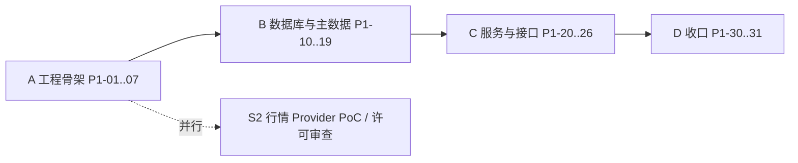

# PHASE-1-PLAN：基础工程、证券主数据与数据存储

> **状态：已批准（approved，2026-11-06，项目负责人）。** 编码尚未开始；开始 P1-01 须项目负责人另行明确指示（见 [AGENTS.md](../../AGENTS.md)）。
> **档位：** MVP-1 / 里程碑 M1-a 的第一阶段。**对应 Epic：** EPIC 0、EPIC 1（见 [ROADMAP.md](../ROADMAP.md)）。
> **权威依据：** [DATABASE.md](../DATABASE.md)、[DATA_MODEL.md](../DATA_MODEL.md)、[ARCHITECTURE.md](../ARCHITECTURE.md)、[API_CONTRACT.md](../API_CONTRACT.md)、[DEPLOYMENT.md](../DEPLOYMENT.md)；退出准则见 ROADMAP 41.4。

## 1. 目标与退出条件

**目标：** 建立可重复构建、可测试、可在干净环境一键启动的工程骨架，并把证券主数据、来源与原始数据留存、数据快照、单用户登录的**数据库约束与服务**做扎实。本阶段的价值在于“约束写在数据库里并有测试证明”，而不是功能数量。

**退出条件（全部满足才算完成，均需自动化证据）：**

1. 迁移可从空库一键建立，并可从任一迁移回滚到上一版本（`downgrade` 可用）；
2. 排他约束、实体存在性触发器、只追加触发器、`retention` CHECK 的测试全部通过；
3. 同一 ticker 在不同交易场所不冲突；同一场所同 ticker 有效期重叠被拒；同一外部标识符有效期重叠被拒；指向不存在实体的 identifier 被拒（EPIC 1 验收）；
4. 单用户登录、会话、登出可用，无登录无法访问任何业务接口，`/health/live` 与 `/health/ready` 可用；
5. 新开发者按 README 在干净环境启动 `postgres`、`redis`、`api` 并通过基础测试（EPIC 0 验收）；
6. CI 绿色：lint、类型检查、单元与集成测试、迁移检查、依赖漏洞扫描；
7. 规范化哈希函数（快照用）有固定测试向量，结果跨平台一致。

## 2. 范围

### 2.1 范围内

| 类别 | 内容 |
|---|---|
| 工程 | Monorepo 骨架（仅创建本阶段用到的目录）、Python 依赖锁、lint / format / 类型检查 / pytest、CI、`.env.example`、`AGENTS.md` 工程命令补全、ADR 目录已就绪 |
| 数据库迁移 | `currencies`、`workspaces`、`users`、`workspace_members`、`auth_sessions`、`audit_logs`、`issuers`、`securities`、`venues`、`listings`、`providers`、`data_sources`、`provider_entitlements`、`provider_coverage`、`identifiers`（含排他约束与触发器）、`raw_payloads`、`ingest_log`、`data_snapshots`、`data_snapshot_items`；函数 `trg_forbid_mutation` |
| 种子数据 | ISO 4217 币种；ISO 3166 国家代码；美国 MIC（至少 `XNYS`、`XNAS`、`XASE`）；来源 `system_mock`、`manual_import`（provider + data_source） |
| 服务与接口 | 证券消歧服务；`GET /health/live`、`GET /health/ready`、`GET /instruments/resolve`、`GET /instruments/{listing_id}`；登录 / 登出 / 当前用户；审计日志写入 |
| 基础库 | 规范化哈希（canonical hash）工具、统一错误结构（`application/problem+json`）、`trace_id` 贯穿、结构化日志、配置加载 |
| 部署 | `docker-compose.dev.yml`：`postgres`、`redis`、`api` |

### 2.2 范围外（后续 Phase）

- Provider 适配器（SEC / OpenFIGI / 行情）、Mock Provider 的数据生成、限流重试、概念映射、PIT 查询、`market_bars`、`filings`、`financial_facts`、`corporate_actions`、`market_calendars` → **Phase 2**
- Worker / Scheduler / Celery、`research_*` 表 → **Phase 2 起**
- Web、`web` / `worker` / `scheduler` 服务、`docker-compose.prod.yml`、Caddy / TLS、备份恢复 → **Phase 4**（EPIC 6、9）
- 任何 Agent、LLM、MCP、Harness → **MVP-2 / MVP-3**；MVP-1 零 LLM 依赖
- 不得扩大到美国以外市场，不得接入未经许可审查的供应商

## 3. 前置条件与需要评审确认的决定

**Phase 1 开工前必须为 `accepted` 的 ADR**（ROADMAP 41.1）：ADR-0003、0006、0007、0010、0012、0015、0016、0017。其中直接决定本阶段表结构的是 **ADR-0010（快照）、ADR-0011（原始数据去重）、ADR-0016（证券主键与标识符）、ADR-0014（许可）**；建议评审时一并确认 ADR-0001、0004。**状态（2026-11-06）：上述 8 个必需 ADR 及 0001、0004、0011、0014 已全部 `accepted`，前置条件满足。**

**以下事项规格书没有规定，评审时请确认（括号内为我的建议）：**

| # | 决定 | 建议 |
|---|---|---|
| D1 | 认证端点路径（规格 25 节未列登录接口） | `POST /api/v1/auth/login`、`POST /api/v1/auth/logout`、`GET /api/v1/auth/me`，并补入 API_CONTRACT |
| D2 | 首个 Owner 用户如何创建（禁止开放注册） | 仅通过 CLI 命令 `manage create-owner`（密码从交互输入或环境变量读取），写审计日志 |
| D3 | 密码哈希算法 | argon2id；会话令牌为 32 字节随机数，库中仅存 SHA-256 哈希；HttpOnly + SameSite=Lax + 生产环境 Secure |
| D4 | Phase 1 是否包含 Redis | **【已确认 2026-11-06】** 包含，镜像 `redis:8`（本机已有；缺失时由 `make up` 自动拉取）。Phase 1 仅用于 `/health/ready` 依赖检查，不使用队列；Celery 留到 Phase 2。许可说明：Redis 8 为 RSALv2 / SSPLv1 / AGPLv3 三许可，本项目自托管、不对外分发 Redis，可接受；若将来需要宽松许可，可平替为 Valkey |
| D5 | 数据库集成测试的 PostgreSQL 来源 | **【已确认 2026-11-06】** 真实 PostgreSQL 16，**通过 Docker 运行**：本地使用 `docker-compose.dev.yml` 的 `postgres:16` 服务，CI 使用 service container 且镜像标签保持一致；**不用 SQLite 或内存替身**（排他约束和触发器无法模拟）。不要求在宿主机直接安装 PostgreSQL（已验证本机 Docker 29.7.2 / Compose v5.5.0 可用） |
| D6 | 迁移中的 DDL 写法 | **【已确认】** 排他约束、触发器、函数一律用原生 SQL（`op.execute`），不依赖 SQLAlchemy 元数据自动生成 |
| D7 | 分层边界的强制手段 | **【已确认】** `import-linter` 契约：`packages/domain` 不得导入 FastAPI、SQLAlchemy、Celery、任何供应商 SDK |
| D8 | CI 平台 | **【调研中】** GitHub Actions，运行在已有远程 `origin`；调研结论与待确认项见下方“D8 调研”，CI 只调用 `make` 目标，保证本地 `make ci` 与远程一致 |
| D9 | 前端包管理器（Phase 1 不用，但规格存在不一致） | **【已确认：统一为 pnpm】** 规格 7 节写 `package-lock.json`，35 节目录树写 `pnpm-lock.yaml`；建议统一为 pnpm，Phase 4 前定稿 |
| D10 | 规范化哈希规则 | **【已确认】** JSON 键排序、UTF-8、无多余空白、Decimal 用字符串、时间统一 UTC ISO 8601；规则写入 DATABASE 文档并配固定测试向量 |

**决定状态（2026-11-06）：** 已确认 D1–D3（登录按原方案实现）、D5、D6、D7、D9、D10；**D8 调研中**；D4 已确认（包含 Redis）。

**本机已就绪的镜像（2026-11-06 核实）：** `postgres:16`（PostgreSQL 16.15，`sha256:933463a6c8eb…`，本次拉取）、`redis:8`（Redis 8.10.3，`sha256:de1068af6f55…`，本机原有）。Compose 与 CI 使用相同的主版本标签；P1-05 中按完整 digest 固定镜像，升级须单独提交并通过全部集成测试。`make up` 在镜像缺失时自动 `docker compose pull`。D9 确认后，规格书 7 节的 `package-lock.json` 需在 Phase 4 前改为 `pnpm-lock.yaml`。

### D8 调研：通过 GitHub 远程运行 CI

**已核实的现状：**

- 远程 `origin = git@github.com:WLZZJR/dsh-stock-trade-system.git`，SSH 只读访问成功（`git ls-remote` 返回 `main` 与 `docs/spec-v1.1` 两个分支）；本地 `main` 跟踪 `origin/main`；
- 本机**未安装 `gh` CLI**（不影响 Actions，仅少了命令行查看 CI 状态的便利，可选安装）；
- 本机 Docker 29.7.2 / Compose v5.5.0 可用；
- 仓库**尚无 `.gitignore`、`.gitattributes`、`.github/workflows/`**；Git 已提示 `LF will be replaced by CRLF`，说明存在换行符不一致风险。

**项目负责人已确认（2026-11-06）：**

1. 当前 SSH 身份（GitHub 账号 `WLZZJR`，即仓库所有者）**有 push 权限**；
2. 仓库为 **private**；
3. 分支保护委托由助手设置——原本无法执行（无 `gh`、无 API 凭据）。**【2026-11-07 更新】** 项目负责人已安装并登录 `gh`（账号 `WLZZJR`，仓库 `admin: true`），但经核实 **Free 套餐的 private 仓库无法设置分支保护 / Rulesets**（Rulesets 接口返回 403：“Upgrade to GitHub Pro or make this repository public”），因此不设平台级保护，采用下方“分支保护”中的替代方案。

**分支保护（2026-11-07 结论：不可用，采用替代方案）：**

- **已核实：** private 仓库在 GitHub Free 个人账号下**不提供**分支保护 / Rulesets（需要 Pro、Team 或 Enterprise），经 `gh api` 调用 Rulesets 接口确认。项目负责人确认当前为个人开发，影响可接受（2026-11-07）；
- **采用的替代方案（已写入 README“分支与合并约定”）：** 智能体只做本地分支提交（提交前本地 `make ci`），推送、发 PR、合并到 `main` 均由项目负责人手动操作（2026-11-07 调整，取消由智能体推送和发 PR 的做法）；CI 仅在 PR 与推送 `main` 时触发，需要合并前检查时由负责人发 PR；本地 pre-push 钩子（`scripts/guard_main_push.sh` + `make ci`，经 `make install-hooks` 安装）。**局限：** 钩子只约束安装它的那台机器，换机器、网页编辑或 `--no-verify` 均可绕过，不等价于服务器端保护；出现多人协作或进入生产前须重新评估（升级 Pro 或迁移到组织账号）；
- 以下“分两步设置”仅在将来升级套餐后适用：
- **分两步设置，避免把自己锁住：** ①现在（仅文档阶段，尚无 CI）：`main` 要求通过 PR 合并、禁止强制推送、禁止删除分支，必需审批数设为 0（单人开发时设为 1 会导致无法合并自己的 PR）；②P1-06 的 CI 首次运行成功后：再把 CI 作业名加入 “Require status checks”，因为状态检查名称在首次运行之前并不存在。

**建议方案（待确认后定稿）：**

1. **改动走分支 + PR，不直接推 `main`。** Phase 0 的文档拆分与计划先在新分支提交并发起 PR，评审后合并；
2. 在 P1-06 增加 `.github/workflows/ci.yml`，触发条件为 `pull_request` 与 `push` 到 `main`；
3. 作业划分：①lint + 类型检查 + 单元测试；②集成测试，使用 `postgres:16` service container（与 Compose 同一镜像标签）；③迁移检查（`upgrade → downgrade → upgrade` 往返 + 模型漂移检查）；④依赖漏洞扫描；⑤secret 扫描；⑥`canonical_hash` 向量测试的 Linux + Windows 矩阵（对应 P1-18）；
4. **CI 只调用 `make` 目标**（`make lint typecheck test ci`），不在 workflow 里另写一套命令，避免本地与远程漂移；
5. **Phase 1 的 CI 不需要任何 secret**（全部使用 mock / fixture）。供应商 API Key 不得放入 Actions secrets，除非后续某个 Phase 明确设计了受控的 PoC；
6. 为 `main` 设置分支保护（要求 CI 通过 + PR 评审），需要仓库管理权限；
7. 在第一次提交 Phase 1 代码之前，必须先有 `.gitignore`（含 `.env`、虚拟环境、构建产物）与 `.gitattributes`（`* text=auto eol=lf`），保证 SQL、fixture 与哈希测试向量在 Windows / Linux 下一致。

## 4. 目标目录（仅本阶段创建）

```text
apps/api/                       # FastAPI 应用（路由、依赖注入、鉴权中间件）
packages/domain/                # 领域模型与规则（无框架依赖）
packages/application/           # 用例：resolve_instrument、auth、health
packages/data_engine/           # 本阶段仅含 canonical_hash 与来源登记用例
database/migrations/            # Alembic（原生 SQL 为主）
database/seeds/                 # 币种、国家、MIC、system_mock / manual_import
configs/                        # default.yaml
deploy/compose/                 # docker-compose.dev.yml
tests/{unit,integration,contract,security}/
.github/workflows/              # CI
.env.example  Makefile  pyproject.toml  uv.lock
```

`apps/web`、`apps/worker`、`apps/scheduler`、`apps/mcp-server`、`agents/`、`integrations/` 等目录**本阶段不创建**。

## 5. 工作分解

约定：每个任务遵循 TDD（先测试后实现）；“验收”列为该任务的完成证据。任务编号 P1-x。

### 阶段 A：工程骨架（EPIC 0）

| 任务 | 内容 | 验收 |
|---|---|---|
| P1-01 | Monorepo 目录、`pyproject.toml`、`uv.lock`、Python 3.12；`.gitignore`（含 `.env`）与 `.gitattributes`（`eol=lf`） | `uv sync` 在干净环境成功；`git check-ignore .env` 命中；Windows 检出后 SQL 与 fixture 无 CRLF |
| P1-02 | ruff（lint + format）、类型检查（packages 严格，apps 标准）、pytest、coverage、pre-commit | `make lint typecheck test` 全绿 |
| P1-03 | `import-linter` 分层契约（D7） | 故意违规的导入会使 CI 失败（含一个负向测试） |
| P1-04 | `Makefile`（`up / down / migrate / test / ci`）、`.env.example`、配置加载（环境变量 > yaml，密钥不进 yaml） | 缺少必需环境变量时启动失败并给出明确错误；`.env` 在 `.gitignore` 中 |
| P1-05 | `docker-compose.dev.yml`：`postgres:16`、`redis`、`api`；仅绑定 localhost；不含 `mcp` | `docker compose up -d` 后三个服务健康 |
| P1-06 | CI（D8）：lint、类型、单测、集成测（PG service）、迁移检查、依赖漏洞扫描、secret 扫描 | PR 上全部检查为绿 |
| P1-07 | 补全 `AGENTS.md` 的工程命令；写 README 快速开始 | 新环境按 README 走通 |

### 阶段 B：数据库与主数据（EPIC 1）

| 任务 | 内容 | 验收（测试名称建议） |
|---|---|---|
| P1-10 | Alembic 初始化；迁移 0001：扩展 `pgcrypto`、`btree_gist`；函数 `trg_forbid_mutation`；`currencies` | `upgrade head` 与 `downgrade base` 往返成功 |
| P1-11 | 迁移 0002：`workspaces`、`users`、`workspace_members`、`auth_sessions`、`audit_logs`（含只追加触发器） | `test_audit_logs_reject_update_delete`；外键与 CHECK 测试 |
| P1-12 | 迁移 0003：`issuers`、`securities`、`venues`、`listings`（含 GIST 排他约束） | `test_same_ticker_different_venue_ok`；`test_same_venue_overlapping_ticker_rejected`；`test_ticker_reuse_after_delisting_ok`（区间首尾相接 `[)` 不冲突） |
| P1-13 | 迁移 0004：`providers`、`data_sources`、`provider_entitlements`、`provider_coverage` | 默认 `persistence_allowed = false` 的测试 |
| P1-14 | 迁移 0005：`identifiers`（排他约束 + 实体存在性触发器 + 主数据删除保护触发器 + 索引） | `test_identifier_overlap_rejected`；`test_identifier_nonexistent_entity_rejected`；`test_identifier_same_value_different_period_ok`；`test_identifier_update_to_missing_entity_rejected`；`test_delete_identified_entity_rejected` |
| P1-15 | 迁移 0006：`raw_payloads`（含 `retention` CHECK）、`ingest_log` | `test_hash_only_requires_null_payload`；`test_stored_requires_payload`；`test_raw_payload_dedup_unique`；`test_ingest_log_failed_request_has_no_payload` |
| P1-16 | 迁移 0007：`data_snapshots`、`data_snapshot_items`（不可变触发器、记录引用 CHECK、部分唯一索引） | `test_snapshot_immutable`；`test_snapshot_item_range_vs_record_ref_check`；`test_snapshot_item_duplicate_record_rejected` |
| P1-17 | 种子数据（币种、国家、美国 MIC、`system_mock`、`manual_import`）；种子可重复执行（幂等） | 重复执行不产生重复行；`manual_import` 可取得合法 `source_id` |
| P1-18 | 规范化哈希工具 `canonical_hash`（D10）与固定测试向量 | 向量测试在 Linux 与 Windows（CI 矩阵或本地验证）结果一致；浮点输入被拒绝 |
| P1-19 | 迁移检查：模型与迁移无漂移；每个迁移文件带 `downgrade` | CI 中的“迁移检查”任务通过 |

**迁移顺序注意：** `trg_forbid_mutation` 必须先于 `audit_logs`、`data_snapshots` 等触发器创建；`audit_logs` 与 `users` 的外键关系决定 P1-11 内部的建表顺序。`listings.valid_from` 默认值为 `CURRENT_DATE`，**历史上市记录必须显式给出 `valid_from`**，种子与导入流程不得依赖默认值。

### 阶段 C：服务与接口

| 任务 | 内容 | 验收 |
|---|---|---|
| P1-20 | 统一错误结构（`application/problem+json`）、`trace_id` 中间件、结构化日志（密钥与认证头脱敏） | 契约测试：错误响应字段完整；日志中不出现 `Authorization`、密码、令牌 |
| P1-21 | 证券消歧服务与 `GET /instruments/resolve`：支持 ticker、ISIN、FIGI、公司名；多候选返回 `requires_user_selection = true`，**不得自行选择**；缺失市场参数时的行为明确 | `test_ambiguous_ticker_requires_selection`；`test_resolve_by_isin`；响应形状符合 API_CONTRACT 25.1 |
| P1-22 | `GET /instruments/{listing_id}` | 404 / 200 契约测试 |
| P1-23 | 认证：`manage create-owner`（D2）、登录 / 登出 / me（D1）、会话中间件、登录限流（失败次数与退避）、审计日志 | `security/` 测试：无会话访问业务接口返回 401；令牌仅以哈希入库；已撤销 / 过期会话被拒；暴力登录被限流；登录成功与失败均写审计 |
| P1-24 | workspace 归属校验依赖（所有以后的 workspace 资源复用）：从会话取 `workspace_id`，不信任请求参数 | 越权测试：用户 A 无法读取 B 的资源（用测试夹具构造两个 workspace） |
| P1-25 | `GET /health/live`（进程存活）、`GET /health/ready`（PostgreSQL + Redis + 迁移版本为 head） | 依赖不可用时 503；`ready` 不泄露内部细节 |
| P1-26 | OpenAPI 自动生成与契约回归测试骨架（快照比对） | CI 中接口变更必须同时更新契约快照 |

### 阶段 D：收口

| 任务 | 内容 | 验收 |
|---|---|---|
| P1-30 | 按 AGENTS.md 的“每个 Phase 完成时提供”清单编写交付说明：完成项、未完成与阻塞、迁移说明、测试结果与覆盖范围、启动与验证命令、安全与许可影响、文档更新清单、与退出条件逐项对应的证据 | 清单齐全并附命令输出 |
| P1-31 | 更新受影响文档（API_CONTRACT 的认证端点、DATABASE 的哈希规则与迁移顺序、CHANGELOG） | 文档与实现一致，无新增矛盾 |

## 6. 依赖与顺序



- A 完成前不开始 B（CI 与测试基础设施是 B 的前提）；
- P1-21（消歧）依赖 P1-12、P1-14、P1-17；P1-23（认证）依赖 P1-11；P1-25 依赖全部迁移；
- 行情 Provider PoC（ROADMAP 41.2 的 S2）与本阶段并行启动，其结论是 Phase 2 的阻塞项；
- 不引入 Phase 2 才需要的依赖（Celery、HTTP 客户端重试库、`exchange_calendars` 等）。

## 7. 测试策略（本阶段）

| 层 | 内容 |
|---|---|
| Unit | `canonical_hash`、消歧排序规则、密码与令牌处理、配置加载 |
| Integration（真实 PG16） | 全部约束与触发器、种子幂等、迁移往返、`ready` 探针 |
| Contract | 错误结构、`/instruments/*`、`/health/*`、认证端点；OpenAPI 快照 |
| Security | 未登录 401、会话撤销、登录限流、令牌不落明文、日志脱敏、workspace 越权 |
| 覆盖率 | `packages/` 建议 ≥ 90%，整体 ≥ 80%（数据库约束测试按“每个约束至少一个正例一个反例”计，不仅看行覆盖） |

测试数据一律标记为 fixture / mock，不使用真实供应商数据，不把任何密钥或个人数据写入仓库。

## 8. 风险与缓解

| 风险 | 缓解 |
|---|---|
| ORM 自动迁移丢失排他约束 / 触发器 | D6：原生 SQL 迁移 + P1-19 漂移检查 + 约束测试 |
| `identifiers` 的 `-infinity` / `infinity` 在 ORM 与驱动间的往返不一致 | 在 P1-14 增加边界值往返测试；必要时封装自定义类型 |
| 排他约束的键不含 `entity_id`，同一实体重复插入重叠版本也会被拒 | 这是预期行为（同一标识符同一时间只能有一个有效映射）；在测试与文档中显式说明，修订走“关闭旧区间再开新区间” |
| 多态 `identifiers` 无外键，实体删除可能留下孤儿标识符 | 主数据表加 `BEFORE DELETE` 删除保护触发器，被 `identifiers` 引用即拒绝删除（ADR-0016），并纳入集成测试 |
| 会话与认证实现不当 | 使用成熟库、不自造加密；安全测试先行；完成后由安全评审过一遍 |
| 范围蔓延（顺手加 Provider / Worker） | 以 2.2 为准，评审时逐项冻结；超范围改动须先更新本计划 |

## 9. 评审清单（供项目负责人逐项勾选）

- [x] 范围（2.1 / 2.2）无异议
- [x] D1–D10 已逐项确认或给出替代决定
- [x] 前置 ADR 已为 `accepted`
- [x] 退出条件（第 1 节）可作为验收标准
- [x] 任务分解的顺序与依赖合理
- [x] 评审通过后，将本文件状态改为 `approved`，再开始 P1-01
